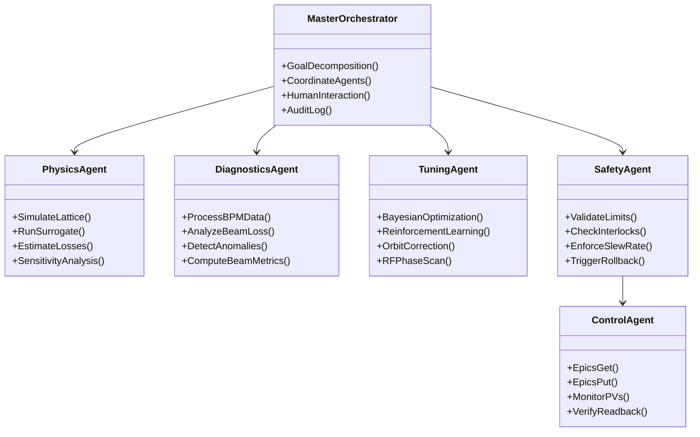
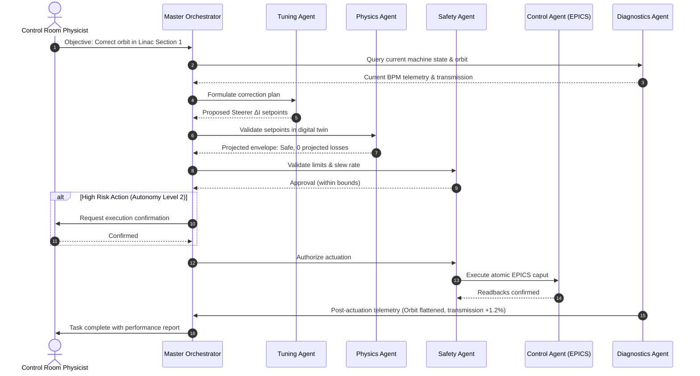

# HELIOS Multi-Agent Architecture (AGENTS.md)

This document defines the architectural principles, agent taxonomy, communication protocols, and safety guardrails governing the **HELIOS** (**H**eavy ion **E**nergy / **L**inac **I**ntelligent **O**rchestration **S**uite) framework.

---

## 1. Core Architectural Principles

1. **Pre-flight Simulation Verification**: No setpoint is delivered to live accelerator hardware without prior validation through physics simulations or high-fidelity surrogate models.
2. **Strict Separation of Concerns**: Optimization algorithms do not talk directly to hardware. All commands pass through verification and safety layers.
3. **Defense in Depth & Safety by Design**: Multi-tiered boundaries (software limits, rate-of-change constraints, machine protection system status checks) are enforced before and during actuation.
4. **Explainability & Observability**: Every high-level decision, simulation result, and hardware action is logged with reasoning traces, enabling complete post-mortem and audit review.
5. **Graduated Autonomy (Human-in-the-Loop)**: The framework supports graduated operational autonomy levels with explicit human operator consent required for high-risk actions.

---

## 2. Agent Taxonomy & Responsibilities

### 2.1 Master Orchestrator Agent (`HELIOS-Orchestrator`)
- **Role**: Executive planner, coordinator, and operator liaison.
- **Responsibilities**:
  - Ingests high-level operational directives from control room physicists (e.g., *"Tune MEBT trajectory and minimize downstream beam loss"*).
  - Decomposes directives into verifiable sub-tasks and delegates them to specialized agents.
  - Maintains global accelerator state and operational context.
  - Generates clear, human-readable operational summaries, plots, and risk assessments.

### 2.2 Physics & Simulation Agent (`HELIOS-Physics`)
- **Role**: Accelerator digital twin custodian and physics modeling engine.
- **Responsibilities**:
  - Manages accelerator lattice models and beam dynamics codes (e.g., TRACK, IMPACT-Z, Elegant, Bmad).
  - Executes rapid pre-flight validations using neural network surrogate models.
  - Performs sensitivity analysis, phase advance verification, and beam loss projections.
  - Calibrates simulation parameters to match real-time machine readouts.

### 2.3 Diagnostics & Telemetry Agent (`HELIOS-Diagnostics`)
- **Role**: Machine perception, signal processing, and health monitoring.
- **Responsibilities**:
  - Reads and cleans data from beam position monitors (BPMs), Faraday cups, wire scanners, and beam loss monitors (BLMs).
  - Calculates live beam metrics: beam transmission, RMS orbit distortion, beam centroid, and emittance.
  - Employs anomaly detection models to identify RF cavity trips, vacuum spikes, or magnet drift.
  - Flags diagnostic hardware faults or sensor degradation.

### 2.4 Optimization & Tuning Agent (`HELIOS-Tuner`)
- **Role**: Algorithmic problem solver and control policy optimizer.
- **Responsibilities**:
  - Implements multi-objective optimization algorithms: Bayesian Optimization (BO), Extremum Seeking Control (ESC), Reinforcement Learning (RL), and Response Matrix Inversion.
  - Formulates optimization objectives (e.g., beam transmission maximization, envelope matching, orbit flattening).
  - Proposes candidate magnet currents (solenoids, quadrupoles, steerers) and cavity setpoints (phase, amplitude).

### 2.5 Safety & Verification Agent (`HELIOS-Safety`)
- **Role**: Deterministic gatekeeper, risk assessor, and boundary enforcer.
- **Responsibilities**:
  - Verifies proposed setpoints against hard hardware limits, vacuum limits, and thermal tolerances.
  - Enforces slew-rate limits to avoid abrupt magnet quenching or RF cavity breakdown.
  - Polls Machine Protection System (MPS) and fast interlock statuses.
  - Maintains instant rollback checkpoints for rapid return to safe machine states upon unexpected beam loss.

### 2.6 Control & Hardware Interface Agent (`HELIOS-Control`)
- **Role**: Low-level actuator and EPICS communicator.
- **Responsibilities**:
  - Communicates directly with the accelerator control system via EPICS Channel Access (CA) and pvAccess (PVA).
  - Performs atomic `caput` operations with readback verification (`caget` confirmation).
  - Handles network timeouts, reconnect logic, and device driver latency.

---

## 3. Standard Operational Workflow

The standard lifecycle of any automated action follows a deterministic closed-loop pipeline:

---

## 4. Autonomy Levels

HELIOS defines five levels of operational autonomy:

| Level | Name | Description | Operator Role |
| :---: | :--- | :--- | :--- |
| **0** | **Advisory** | Agents observe telemetry, detect anomalies, and suggest corrections. No actuation. | All actions executed manually by operator. |
| **1** | **Assisted** | Agents calculate solutions and simulate effects; operator clicks to approve every single PV change. | Mandatory approval per setpoint. |
| **2** | **Supervised** | Agents run automated tuning sequences within tightly constrained envelopes; human confirms sequence start and pause/stop. | Supervisory oversight and abort authority. |
| **3** | **Bounded Autonomous** | Autonomous closed-loop optimization within pre-certified boundaries (e.g., continuous orbit drift correction). | Passive monitoring, notified on alerts. |
| **4** | **Fully Autonomous** | Comprehensive self-driving commissioning and optimization across full linac domains. | High-level goal setting only. |

---

## 5. Agent Communication Protocols

- **Structured Messaging**: Agents communicate via strongly-typed Pydantic schemas over asynchronous message queues (or in-process event buses).
- **Tool Protocol**: Specialized capabilities (running TRACK, IMPACT-Z, calling EPICS, computing SVD) are encapsulated as typed tools conforming to OpenAPI/function calling standards.
- **State Store**: Global machine state, lattice files, and active policies reside in a version-controlled shared state store.
- **Rollback Invariant**: Prior to any hardware setpoint write, the `ControlAgent` registers the previous known valid setpoints to the `SafetyAgent` rollback stack.

---

## 6. Plan-First Execution Model (LBNL Osprey Alignment)

In alignment with LBNL's Osprey framework, HELIOS enforces a **Plan-First** orchestration workflow before executing any action sequence:

1. **Plan Generation**: High-level natural language directives from physicists are first synthesized into explicit, machine-readable execution plans (`docs/exec-plans/active/<5-digit>_<plan_name>.md`).
2. **Pre-Flight Validation**: Each action within the plan is independently verified by `HELIOS-Physics` (digital twin evaluation) and `HELIOS-Safety` (boundary, interlock, and rate-of-change validation).
3. **Approval Gating**: Based on the active Autonomy Level, plans require human confirmation before execution begins.
4. **Execution & Provenance**: As steps execute, state, parameters, readbacks, and logs are tracked. Upon completion, the finalized record is archived under `docs/exec-plans/completed/<5-digit>_<plan_name>.md` to maintain full reproducibility.
5. **Dynamic Capability Classification**: Tools and skills are filtered dynamically per sub-task to minimize prompt size and avoid context pollution across extensive accelerator subsystems.

---

## 7. Data Modeling Standards: Pydantic `BaseModel` vs `@dataclass`

HELIOS enforces a clear separation of data record styles across architectural tiers:

1. **Pydantic `BaseModel` at Trust Boundaries**:
   - **Where**: System inputs, configuration files (`FacilityConfig`, `ChannelLimits`), HTTP/WebSocket request & response bodies, persistent execution plans (`ExecutionPlan`, `PlanStep`, `SetpointBatch`), and inter-agent message payloads (`AgentMeshMessage`).
   - **Rationale**: Strict runtime schema validation, serialization/deserialization guarantees, automated JSON schema generation for OpenAPI/tools, and fail-fast coercion at boundary ingress.

2. **Python `@dataclass` (prefer `frozen=True`) for Internal Numerics**:
   - **Where**: High-frequency physics tracking (`TrajectoryPoint`, `ParticleBatch`), digital twin simulation states (`TwinFrame`, `TwinPrediction`, `SurrogatePrediction`), algorithmic scratchpads (`BBADataPoint`, `NSGA2Individual`), and in-memory safety stacks (`RollbackRecord`).
   - **Rationale**: Zero validation overhead, minimal memory footprint, compatibility with high-performance numerical routines (NumPy/SciPy/PyTorch), and immutability guarantees (`frozen=True`) for multi-agent concurrency.

