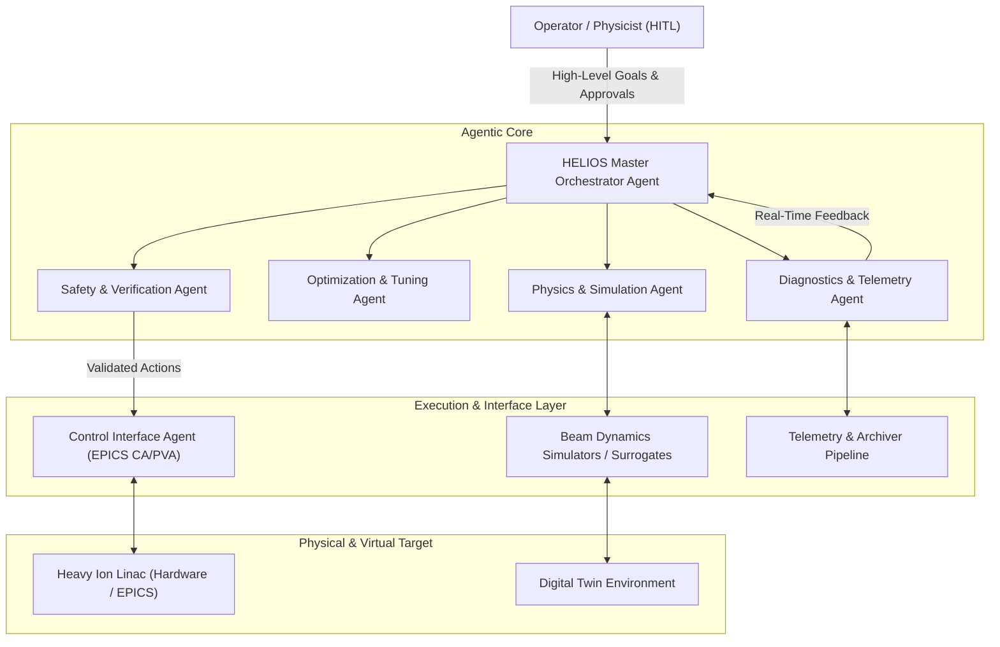

# HELIOS: HEavy ion Linac Intelligent Orchestration

[](LICENSE)
[](https://www.python.org/)
[](#)

**HELIOS** (**HE**avy ion **L**inac **I**ntelligent **O**rchestration) is an agentic AI framework engineered for autonomous operation, beam tuning, anomaly detection, and physics-informed control of heavy ion linear accelerators.

---

## 🎯 Overview

Modern heavy ion linear accelerators (linacs) present unique operational challenges: complex multi-charge-state beams, extensive parameter spaces across superconducting radiofrequency (SRF) cavities and focusing magnets, tight beam loss tolerances, and non-linear space charge dynamics. 

HELIOS provides an autonomous, multi-agent AI framework designed to orchestrate accelerator operations ranging from digital twin simulation to live control via EPICS. By decomposing control and optimization problems into specialized, collaborative AI agents, HELIOS enables:

- **Autonomous Beam Commissioning & Tuning**: Multi-objective trajectory correction, transverse matching, RF cavity phase/amplitude scanning, and longitudinal tune-ups.
- **Physics-Informed Decision Making**: Seamless coupling of deep neural surrogate models with benchmarked beam dynamics simulation codes (e.g., TraceWin, IMPACT-Z, Elegant).
- **Proactive Anomaly Detection & Machine Protection**: Real-time telemetry monitoring, RF trip prediction, beam loss localization, and safe fallback procedures.
- **Safe Human-in-the-Loop (HITL) Operations**: Tiered permission policies, action verification, explainable action plans, and automated reporting.

---

## 🏗️ System Architecture

HELIOS operates through a collaborative hierarchy of specialized agents interacting with accelerator simulation environments and live EPICS control systems.



For detailed agent roles, interaction protocols, and decision boundaries, see [AGENTS.md](AGENTS.md).

---

## 🧩 Project Structure

```text
helios/
├── README.md               # Project overview and documentation
├── AGENTS.md               # Multi-agent architecture and role specifications
├── docs/                   # Architecture designs, manuals, and technical notes
├── helios/                 # Core HELIOS Python package
│   ├── agents/             # Agent definitions (Orchestrator, Physics, Tuning, Safety, etc.)
│   ├── core/               # Orchestration engine, LLM interfaces, and state management
│   ├── envs/               # Accelerator environments (Digital Twin, Simulation wrappers)
│   ├── interfaces/         # Control system bridges (EPICS CA/PVA, Archiver Appliance)
│   ├── models/             # Machine learning surrogates and neural networks
│   ├── physics/            # Beam dynamics utilities, lattice parsers, and beamline models
│   └── tools/              # Reusable agent tool definitions and hardware wrappers
├── configs/                # Lattice configs, agent prompts, and operational policies
├── scripts/                # Launchers, commissioning workflows, and demo scripts
└── tests/                  # Unit and integration test suites
```

---

## 🚀 Key Features

1. **Multi-Agent Collaboration**
   - Hierarchical coordination ensuring goal decomposition, verification, and conflict resolution across domain-specific agents.
2. **Physics-Engine Integration**
   - Direct interfaces with beam dynamics solvers and high-speed surrogate models for predictive verification before hardware execution.
3. **EPICS Native Connectivity**
   - First-class support for EPICS Channel Access (CA) and pvAccess (PVA) with integrated rate-limiting and soft boundaries.
4. **Safety-by-Design**
   - Strict action boundary checks, automated interlock monitoring, rollbacks, and explicit human sign-off triggers for high-risk operations.

---

## 📋 Getting Started

### Prerequisites
- Python 3.10+
- EPICS base libraries (optional for simulation-only mode)
- Beam dynamics simulation binaries (e.g., TraceWin, IMPACT-Z) configured in path or container

### Installation

```bash
# Clone the repository
git clone https://github.com/your-org/helios.git
cd helios

# Create and activate virtual environment
python3 -m venv .venv
source .venv/bin/activate

# Install dependencies (development mode)
pip install -e ".[dev]"
```

---

## 📄 Documentation & References

- [Agent Specifications & Architecture (AGENTS.md)](AGENTS.md)
- [EPICS Control Integration Guide](docs/epics_integration.md) *(Coming Soon)*
- [Beam Physics & Surrogate Models](docs/physics_models.md) *(Coming Soon)*

---

## 🛡️ License

This project is licensed under the MIT License - see the LICENSE file for details.
