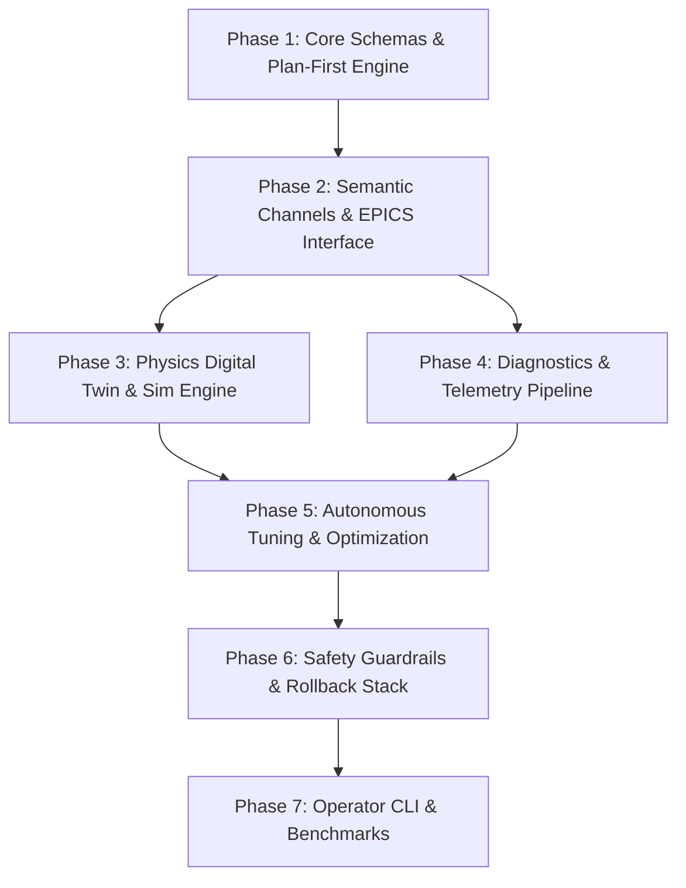

# HELIOS Development Task List & Roadmap

- **Status**: Active
- **Reference Architecture**: LBNL Osprey Framework
- **Domain**: Heavy Ion Linear Accelerators (LEBT, RFQ, MEBT, SCL, HEBT)
- **Last Updated**: 2026-10-13

---

## 🎯 Development Roadmap Overview

The HELIOS framework development is partitioned into seven iterative phases following LBNL Osprey's **Plan-First** orchestration paradigm, semantic channel mapping, dynamic capability classification, and rigorous safety-by-design principles.

---

## Phase 1: Core Foundation & Plan-First Orchestration Engine

- [x] **1.1 Project Scaffolding & Packaging**
  - [x] Set up `pyproject.toml` with modern build backend (setuptools/wheel).
  - [x] Configure core dependencies (`pydantic>=2.5`, `numpy`, `scipy`, `pyyaml`, `rich`, `typer`).
  - [x] Set up development tooling (pytest, pytest-asyncio, pytest-cov).
- [x] **1.2 Data Schemas & State Models**
  - [x] Define `ExecutionPlan`, `PlanStep`, `PlanState`, and `ValidationResult` Pydantic models.
  - [x] Define `MachineState`, `SetpointBatch`, `TelemetrySnapshot`, and `AnomalyReport` schemas.
- [x] **1.3 Plan-First Orchestrator Engine**
  - [x] Implement plan lifecycle manager (`DRAFT` → `SIMULATION_VERIFIED` → `SAFETY_APPROVED` → `EXECUTING` → `COMPLETED` / `ROLLED_BACK`).
  - [x] Implement Plan artifact serializer and file-based state tracker (`docs/exec-plans/active/` and `completed/`).
- [x] **1.4 Dynamic Capability Classifier**
  - [x] Build intent-based tool/capability dispatcher (Osprey pattern) to keep LLM context compact.
  - [x] Implement capability registries for agents.

---

## Phase 2: Semantic Channel Resolution & Control System Interface

- [x] **2.1 Semantic Channel Mapping**
  - [x] Define heavy ion linac device hierarchy (Ion Source, LEBT, RFQ, MEBT, SCL QWR/HWR, HEBT).
  - [x] Implement semantic alias resolution (e.g. `"MEBT Quad 01 gradient"` → `MEBT:QD01:BField_Set`).
  - [x] Support YAML/JSON linac lattice channel configuration files.
- [x] **2.2 EPICS CA / PVA Interface Layer**
  - [x] Implement unified `EPICSInterface` with asynchronous `caget`, `caput`, and PV monitoring.
  - [x] Build readback verification (`caget` confirmation after `caput` with tolerance and timeout).
  - [x] Implement slew-rate limiter and rate-of-change clamping to protect hardware.
- [x] **2.3 Mock / Virtual EPICS Environment**
  - [x] Implement `MockControlInterface` for offline development, automated tests, and simulation bridging.

---

## Phase 3: Accelerator Physics, Simulation & Digital Twin Engine

- [x] **3.1 Lattice Model & Physics Abstraction**
  - [x] Define linac beamline elements (Solenoid, Quadrupole, Dipole, RF Cavity, Drift, BPM, BLM).
  - [x] Implement lattice importer/exporter (TraceWin `.dat`, IMPACT-Z input, Elegant `.lte`).
- [x] **3.2 Beam Dynamics Simulator Wrappers**
  - [x] Create standardized wrapper interface `BeamDynamicsEngine`.
  - [x] Implement TraceWin wrapper (envelope tracking and multi-particle runs).
  - [x] Implement IMPACT-Z wrapper for 3D space-charge intensive sections.
- [x] **3.3 Fast Neural Surrogate Engine**
  - [x] Define surrogate model inference pipeline (ONNX / PyTorch / Analytic) for sub-second envelope & loss prediction.
  - [x] Pre-flight physics verification tool for proposed setpoints.

---

## Phase 4: Diagnostics, Telemetry & Anomaly Detection

- [ ] **4.1 Telemetry Pipeline**
  - [ ] Real-time BPM signal ingestion (RMS orbit distortion, beam phase, energy calculation).
  - [ ] BLM loss profile aggregator and beam transmission calculator.
  - [ ] Wire scanner / emittance reconstruction utilities.
- [ ] **4.2 Data Archiver Bridge**
  - [ ] EPICS Archiver Appliance query client.
  - [ ] Telemetry snapshot recorder (HDF5 / JSON provenance).
- [ ] **4.3 Anomaly & Fault Detection**
  - [ ] RF cavity trip detector and phase jump monitor.
  - [ ] Vacuum degradation and steerer current drift monitors.

---

## Phase 5: Autonomous Tuning & Optimization Engine

- [ ] **5.1 Algorithm Suite**
  - [ ] Singular Value Decomposition (SVD) and response-matrix orbit correction.
  - [ ] Multi-objective Bayesian Optimization (BoTorch / Ax integration).
  - [ ] Extremum Seeking Control (ESC) for real-time beam transmission maximization.
- [ ] **5.2 Standard Linac Commissioning Workflows**
  - [ ] MEBT / SCL trajectory and orbit correction workflow.
  - [ ] Transverse envelope matching across matching sections.
  - [ ] RF cavity phase and amplitude calibration scan workflow (Time-of-Flight).

---

## Phase 6: Safety Guardrails, Rollback Stack & Graduated Autonomy

- [ ] **6.1 Deterministic Safety Gatekeeper**
  - [ ] Hard software boundary enforcement (min/max current, max power, temperature limits).
  - [ ] Machine Protection System (MPS) interlock state verifier.
- [ ] **6.2 Instant Rollback Controller**
  - [ ] Rollback snapshot stack: automatic capture of pre-action setpoints.
  - [ ] Atomic rollback trigger upon beam loss trip or operator abort.
- [ ] **6.3 Graduated Autonomy Policy Engine**
  - [ ] Implement Autonomy Levels (0: Advisory, 1: Assisted, 2: Supervised, 3: Bounded Auto, 4: Fully Auto).
  - [ ] Interactive human operator sign-off gates.

---

## Phase 7: Operator CLI, Interactive Console & Benchmarks

- [ ] **7.1 Command Line & Interactive Console**
  - [ ] Rich/Typer-based CLI for orchestrator launch, plan inspection, and execution monitoring.
  - [ ] Human-in-the-loop interactive review prompt.
- [ ] **7.2 End-to-End Simulation Benchmarks**
  - [ ] Closed-loop MEBT steering benchmark on virtual linac.
  - [ ] SCL RF phase scan and fault recovery benchmark.
- [ ] **7.3 Documentation & Tutorials**
  - [ ] Developer guide and API reference.
  - [ ] Quickstart tutorial using mock linac simulation.
