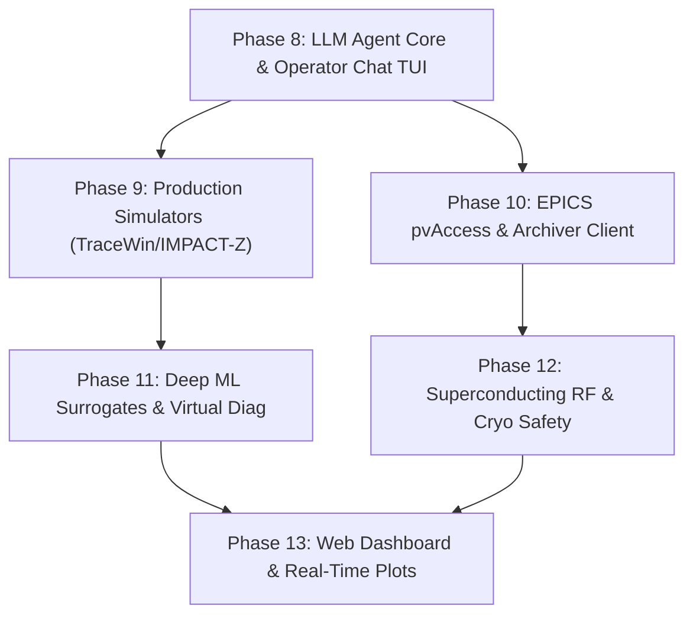

# HELIOS Next Phase Development Task List (Phases 8 - 13)

- **Status**: Active
- **Reference Architecture**: LBNL Osprey Framework
- **Domain**: Heavy Ion Linear Accelerators (LEBT, RFQ, MEBT, SCL, HEBT)
- **Last Updated**: 2026-10-13

---

## 🎯 Strategic Roadmap Overview

Having completed the foundational architecture (Phases 1–7) with 44/44 passing tests and a dedicated conda environment, the next roadmap moves HELIOS from an algorithmic prototype toward a production-grade, deployment-ready accelerator AI assistant aligned with LBNL's Osprey framework.

---

## Phase 8: LLM Agent Core & Natural Language Operator Interface

- [x] **8.1 Multi-Provider LLM Integration Layer**
  - [x] Implement extensible LLM adapter (supporting local Ollama, Google Gemini, Anthropic, OpenAI, and deterministic Mock).
  - [x] Support structured tool calling / JSON function schema binding.
  - [x] Provide prompt caching and context management.
- [x] **8.2 Natural Language Planner Agent (`HELIOS-Orchestrator`)**
  - [x] Build intent parser converting operator dialogue into structured `ExecutionPlan` drafts.
  - [x] Dynamic capability injection: bind classified tools from `CapabilityRegistry` into LLM system prompts.
  - [x] Implement chain-of-thought and explainability traces for physicist review.
- [x] **8.3 Interactive Operator Chat Console (TUI / CLI)**
  - [x] Rich/Prompt-Toolkit interactive terminal chat session (`helios chat`).
  - [x] Visual plan review modal with interactive `[Approve] / [Reject] / [Modify]` buttons.
  - [x] Real-time execution streaming and step progress bars.

---

## Phase 9: Real Simulation Code Integration & Heavy Ion Dynamics

- [x] **9.1 ANL TRACK File Parser & Execution Engine**
  - [x] Generate TRACK `track.dat` and `sclinac.dat` lattice definitions.
  - [x] Headless execution via `/usr/bin/wine` on 64-bit TRACK binary (`TRACKv39C.exe`).
  - [x] Ingest TRACK outputs (`envelop.out`, loss projection) with graceful fallback to digital twin.
- [x] **9.2 LBNL IMPACT-Z 3D Space-Charge Engine**
  - [x] Integration via `lume-impact` and `ImpactZ` for 3D PIC space-charge modeling in low-energy and linac sections.
  - [x] Ingest beam metrics and transmission estimates.
- [x] **9.3 Multi-Charge-State (MCS) Heavy Ion Dynamics & Lattice Integration**
  - [x] Support multi-species and multi-charge-state beam tracking in physics engine elements.
  - [x] Expose `TrackSimulator` and `ImpactZSimulator` tools in `CapabilityRegistry` for orchestrator agents.

---

## Phase 10: Advanced EPICS pvAccess & Archiver Appliance Bridge

- [x] **10.1 EPICS pvAccess (PVA) Support**
  - [x] Integrate `p4p` / pvAccess for high-performance structured normative types (`NTTable`, `NTNDArray`, `NTScalar`).
  - [x] Support high-rate beam profile camera acquisition and multi-BPM vector readouts.
- [x] **10.2 Production EPICS Archiver Appliance Client**
  - [x] Implement REST API client to query facility PB-based Archiver Appliances (SLAC/FRIB/ALS/RAON).
  - [x] Provide automated baseline extraction: pull historical golden setpoints based on date/shift.
- [x] **10.3 Control System Security & Access Enforcement**
  - [x] Implement Channel Access Security (CAS) permission checks before issuing write requests.

---

## Phase 11: Deep Neural Surrogates & Virtual Diagnostics

- [x] **11.1 PyTorch Linac Surrogate Architecture**
  - [x] Multi-layer Perceptron / ResNet surrogate trained on simulation samples.
  - [x] Instantaneous prediction of 6D beam phase space and transverse envelope along full linac.
- [x] **11.2 Virtual Diagnostic Inference**
  - [x] Virtual Wire Scanner: non-interceptive transverse beam size and emittance prediction.
  - [x] Virtual Beam Loss Monitor: predict halo scraping and loss locations before beam turns on.
- [x] **11.3 Online Model Calibration**
  - [x] Parameter estimation calibrating surrogate and digital twin parameters against real BPM readings.

---

## Phase 12: Superconducting RF (SRF) & Advanced Linac Safety Guardrails

- [x] **12.1 SRF Cavity Quench & Thermal Protection**
  - [x] Cryogenic temperature monitor and liquid helium liquid level checks.
  - [x] Cavity gradient limits, forward/reflected power ratio trips, and multipacting protection.
- [x] **12.2 Persistent Rollback Stack & Crash Recovery**
  - [x] SQLite / disk-persisted rollback journal ensuring recovery survives power outages or process crashes.
  - [x] One-click emergency panic button: global machine shutdown setpoint triggers.
- [x] **12.3 Machine Protection System (MPS) Latency Modeling**
  - [x] Fast interlock verification with microsecond response constraints.

---

## Phase 13: Live Web Dashboard & Real-Time Visualization

- [ ] **13.1 Web-Based Control Room Dashboard**
  - [ ] FastAPI backend + React/Streamlit operator console.
  - [ ] Real-time WebSocket streaming of linac telemetry and plan progression.
- [ ] **13.2 Interactive Physics Plots**
  - [ ] Real-time orbit plot with BPM readouts vs golden orbit and tolerance bands.
  - [ ] Interactive 3-sigma beam envelope plot along $z$-axis with vacuum chamber aperture lines.
  - [ ] BLM loss radiation heatmap with highlighted loss hotspots.
- [ ] **13.3 Human-in-the-Loop Approval Dashboard**
  - [ ] Web-based plan confirmation card with simulated beam projection and diff view of changed PVs.
