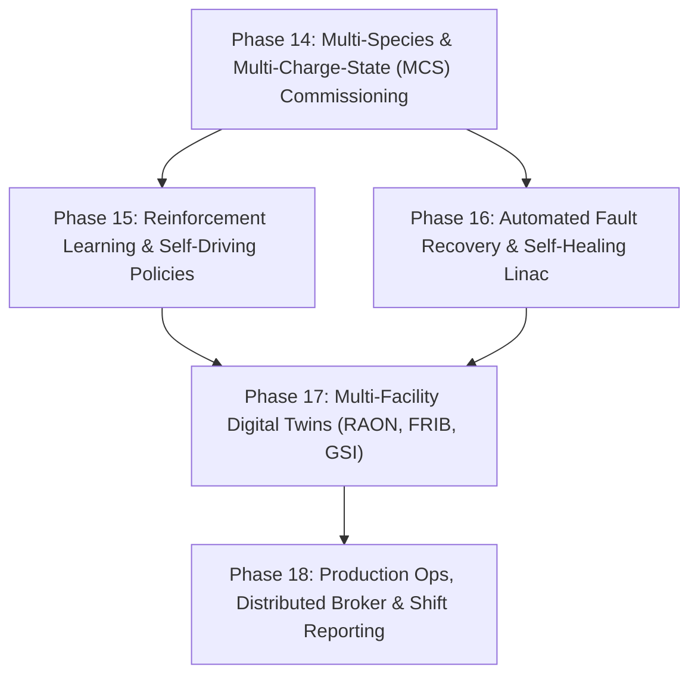

# HELIOS Next Phase Development Task List (Phases 14 - 18)

- **Status**: Active
- **Reference Architecture**: LBNL Osprey Framework
- **Domain**: Heavy Ion Linear Accelerators (LEBT, RFQ, MEBT, SCL, HEBT)
- **Last Updated**: 2026-10-13

---

## 🎯 Strategic Roadmap Overview (Phases 14 - 18)

Having completed the foundational architecture, production simulation wrappers (ANL TRACK & LBNL IMPACT-Z), EPICS pvAccess, deep neural surrogates, SRF cryo-protection, and the real-time web dashboard (Phases 1–13 with 66/66 passing tests), the next roadmap elevates HELIOS to an autonomous, self-healing, multi-facility heavy ion accelerator intelligence platform.

---

## Phase 14: Multi-Species & Multi-Charge-State (MCS) Heavy Ion Commissioning

- [ ] **14.1 Multi-Species Beam Modeling & Charge State Distributions**
  - [ ] Implement multi-species beam parameter definitions ($^{238}\text{U}^{33+/34+}$, $^{124}\text{Xe}^{26+}$, $^{40}\text{Ar}^{11+}$, $^{16}\text{O}^{6+}$, protons).
  - [ ] Support isotopic abundance ratios, multi-charge state fractions, and composite current distributions.
- [ ] **14.2 Stripper Foil Degradation & Lifetime Modeling**
  - [ ] Model carbon / liquid lithium stripper foil Coulomb scattering and mean energy loss ($\Delta E$).
  - [ ] Thermal sublimation and foil lifetime degradation tracking with autonomous replacement alerts.
- [ ] **14.3 Charge State Separator (CSS) Autonomous Tuning**
  - [ ] Autonomous trajectory steering through achromatic charge selectors and magnetic chicane slits.
  - [ ] Slit transmission maximization and charge-state purity optimization.
- [ ] **14.4 Multi-Charge-State (MCS) Transverse Matching in SCL**
  - [ ] Simultaneous envelope matching for multiple charge states across superconducting cryomodules.

---

## Phase 15: Reinforcement Learning (RL) & Advanced Self-Driving Control Policies

- [ ] **15.1 Gymnasium-Compatible Linac Environment (`LinacGymEnv`)**
  - [ ] Build standard `gymnasium.Env` wrapper around digital twin, surrogate model, and live EPICS control.
  - [ ] Support customizable observation spaces (BPM orbits, losses, cavity states) and action spaces (steerers, quads, RF setpoints).
- [ ] **15.2 Deep Reinforcement Learning Agent (PPO / SAC)**
  - [ ] Train continuous control policies for non-linear dynamic orbit correction and envelope matching under space charge.
  - [ ] Multi-objective reward formulations penalizing beam loss, halo scraping, and trajectory RMS error.
- [ ] **15.3 Sim-to-Real Transfer & Domain Randomization**
  - [ ] Inject parameter noise (magnet alignment errors, calibration offsets, BPM noise) to enable robust sim-to-real transfer.
- [ ] **15.4 Neural Model-Predictive Control (MPC)**
  - [ ] High-rate MPC controller utilizing neural surrogates to compensate for 60 Hz mains jitter and cryogenic pressure fluctuations.

---

## Phase 16: Automated Fault Recovery & Self-Healing Linac Architecture

- [ ] **16.1 Autonomous Local RF Cavity Failure Rematching**
  - [ ] Detect RF cavity trips or microphonics unlock in superconducting cryomodules.
  - [ ] Autonomously recalculate downstream cavity phases and amplitudes to maintain synchronous arrival time and target energy without dropping the beam.
- [ ] **16.2 Magnet Power Supply Trip Isolation & Re-Steering**
  - [ ] Fast isolation of tripped magnet sectors.
  - [ ] Reconfigure neighbouring focusing magnets to preserve stable optical necking.
- [ ] **16.3 Beam Loss Localization & Automated Beam Centering**
  - [ ] Radiation centroid localization using BLM arrays and automatic steerer correction toward vacuum pipe center.

---

## Phase 17: Multi-Facility Digital Twin Adapters & Benchmark Lattice Decks

- [ ] **17.1 Pre-Configured Facility Lattice Digital Twins**
  - [ ] RAON (Rare isotope Accelerator complex for ON-line experiment) SCL1/SCL2 lattice models.
  - [ ] FRIB (Facility for Rare Isotope Beams) Linac Segments 1 & 2 decks.
  - [ ] GSI / FAIR heavy-ion linac baseline lattice decks.
- [ ] **17.2 Cross-Format Lattice Converters**
  - [ ] Bi-directional converters between HELIOS lattice definitions and MAD-X, Elegant, and Bmad formats.
- [ ] **17.3 Automated Physics Benchmark Suite**
  - [ ] Multi-code benchmark runner comparing ANL TRACK vs LBNL IMPACT-Z vs Analytic Digital Twin transfer matrices.

---

## Phase 18: Production Ops Tooling, Distributed Architecture & Shift Reporting

- [ ] **18.1 Automated Shift Handover & Commissioning Reports**
  - [ ] Generate comprehensive Markdown, PDF, and LaTeX commissioning shift reports detailing executed plans, beam transmission gains, and anomaly events.
  - [ ] Record complete hardware provenance and parameter diffs for accelerator logbooks (Olog / Elog).
- [ ] **18.2 Distributed Multi-Agent Message Broker**
  - [ ] Implement Redis / MQTT / RabbitMQ pub-sub event bus for multi-node agent deployment across distributed control room servers.
- [ ] **18.3 Operator Audit Trail & Regulatory Compliance Logging**
  - [ ] Cryptographic signing / tamper-evident logging of all setpoint modifications for regulatory compliance and post-mortem forensic review.
