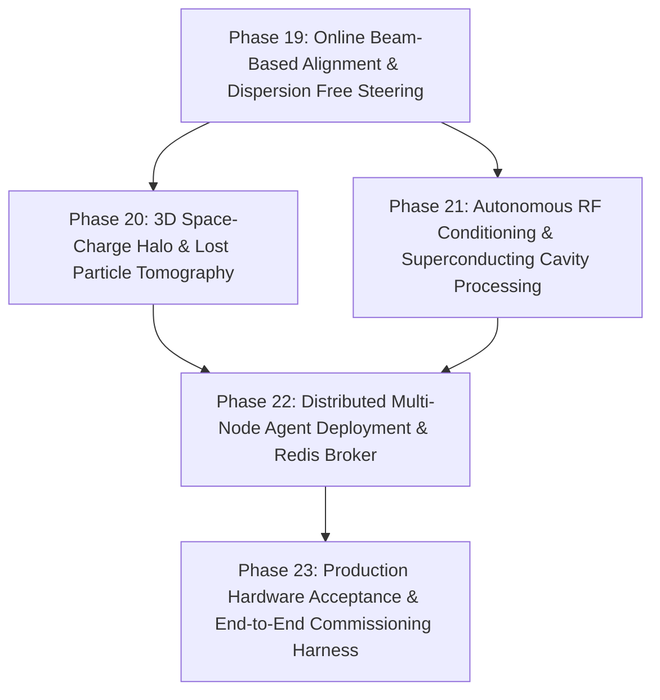

# HELIOS Next Phase Development Task List (Phases 19 - 23)

- **Status**: Active
- **Reference Architecture**: LBNL Osprey Framework & Autonomous Control Rooms
- **Domain**: Heavy Ion Linear Accelerators (LEBT, RFQ, MEBT, SCL, HEBT)
- **Created**: 2026-10-13

---

## 🎯 Strategic Roadmap Overview (Phases 19 - 23)

Having completed foundational orchestration, production physics codes (TRACK, IMPACT-Z), deep surrogates, multi-species/charge states, fault recovery, multi-facility digital twins (RAON, FRIB, GSI), and operations reporting (Phases 1–18, 83/83 passing tests), this roadmap advances HELIOS towards full autonomous facility operation:

---

## Phase 19: Online Beam-Based Alignment (BBA) & Dispersion-Free Steering (DFS)

- [ ] **19.1 Beam-Based Quadrupole Alignment (BBA)**
  - [ ] Implement quadrupole strength modulation technique ($\Delta K_1$) to pinpoint beam offset relative to magnetic center.
  - [ ] Compute quadrupole offset calibration tables with error covariance minimization.
- [ ] **19.2 Dispersion-Free Steering (DFS) Solver**
  - [ ] Implement dual-energy / momentum-spread response matrix formulation to simultaneously minimize orbit and spurious dispersion $\eta_x, \eta_y$.
  - [ ] Prevent transverse emittance blowup across high-dispersion transitions (e.g. MEBT to SCL matching).
- [ ] **19.3 Automated Quadrupole Center Zeroing**
  - [ ] Integration with `HELIOS-Tuner` and `HELIOS-Safety` for automated BBA execution loops with readback confirmation.

---

## Phase 20: 3D Space-Charge Halo & Lost Particle Tomography

- [ ] **20.1 Multi-Monitor Transverse Phase Space Tomography (MENT)**
  - [ ] Maximum Entropy (MENT) reconstruction algorithm using multi-wire / profile monitor projections to recover 2D $(x, x')$ and $(y, y')$ phase-space distributions.
- [ ] **20.2 Beam Halo Quantification & Core-Halo Separation**
  - [ ] Implement profile tail decomposition (Gaussian core vs. Lorentzian/exponential halo) to evaluate halo parameter $H$.
  - [ ] Provide real-time alerts when halo parameter exceeds cryogenic chamber scraping thresholds.
- [ ] **20.3 3D Loss Distribution Reconstructor**
  - [ ] Correlate BLM sensor arrays with linac geometry to synthesize continuous 3D lost-particle heatmaps along the cryomodule beam pipes.

---

## Phase 21: Autonomous RF Conditioning & Superconducting Cavity Processing

- [ ] **21.1 Automated RF Cavity Conditioning Sequencer**
  - [ ] Implement progressive pulse-width and RF power ramping algorithms with vacuum pressure threshold feedback.
  - [ ] Dynamic dwell-time adjustments upon outgassing or multipacting detection.
- [ ] **21.2 Multipacting Band Identification & Fast Breakthrough**
  - [ ] Real-time detection of electron pickup signals and sudden vacuum degradation within known multipacting power levels.
  - [ ] Fast automated frequency/power jumping to break through multipacting barriers without cavity surface damage.
- [ ] **21.3 Automated Cavity Tuning & Resonance Frequency Tracking**
  - [ ] Stepper motor tuner and piezo actuator closed-loop resonance tracking to maintain zero phase offset under microphonics and helium bath pressure drift.

---

## Phase 22: Multi-Host Distributed Agent Infrastructure & Cloud/Cluster Broker

- [ ] **22.1 Redis / RabbitMQ / MQTT Network Event Broker Backend**
  - [ ] Expand `DistributedEventBus` to support external network brokers (Redis pub/sub, RabbitMQ AMQP, MQTT) for distributed multi-server control rooms.
  - [ ] Support failover and automatic reconnection logic across high-availability control clusters.
- [ ] **22.2 Remote Agent RPC & Asynchronous Task Scheduling**
  - [ ] Distributed agent worker nodes running compute-heavy TRACK / IMPACT-Z simulations on GPU/CPU cluster nodes while the orchestrator runs in the control room.
- [ ] **22.3 Shared Distributed Machine State & Consensus**
  - [ ] Real-time synchronization of active linac setpoints and safety rollback stacks across multiple control workstations.

---

## Phase 23: Production Hardware Acceptance, E2E Commissioning & Virtual Accelerator Mock

- [ ] **23.1 Comprehensive Virtual Heavy Ion Accelerator Mock (End-to-End EPICS IOC)**
  - [ ] Standalone PCASpy / softIOC mock running realistic heavy-ion linac physics (RAON/FRIB parameters) with simulated noise, drift, and fault injections.
- [ ] **23.2 Complete End-to-End Autonomous Commissioning Workflow**
  - [ ] Execute continuous automated commissioning sequence from cold start: RF turn-on $\rightarrow$ orbit centering $\rightarrow$ BBA $\rightarrow$ CSS slit tuning $\rightarrow$ cavity rematch $\rightarrow$ shift report generation.
- [ ] **23.3 Control Room Operator Acceptance Test Suite**
  - [ ] Integration validation harness verifying all 23 phases under simulated real-world accelerator operational disruptions.
