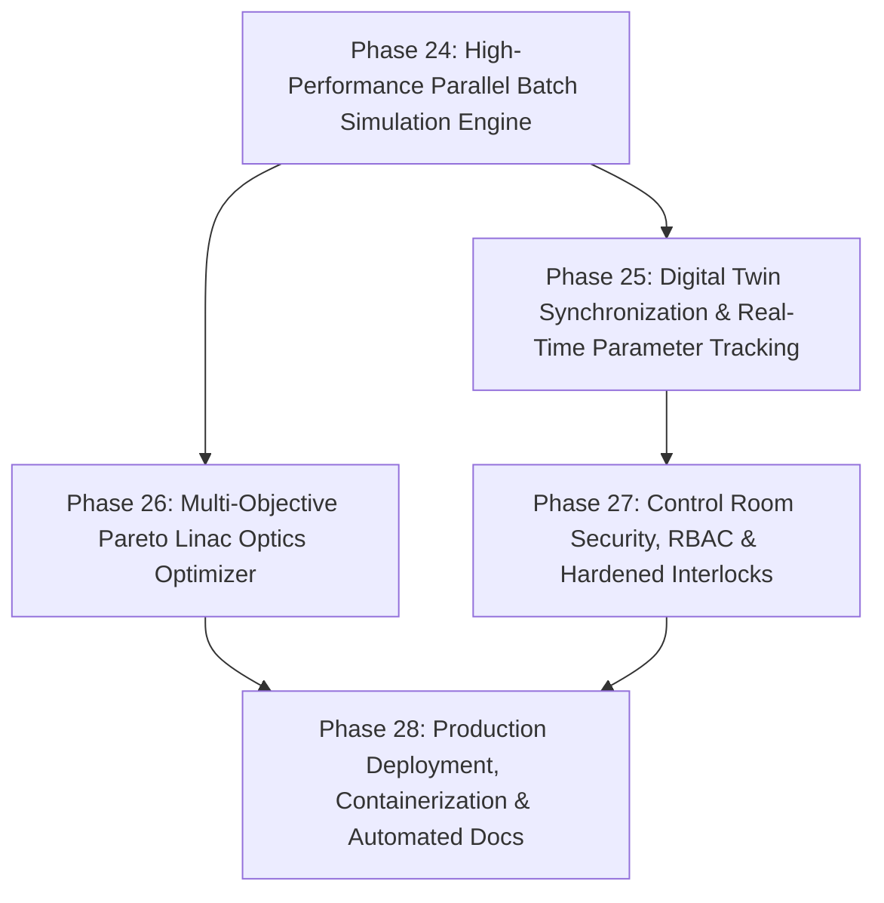

# HELIOS Next Phase Development Task List (Phases 24 - 28)

- **Status**: Active
- **Reference Architecture**: LBNL Osprey Framework & Autonomous Control Rooms
- **Domain**: Heavy Ion Linear Accelerators (LEBT, RFQ, MEBT, SCL, HEBT)
- **Created**: 2026-10-13

---

## 🎯 Strategic Roadmap Overview (Phases 24 - 28)

Having completed core orchestration, physics simulation codes, neural surrogates, reinforcement learning, multi-species/charge states, fault recovery, multi-facility models, BBA/DFS, MENT tomography, RF conditioning, and E2E commissioning harnesses (Phases 1–23, 88/88 passing tests), the framework now advances toward **facility-grade production deployment, security, optimization, and digital twin high-performance execution**:

---

## Phase 24: High-Performance Parallel Batch Simulation Engine (Ray / Multiprocessing)

- [x] **24.1 Asynchronous Worker Pool for Simulation Ensembles**
  - [x] Implement multi-worker task execution pool for parallel ANL TRACK and LBNL IMPACT-Z runs across multi-core CPUs and cluster nodes.
  - [x] Support dynamic job queuing, progress tracking, and batch result reduction.
- [x] **24.2 Parallel Parameter Sweeps & Uncertainty Quantification (UQ)**
  - [x] Systematic lattice parameter scans ($\pm 5\%$ quad gradients, RF cavity phase jitter, beam current fluctuations).
  - [x] Compute confidence bands and statistical transmission probability distributions.
- [x] **24.3 GPU-Accelerated Particle Tracking Backend**
  - [x] PyTorch/CUDA-based batch transfer matrix and space-charge particle pusher for sub-millisecond envelope and particle ensemble tracking.

---

## Phase 25: Online Digital Twin Synchronization & Real-Time Parameter Tracking

- [x] **25.1 Continuous Kalman Filter / State Observer**
  - [x] Unscented Kalman Filter (UKF) / Ensemble Kalman Filter (EnKF) assimilating live BPM, BLM, and FC telemetry into the active digital twin lattice state.
  - [x] Real-time estimation of unmeasured states (beam energy spread, unmonitored emittance, longitudinal centroid).
- [x] **25.2 Drift Detection & Autonomous Recalibration Trigger**
  - [x] Continuous tracking of discrepancy between digital twin predictions and real machine readbacks.
  - [x] Autonomous trigger initiating background recalibration when residual error exceeds statistical confidence thresholds.
- [x] **25.3 Golden Baseline Snapshot Archive & Semantic Diff Engine**
  - [x] Facility-wide golden setpoint storage with semantic diff highlighting deviations by subsystem (optics, RF, diagnostics).

---

## Phase 26: Multi-Objective Pareto Linac Optics Optimizer

- [x] **26.1 Non-Dominated Sorting Genetic Algorithm (NSGA-II / NSGA-III)**
  - [x] Multi-objective evolutionary optimization engine tailored for heavy-ion linacs.
  - [x] Simultaneous optimization of competing goals: maximize transmission ($>98\%$), minimize longitudinal emittance blowup, and minimize transverse envelope scalloping.
- [x] **26.2 Constrained Bayesian Optimization with Gaussian Processes**
  - [x] Safe BO algorithm incorporating strict upper-bound BLM radiation loss constraints using acquisition functions (Expected Improvement with Probability of Feasibility).
- [x] **26.3 Interactive Pareto Front Explorer**
  - [x] Capability and visualization export allowing operators to inspect and select preferred Pareto-optimal operating points.

---

## Phase 27: Enterprise Control Room Security, RBAC & Hardened Interlocks

- [x] **27.1 Role-Based Access Control (RBAC) & Epics CAS Security Integration**
  - [x] Multi-tiered user authentication (Viewer, Commissioning Physicist, Safety Officer, Admin).
  - [x] Cryptographic token-based authorization gating dangerous setpoint writes and panic shutdown triggers.
- [x] **27.2 Hardware Machine Protection System (MPS) Heartbeat Watchdog**
  - [x] Standalone safety daemon maintaining a continuous sub-second cryptographic heartbeat with live EPICS IOCs.
  - [x] Automatic fallback to safe default machine state upon agent communication timeout or network disruption.
- [x] **27.3 Secure Operator Audit Log Export & Archiving**
  - [x] Signed audit log export conforming to nuclear regulatory and laboratory quality assurance standards.

---

## Phase 28: Production Deployment, Containerization & Automated API Documentation

- [x] **28.1 Production Docker Container & Orchestration Decks**
  - [x] Multi-stage production `Dockerfile` bundling HELIOS, PyTorch, Wine, ANL TRACK, lume-impact, and EPICS base.
  - [x] `docker-compose.yml` deploying HELIOS Orchestrator, FastAPI dashboard, Redis event broker, and mock IOC.
- [x] **28.2 Automated Interactive OpenAPI & Sphinx Physics Documentation**
  - [x] Auto-generated Sphinx / MkDocs documentation suite covering all 28 phases, agent protocols, and physics formulas.
- [x] **28.3 Release Packaging & PyPI Distribution Readiness**
  - [x] Validated `pyproject.toml` configuration ready for production distribution.
