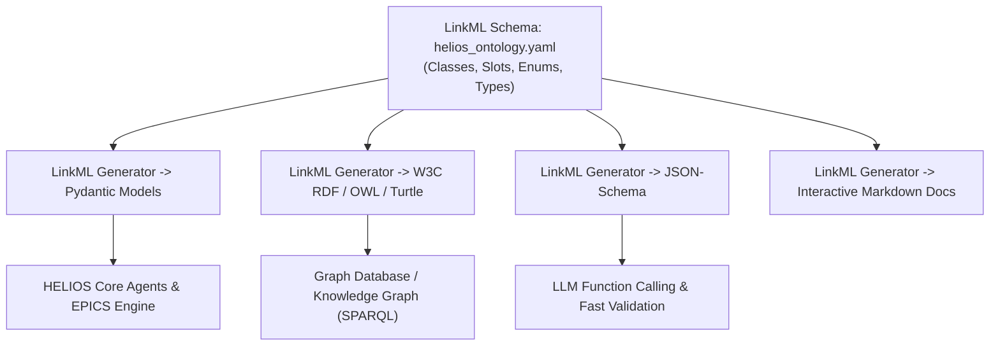

# HELIOS Phase 29 Development Task List: LinkML Accelerator Modeling & Ontology Architecture

- **Status**: Active
- **Plan ID**: `00034`
- **Domain**: Heavy Ion Linear Accelerator Ontology & Modeling Standards
- **Standard**: [LinkML (Linked Open Data Modeling Language)](https://linkml.io/)
- **Created**: 2026-10-13

---

## 🎯 Executive Overview & Motivation

**LinkML** is a modern, YAML-based modeling language that allows developers to define a single canonical schema and generate:
1. **Python Pydantic models** (strongly typed runtime validation).
2. **JSON-Schema** (API validation and LLM tool arguments).
3. **W3C RDF / OWL Ontologies** (semantic web, graph databases, and knowledge graphs).
4. **Interactive Markdown / HTML documentation** of the accelerator domain model.

Integrating LinkML into HELIOS replaces ad-hoc Pydantic/YAML definitions with a **formally governed semantic data model** aligned with laboratory metadata initiatives (e.g. LBNL, FAIR data standards, and CERN OpenData).

---

## Phase 29: LinkML Accelerator Modeling & Ontology Integration

### 1. Environment & Packaging Integration
- [ ] **29.1 Add LinkML Dependency & Tooling Configuration**
  - Add `linkml` and `linkml-runtime` to `pyproject.toml` under optional dependencies `[project.optional-dependencies] ontology = ["linkml>=1.7.0", "linkml-runtime>=1.7.0", "rdflib>=7.0.0"]`.
  - Provide fallback support for standalone environments without LinkML CLI binaries installed.

### 2. Canonical LinkML Accelerator Schema Definition (`helios/ontology/`)
- [ ] **29.2 Define `helios_schema.yaml` Specification**
  - **Classes**:
    - `BeamlineElement`: Abstract base class with slot definitions (`id`, `name`, `z_position_m`, `length_m`, `section`).
    - `MagneticElement`: Specializes `BeamlineElement` (`Quadrupole`, `Dipole`, `Solenoid`, `SteererH`, `SteererV`) with magnetic fields ($T$, $T/m$), currents, and calibration polynomial coefficients.
    - `RFCavityElement`: Cavity frequency, voltage ($kV$), synchronous phase ($deg$), transit time factor, cryogenic temperature ($K$), and multipacting bands.
    - `DiagnosticElement`: Non-interceptive (`BPM`, `BLM`, `ACCT`) and interceptive (`FaradayCup`, `WireScanner`) instruments.
    - `IonBeam`: Species isotope ($A$, $Z$, $Q$), beam energy ($MeV/u$), current ($mA$), emittance ($\pi \cdot mm \cdot mrad$), and Twiss parameters ($\alpha, \beta, \gamma$).
  - **Enums & Prefixes**:
    - Standard prefixes (`helios:`, `qudt:` for physical units, `w3c:`, `schema:`).
    - `AcceleratorSectionEnum`, `DeviceTypeEnum`, `InterlockStateEnum`, `RiskLevelEnum`.

### 3. LinkML Schema Compiler & Runtime Loaders
- [ ] **29.3 Schema Validation & Dynamic Ingestion Engine (`helios/ontology/loader.py`)**
  - Implement programmatic validator using LinkML runtime (`linkml_runtime.loaders.yaml_loader`).
  - Provide seamless bidirectional conversion between LinkML models and existing HELIOS `LinacDevice`, `Lattice`, and `Element` instances.
- [ ] **29.4 RDF / Turtle (TTL) & OWL Ontology Exporter (`helios/ontology/rdf_exporter.py`)**
  - Export live linac lattice and device states into W3C Turtle (`.ttl`) and OWL formats.
  - Enable semantic reasoning (e.g., verifying whether all superconducting cavities have corresponding cryo sensors).

### 4. Semantic Query & Knowledge Graph Traverser (`helios/ontology/graph.py`)
- [ ] **29.5 Graph Traversal & Topology Navigation**
  - Query upstream/downstream beamline neighborhood (e.g. *"Find the nearest two horizontal steerers upstream of BPM02"*).
  - Power the Natural Language Planner (`HELIOS-Planner` / `helios chat`) with structural topology awareness extracted from the ontology.

### 5. Automated Unit Tests & Verification
- [ ] **29.6 Verification Suite (`tests/test_linkml_ontology.py`)**
  - Validate `helios_schema.yaml` parsing and conformance against LinkML meta-model.
  - Test serialization/deserialization of RAON, FRIB, and SCL1 lattices via LinkML.
  - Test RDF/OWL export and SPARQL/graph topology queries.
