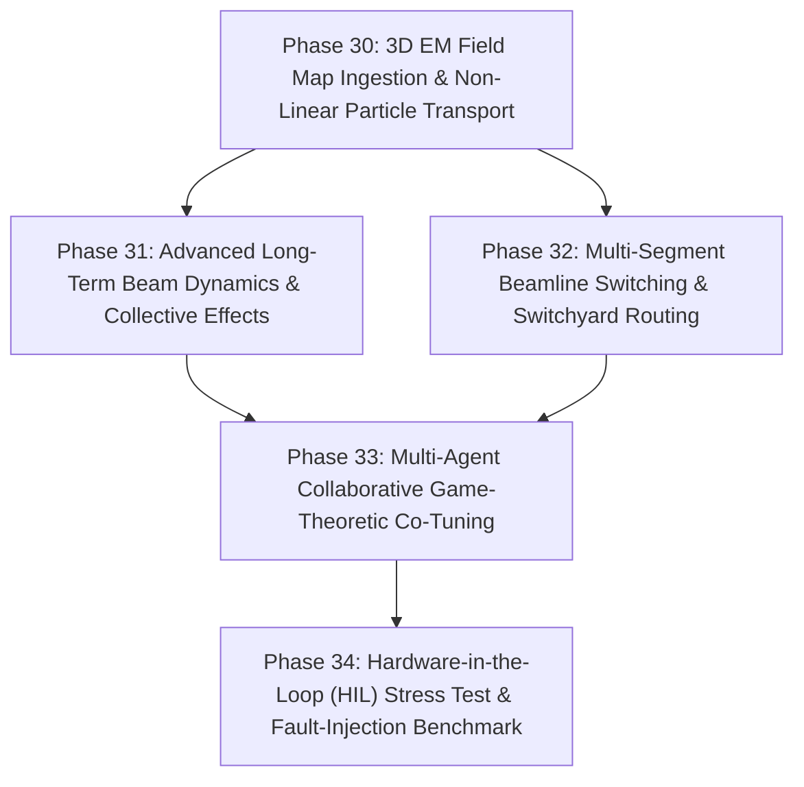

# HELIOS Next Phase Development Task List: Advanced Physics Fidelity & Enterprise Control (Phases 30 - 34)

- **Status**: Active
- **Plan ID**: `00037`
- **Domain**: Heavy Ion Linear Accelerators (LEBT, RFQ, MEBT, SCL, HEBT)
- **Reference Architecture**: LBNL Osprey Framework & Autonomous Digital Twin Operation
- **Created**: 2026-10-13

---

## 🎯 Strategic Roadmap Overview (Phases 30 - 34)

With foundational agent orchestration, multi-simulator execution (TRACK & IMPACT-Z), LinkML ontology, RF conditioning, BBA/DFS, and automated reporting fully realized and verified (Phases 1–29, 98/98 tests passing), this roadmap focuses on **ultra-high-fidelity beam physics, 3D electromagnetic field map processing, hardware-in-the-loop (HIL) automated commissioning, and intelligent multi-beamline switching**:

---

## Phase 30: 3D Electromagnetic Field Map Ingestion & Non-Linear Symplectic Tracking

- [ ] **30.1 3D RF & Magnet Field Map Importer (`helios/physics/fieldmaps.py`)**
  - [ ] Ingest standard 3D field map formats (CST Microwave Studio, ANSYS HFSS, Opera-3D, TRACK field files).
  - [ ] Implement fast 3D tricubic spline interpolation on structured spatial grids for $(E_x, E_y, E_z, B_x, B_y, B_z)$.
- [ ] **30.2 Symplectic High-Order Particle Pusher (`helios/physics/pusher.py`)**
  - [ ] Implement relativistic Boris / Yoshida 4th-order symplectic particle integrator for realistic tracking across realistic fringing fields and cavity gap non-linearities.
- [ ] **30.3 Non-Linear Chromatic & Sextupole Resonance Evaluation**
  - [ ] Evaluate chromaticity, higher-order multipole aberrations, and phase-space distortion in bending switchyards and final focus sections.

---

## Phase 31: Advanced Long-Term Collective Effects & Intra-Beam Scattering (IBS)

- [ ] **31.1 Intra-Beam Scattering (IBS) Engine (`helios/physics/ibs.py`)**
  - [ ] Implement Piwinski / Bjorken-Mtingwa IBS rate models tailored for dense heavy-ion bunches ($^{238}\text{U}, ^{124}\text{Xe}$).
  - [ ] Calculate longitudinal energy spread growth and transverse emittance diffusion rates along superconducting cryomodules.
- [ ] **31.2 Longitudinal Microbunching & Space-Charge Impedance Modeling**
  - [ ] Impedance accumulation along periodic cryomodule RF gaps and vacuum chamber bellows.
  - [ ] Estimate Landau damping margins and microbunching gain curves to prevent beam instability.

---

## Phase 32: Multi-Segment Switchyard Routing & Fast Beam Delivery

- [ ] **32.1 Automated High Energy Beam Transport (HEBT) Switchyard Router (`helios/tuning/switchyard.py`)**
  - [ ] Autonomous trajectory steering through magnetic switchyards delivering beams to target experiment vaults (e.g. nuclear physics, materials science, isotope production).
  - [ ] Automated bending dipole, septum, and kicker magnet timing synchronization.
- [ ] **32.2 Multi-Energy Fast Lattice Reconfiguration**
  - [ ] Rapid parameter transitions between different energy stages without complete cold-start linac retuning.
  - [ ] Coordinated slew-rate ramping preserving envelope matching across transitions.

---

## Phase 33: Multi-Agent Collaborative Game-Theoretic Co-Tuning

- [ ] **33.1 Multi-Agent Nash Equilibrium & Pareto Co-Tuning (`helios/agents/cotuner.py`)**
  - [ ] Distributed coordination between localized subsystem tuning agents (e.g., MEBT Tuner vs SCL1 Tuner vs Switchyard Tuner).
  - [ ] Formulate cooperative games to resolve inter-subsystem conflicting objectives (e.g., matching transverse beta functions across section interfaces).
- [ ] **33.2 Conflict Resolution & Priority Arbitration Engine**
  - [ ] Deterministic arbitration protocols when multiple agents propose simultaneous Process Variable adjustments to overlapping hardware.

---

## Phase 34: Hardware-in-the-Loop (HIL) Stress Testing & Autonomous Resilience Benchmark

- [ ] **34.1 Synthetic Heavy-Ion Linac Fault Injection Testbed (`helios/ops/stress.py`)**
  - [ ] Automated injection of realistic operational anomalies: mains 60 Hz ground hum, sudden cryomodule helium pressure dips, BPM ADC noise, and random steerer magnet drift.
- [ ] **34.2 Autonomous Resilience Benchmark Suite**
  - [ ] Measure Mean Time to Recovery (MTTR) under autonomous fault rematching across varying autonomy levels.
  - [ ] Verify zero beam trips under continuous 24-hour simulated commissioning runs.
- [ ] **34.3 Comprehensive Verification Suite (`tests/test_advanced_physics_and_resilience.py`)**
  - [ ] Test 3D field map interpolation, symplectic particle integrator, IBS emittance growth, switchyard routing, and game-theoretic arbitration.
