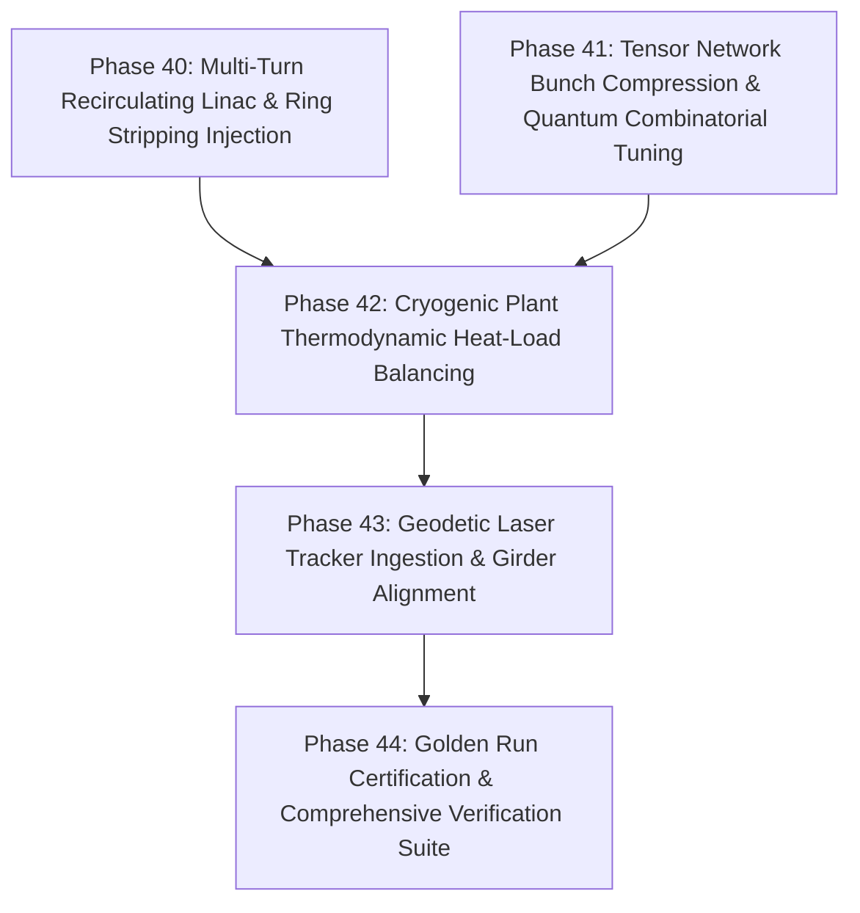

# HELIOS Next Phase Development Task List: Recirculating Dynamics, Cryoplant Heat Load & Tensor Physics (Phases 40 - 44)

- **Status**: Active
- **Plan ID**: `00041`
- **Domain**: Heavy Ion Accelerators (Linacs, Recirculating Rings, Cryomodules, Geodetic Alignment)
- **Reference Architecture**: LBNL Osprey Framework & Autonomous Digital Twin Operation
- **Created**: 2026-10-13

---

## 🎯 Strategic Roadmap Overview (Phases 40 - 44)

With end-to-end differentiable beam dynamics, ECR ion source plasma tuning, predictive quench interlocks, distributed agent mesh architecture, and multi-modal operator interfaces verified (Phases 1–39, 109/109 tests passing), this roadmap expands HELIOS to **recirculating ring injection dynamics, tensor network phase space compression, cryogenic plant heat-load balancing, and mechanical girder laser alignment**:

---

## Phase 40: Multi-Turn Recirculating Linac & Ring Stripping Injection

- [ ] **40.1 Multi-Turn Ring Betatron Optics & Harmonic Orbit Correction (`helios/physics/ring.py`)**
  - [ ] Implement closed-orbit distortion (COD) harmonic decomposition and global tune ($Q_x, Q_y$) working point adjustment.
  - [ ] One-turn map tracking with chromaticity ($\xi_x, \xi_y$) and momentum compaction ($\alpha_c$).
- [ ] **40.2 Charge-Stripping Foil Multi-Turn Injection & Phase-Space Painting**
  - [ ] Simulate multi-turn beam accumulation through thin stripping foils (carbon or liquid metal).
  - [ ] Implement correlated and anti-correlated transverse phase-space painting trajectories using fast bumper magnets to prevent space-charge emittance blowup.

---

## Phase 41: Tensor Network Bunch Compression & Quantum Combinatorial Tuning

- [ ] **41.1 Tensor Train / Matrix Product State (MPS) Bunch Compression (`helios/physics/tensornet.py`)**
  - [ ] Decompose 6D macroparticle density tensors using singular value decomposition (SVD) into low-rank Matrix Product States.
  - [ ] Achieve $> 50\times$ memory reduction for million-particle PIC simulation distributions while preserving high-order moments.
- [ ] **41.2 Quantum-Inspired Combinatorial Optimization (`helios/optimization/quantum.py`)**
  - [ ] Implement Simulated Quantum Annealing (SQA) / QAOA-inspired solver for discrete combinatorial accelerator problems (e.g. discrete steerer polarities, integer collimator staging).
  - [ ] Benchmark convergence against classical simulated annealing and genetic algorithms.

---

## Phase 42: Cryogenic Plant Thermodynamic Heat Load Balancing

- [ ] **42.1 SRF Cavity Thermal Dissipation & Dynamic Heat Load Model (`helios/rf/cryoplant.py`)**
  - [ ] Calculate BCS surface resistance $R_{\text{BCS}}(T, f)$ and residual resistance $R_{\text{res}}$ for superconducting niobium cavities.
  - [ ] Model dynamic heat load dissipation ($P_{\text{diss}} = \frac{V_{\text{acc}}^2}{(R/Q) Q_0}$) across 2.0 K, 4.5 K, and 50 K cryogenic thermal shields.
- [ ] **42.2 Closed-Loop Cryoplant Margin & Joule-Thomson (JT) Valve Coordination**
  - [ ] Autonomously balance RF cavity accelerating gradients against cryoplant refrigeration capacity.
  - [ ] Prevent cold compressor trips and helium pressure instabilities during high-duty-factor heavy-ion operation.

---

## Phase 43: Geodetic Survey & Mechanical Girder Alignment Integration

- [ ] **43.1 Laser Tracker Fiducial Coordinate Ingestion (`helios/diagnostics/survey.py`)**
  - [ ] Ingest geodetic survey data (Leica/Hexagon laser tracker measurements) containing 3D coordinates $(X, Y, Z)$ and mechanical roll/pitch/yaw tilt angles of linac elements.
  - [ ] Compute misalignments relative to the ideal theoretical beam reference axis.
- [ ] **43.2 Motorized Girder Re-Alignment Optimizer**
  - [ ] Calculate optimal mechanical girder mover displacements (cams / jacks) to realign multiple magnets simultaneously.
  - [ ] Minimize required magnetic dipole corrector currents and maximize available physical beam aperture.

---

## Phase 44: Golden Run Certification & Comprehensive Verification Suite

- [ ] **44.1 Automated Golden Run Certification Engine (`helios/ops/golden.py`)**
  - [ ] Statistical comparison between live operating configurations and certified historical Golden Runs.
  - [ ] Generate comprehensive digital certificates with cryptographic SHA-256 hashes for accelerator beamline setups.
- [ ] **44.2 Comprehensive Verification Suite (`tests/test_recirculating_cryo_and_quantum.py`)**
  - [ ] Unit and integration tests for ring optics, tensor train compression, cryogenic heat load balancing, and laser tracker alignment.
