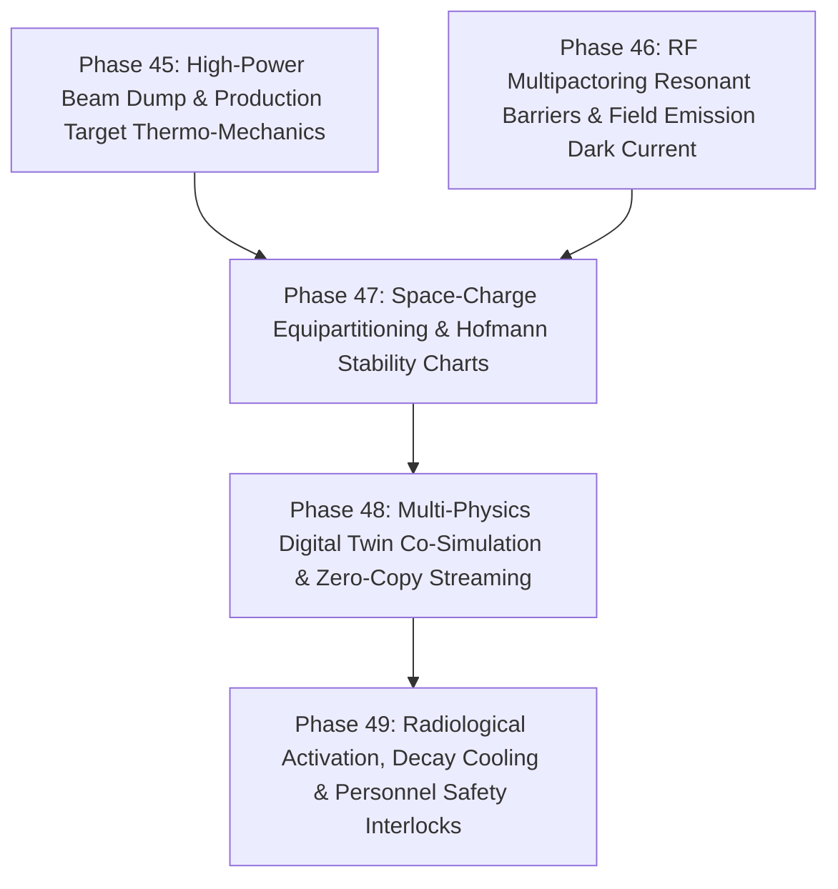

# HELIOS Next Phase Development Task List: High-Power Targets, Multipactoring & Radiological Safety (Phases 45 - 49)

- **Status**: Active
- **Plan ID**: `00043`
- **Domain**: Heavy Ion Linear Accelerators (LEBT, RFQ, MEBT, SCL, High-Power Targets, Beam Dumps, Radiation Protection)
- **Reference Architecture**: LBNL Osprey Framework & Autonomous Digital Twin Operation
- **Created**: 2026-10-13

---

## 🎯 Strategic Roadmap Overview (Phases 45 - 49)

This roadmap deepens the heavy-ion linear accelerator physics and engineering envelope into **high-power target thermo-mechanics, cavity multipactoring breakdown modeling, space-charge equipartitioning stability, multi-physics digital twin co-simulation, and residual radiological activation forecasting**:

---

## Phase 45: High-Power Target & Beam Dump Thermo-Mechanical Stress Simulation

- [ ] **45.1 Bragg Peak Energy Deposition & Hydrodynamic Shockwave Modeling (`helios/physics/beam_dump.py`)**
  - [ ] Model heavy-ion 3D energy deposition Bragg profiles ($dE/dx$) in high-power graphite, copper, and tungsten beam stops (up to 400 kW beam power).
  - [ ] Evaluate instantaneous thermo-elastic pressure spikes ($\Delta P = \Gamma \rho \Delta E$) using Grüneisen equation of state.
  - [ ] Calculate von Mises thermal fatigue stress and critical heat flux (CHF) boiling margins in cooling water channels.
- [ ] **45.2 Proactive Beam Dump Protection Interlock**
  - [ ] Automated beam abort trigger if peak surface power density exceeds thermal shock thresholds.

---

## Phase 46: RF Multipactoring Resonant Barriers & Field Emission Dark Current

- [ ] **46.1 Secondary Electron Yield (SEY) Resonant Multipactoring Engine (`helios/rf/multipactor.py`)**
  - [ ] Model 1-point and 2-point resonant electron multipactoring in coaxial power couplers and low-beta SRF cavities (QWR, HWR).
  - [ ] Map SEY curve $\delta(E_{\text{impact}})$ and identify resonant RF voltage barrier bands susceptible to cavity vacuum trips.
- [ ] **46.2 Fowler-Nordheim Field Emission & Dark Current Radiation Map**
  - [ ] Simulate electron field emission current ($J_{\text{FN}} = A_1 E^2 \exp(-B_1 / E)$) from cavity iris surface defects.
  - [ ] Map bremsstrahlung X-ray radiation dose accumulation along cryomodule silicon diode sensors.

---

## Phase 47: Space-Charge Equipartitioning & Hofmann Stability Charts

- [ ] **47.1 Hofmann Chart Parametric Resonance Mapping (`helios/physics/equipartition.py`)**
  - [ ] Compute transverse-longitudinal kinetic energy anisotropy ratio ($T_\perp / T_\parallel$) along high-current heavy-ion linacs.
  - [ ] Map linac zero-current and depressed phase advances $(\sigma_{0t}, \sigma_{0l}, \sigma_t, \sigma_l)$ onto Hofmann anisotropic space-charge stability diagrams.
- [ ] **47.2 Autonomous Emittance Exchange Avoidance Rematching**
  - [ ] Detect proximity to dangerous parametric resonance stopbands ($2\sigma_t - \sigma_l = 0$, $\sigma_t - \sigma_l = 0$).
  - [ ] Autonomously rematch quadrupole focus and RF cavity phase advances to maintain safe equipartitioning margins.

---

## Phase 48: Multi-Physics Digital Twin Co-Simulation Bridge & Zero-Copy Streaming

- [ ] **48.1 High-Throughput In-Memory IPC Co-Simulation Bridge (`helios/sim/cosim.py`)**
  - [ ] Implement zero-copy Apache Arrow / shared-memory IPC buffer exchange linking particle trackers (TRACK/IMPACT-Z), thermal models, and EPICS.
  - [ ] Synchronize linac macroparticle bunch arrays $(N, 6)$ and 3D loss distributions across heterogeneous simulation processes.
- [ ] **48.2 Adaptive Repetition-Rate Simulation Synchronization**
  - [ ] Dynamically throttle simulation time steps to lock onto live linac macro-pulse repetition rates (1 Hz to 100 Hz).

---

## Phase 49: Residual Radiological Activation, Decay Cooling & Personnel Safety

- [ ] **49.1 Residual Isotope Inventory & Delayed Gamma Radiation Modeling (`helios/safety/activation.py`)**
  - [ ] Calculate nuclear spallation and heavy-ion fragmentation activation along beam pipe walls and collimators.
  - [ ] Implement Bateman decay equations for primary isotope decay chains ($^{60}\text{Co}, ^{54}\text{Mn}, ^{22}\text{Na}$, etc.).
- [ ] **49.2 Radiological Cooling Time Interlock & Access Authority**
  - [ ] Calculate safe cool-down waiting times before personnel tunnel access is granted.
  - [ ] Generate cryptographic clearance tokens for Radiation Protection Officers.
- [ ] **49.3 Comprehensive Verification Suite (`tests/test_high_power_linac_physics.py`)**
  - [ ] Unit and integration tests covering beam dump stress, multipactoring SEY, Hofmann charts, co-simulation bridge, and radiological decay.
