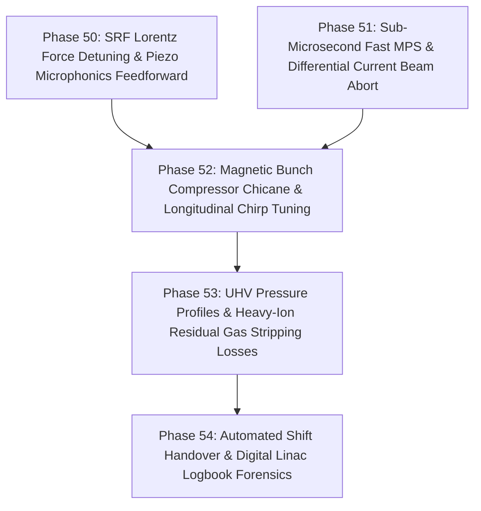

# HELIOS Next Phase Development Task List: Microphonics, Fast MPS, Chicane Compression & Vacuum Dynamics (Phases 50 - 54)

- **Status**: Active
- **Plan ID**: `00045`
- **Domain**: Heavy Ion Linear Accelerators (LEBT, RFQ, MEBT, SCL, Bunch Compressor, UHV Systems, Fast MPS)
- **Reference Architecture**: LBNL Osprey Framework & Autonomous Digital Twin Operation
- **Created**: 2026-10-13

---

## 🎯 Strategic Roadmap Overview (Phases 50 - 54)

This roadmap deepens the heavy-ion linear accelerator real-time control and beam dynamics into **Lorentz Force Detuning (LFD) and microphonics feedforward compensation, sub-microsecond Fast Machine Protection System (MPS) abort chains, magnetic bunch compression chicanes, ultra-high vacuum (UHV) beam-gas stripping loss modeling, and automated shift logbook forensics**:

---

## Phase 50: SRF Lorentz Force Detuning & Piezo Microphonics Feedforward

- [ ] **50.1 Dynamic Lorentz Force Detuning (LFD) & Mechanical Mode Modeling (`helios/rf/microphonics.py`)**
  - [ ] Model electromagnetic radiation pressure cavity wall deformation ($\Delta f_{\text{LFD}} = -K_L \cdot E_{\text{acc}}^2$) for QWR, HWR, and Spoke cavities.
  - [ ] Model multi-mode mechanical eigenfrequency spectrum ($f_m \approx 20\text{--}300\text{ Hz}$) excited by liquid helium boiling and cryogenic plant pressure ripple.
- [ ] **50.2 Adaptive Filtered-X Least Mean Squares (FxLMS) Piezo Controller**
  - [ ] Implement adaptive feedforward algorithm driving fast piezoelectric tuners to cancel microphonics phase and frequency jitter in sub-millisecond timescales.

---

## Phase 51: Sub-Microsecond Fast Machine Protection System (MPS) & Differential Beam Abort

- [ ] **51.1 Differential Current Loss Monitoring & Fast Abort Logic (`helios/safety/fast_mps.py`)**
  - [ ] Model differential current monitoring between non-interceptive ACCT/FCT current transformers ($\Delta I = I_{\text{upstream}} - I_{\text{downstream}} > \Delta I_{\text{threshold}}$).
  - [ ] Sub-microsecond beam kill trip chain ($< 5\ \mu\text{s}$) triggering LEBT electrostatic chopper deflection and RFQ RF drive cutoff.
- [ ] **51.2 Fast Diamond Detector & Scintillator Fiber Loss Array**
  - [ ] Emulate fast diamond BLM signal integration and FPGA register logic for instant localized cryomodule beam punch-through prevention.

---

## Phase 52: Magnetic Bunch Compressor Chicane & Longitudinal Chirp Tuning

- [ ] **52.1 4-Dipole Bunch Compressor Chicane Optics (`helios/tuning/bunch_compressor.py`)**
  - [ ] Model symmetric C-type and S-type magnetic chicanes for heavy-ion linacs: longitudinal dispersion $R_{56} = \frac{\partial z}{\partial \delta}$ and second-order $T_{566}$.
  - [ ] Coordinate upstream RF chirp cavity phase $\phi_{\text{chirp}}$ and chicane bending angle to compress bunch length without non-linear phase space distortion.
- [ ] **52.2 Energy Spread and Longitudinal Filamentation Minimization**
  - [ ] Evaluate peak current enhancement and longitudinal emittance preservation across the compressor chicane.

---

## Phase 53: UHV Pressure Profiles & Heavy-Ion Residual Gas Stripping Losses

- [ ] **53.1 Linac Ultra-High Vacuum (UHV) Pressure Profile Engine (`helios/physics/vacuum.py`)**
  - [ ] Simulate conductance, ion pump pumping speeds, and cold-bore cryogenic condensation along warm (MEBT/HEBT) and cold (SCL) vacuum chambers.
  - [ ] Model pressure distributions for residual gas species ($H_2, N_2, H_2O, CO$).
- [ ] **53.2 Heavy-Ion Beam-Gas Collision Cross-Sections & Runaway Desorption**
  - [ ] Calculate charge-exchange stripping and electron capture cross-sections ($\sigma_{\text{loss}}$) for heavy ions passing through residual gas.
  - [ ] Model ion-induced molecular desorption ($\eta_{\text{desorption}}$) and evaluate vacuum runaway positive feedback margins.

---

## Phase 54: Automated Shift Handover & Digital Linac Logbook Forensics

- [ ] **54.1 Electronic Linac Logbook (e-Log) Generator (`helios/ops/logbook.py`)**
  - [ ] Automatically synthesize structured shift handover records summarizing beam uptime, integrated charge, trip timelines, active lattice configurations, and RPO clearances.
- [ ] **54.2 Post-Trip Circular Buffer Forensics**
  - [ ] Correlate multi-subsystem fast circular buffers (BPMs, BLMs, RF forward/reflected power, piezo voltages) across the 50 ms pre-trip window to diagnose trip root causes.
- [ ] **54.3 Comprehensive Verification Suite (`tests/test_fast_controls_and_uhv.py`)**
  - [ ] Unit and integration tests covering LFD/microphonics, fast MPS aborts, bunch compressor chicanes, UHV gas stripping losses, and logbook forensics.
