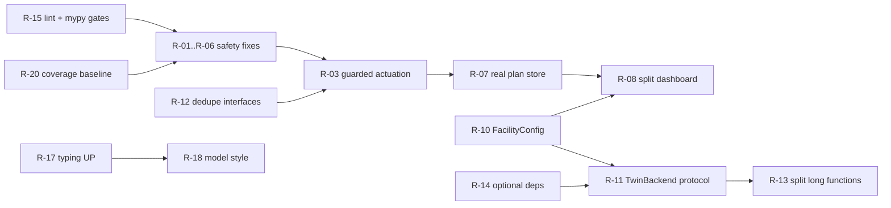

# Active Execution Plan: Repository Refactoring Task List

- **Status**: Active (proposed, nothing executed yet)
- **Plan ID**: `00050`
- **Domain**: Code quality, safety hardening, architecture
- **Created**: 2026-10-14
- **Basis**: Static review of `helios/` (104 modules, about 15.5k lines), `tests/` (32 files), CI and packaging, plus a test run (138 passed, `pytest -q`).

Priorities: **P0** safety-relevant defect (fix before any live use), **P1** structural debt that blocks other work, **P2** hygiene and consistency. Effort: **S** under half a day, **M** 1-2 days, **L** several days.

> [!IMPORTANT]
> Every task that changes actuation, rollback, or the control interfaces (R-01 to R-06) must keep the Plan-First guarantees in `AGENTS.md` (pre-flight, gatekeeper, rollback invariant) and add a regression test that fails before the change.

---

## P0: Safety-relevant defects

- [x] **R-01 (S): Stop `PVAccessInterface` from reporting success after a failed write.**
  `helios/interfaces/pva.py:60-74`: when a real `put` raises, the code logs a warning, writes the value into `_mock_pvs`, and returns `True`. Orchestrator and rollback treat that as a successful actuation. Same pattern for `get` (line 47-49) returning a mock value after a real read fails.
  *Change*: mock mode must be an explicit constructor choice only. A live-mode failure raises `ControlInterfaceError` (or returns `False`). Never silently switch to the mock store.
  *Test*: inject a failing `PvaContext`; assert `put` raises or returns `False` and the mock store stays empty.

- [x] **R-02 (S): Remove `or 0.0` defaults on unreadable setpoints.**
  `helios/agents/orchestrator.py:126` (`rollback_targets[pv] = float(current_sp or 0.0)`) records 0.0 as the rollback target when a setpoint cannot be read, so a later rollback would drive the supply to zero. Also `helios/interfaces/base.py:126` (slew ramp starts from 0.0), and `orchestrator.py:92-93, 159` (missing BPM reads become a perfect 0 mm orbit, which can fake a successful correction).
  *Change*: a `None` read aborts the plan before actuation (typed `MissingReadbackError`). Post-actuation verification must fail, not pass, when BPMs are unreadable.
  *Test*: mock interface with unset PVs; assert plan is rejected and no `put` occurs.

- [x] **R-03 (M): Route actuation through the Safety agent, as `AGENTS.md` specifies.**
  The workflow diagram has `Safety->>Ctrl: execute caput`, but `orchestrator.py:150` calls `self.control.put` directly, and `RollbackController` (`safety/rollback.py:155,170`) holds its own control handle. The gatekeeper only returns a `ValidationResult`, so nothing enforces that a write was validated.
  *Change*: introduce `SafetyGatekeeper.execute(validated_plan)` (or a `GuardedControl` wrapper) as the only object that owns a writable interface. A write requires a token minted by `validate_setpoints` for the same values. The orchestrator and the CLI/dashboard receive the guarded wrapper, not the raw interface.
  *Test*: attempt `put` of unvalidated values through the wrapper; assert refusal.

- [x] **R-04 (M): Authenticate and authorize the dashboard API.**
  `helios/dashboard/app.py:1623-1645`: `/api/plans/{id}/approve`, `/reject`, `/api/emergency/panic`, and `/api/tune/orbit` have no authentication, although `helios/security/rbac.py` and `interfaces/security.py` exist and are not referenced by the dashboard. Approval currently only flips a dict entry (see R-07), but the same endpoints are the natural place for real approval.
  *Change*: FastAPI dependency using the RBAC module (operator vs viewer roles), audit-log every state-changing call, bind to localhost by default.
  *Test*: unauthenticated and under-privileged calls return 401/403.

- [x] **R-05 (S): Stop sending LLM API keys from the browser through `/api/prompt`.**
  `dashboard/app.py:1453` (JS) and `1749-1759`: the key travels in the request body and is held in page state. Read keys from server-side environment or a secrets file; never echo them in logs or responses.

- [x] **R-06 (S): Replace broad `except Exception` in the safety/actuation path with typed handling.**
  14 occurrences. The ones that matter: `physics/engine.py:232, 437` (TRACK/ImpactZ failure silently becomes an analytic result, so a pre-flight "verified by TRACK" may be answered by the toy model), `agents/orchestrator.py:168` (every failure triggers rollback, including programming errors), `ops/broker.py:84` (a failing safety subscriber is only logged).
  *Change*: catch specific errors, tag every result with the backend that produced it (`TrajectoryPoint`/validation provenance: `analytic`, `track`, `fallback`), and let the verifier reject results that fell back when a high-fidelity backend was requested.

---

## P1: Structural debt

- [x] **R-07 (M): Replace the dashboard's in-memory demo plan store with the real plan store.**
  `dashboard/app.py:197-221` hard-codes plans `00001`/`00002`, and approval mutates that dict rather than `helios.core.plan_engine` state, so the GUI can show "IN_PROGRESS" for a plan that never executes.
  *Change*: back `/api/plans*` with `PlanStore`/`PlanLifecycleManager`; approval calls the same authorization path as the CLI.

- [x] **R-08 (L): Split `helios/dashboard/app.py` (1,828 lines).**
  `create_dashboard_app` is about 1,650 lines and `get_dashboard_html` about 1,330, mostly an inline HTML/CSS/JS string. It also embeds facility constants (RAON LEBT station table, response matrices `LEBT_RX/RY`, 0.168 A/mrad, 0.05 A step, lines 40-110) and the orbit-correction algorithm `execute_analytic_orbit_correction` (about 100 lines).
  *Change*:
  1. Move HTML/CSS/JS to `helios/dashboard/static/` (served as files; testable, lintable).
  2. Move routes to `APIRouter` modules (`status`, `plans`, `tuning`, `llm`, `ws`).
  3. Move the orbit-correction logic to `helios/optimization/` or `helios/tuning/` with its tests.
  4. Move facility data to `configs/` (YAML) loaded through one facility-config loader (see R-10).
  5. Keep `create_dashboard_app` a thin composition root.
  *Done when*: no module over about 400 lines in `dashboard/`, existing dashboard tests unchanged and passing.

- [ ] **R-09 (M): Split `core/capabilities.py::get_default_registry` (553 lines, file is 675).**
  A single function that builds the whole registry. Move capability declarations to per-domain modules or a data file, keep the classifier and dispatch logic in `capabilities.py`. Add a test that every registered capability resolves to an importable target.

- [x] **R-10 (M): Centralize facility and PV configuration (remove 57 hard-coded `MEBT:` strings).**
  Present in `channel_map.py` (18), `dashboard/app.py` (12), `safety/rollback.py` (6), `models/calibration.py` (5), `envs/linac_env.py` (5), `models/surrogate.py` (4), `optimization/mpc.py` (4), `safety/srf_protection.py` (2). Also `physics/engine.py:24` and `setup.sh:21,39` hard-code `/home/cspark/...`.
  *Change*: one `FacilityConfig` (YAML under `configs/`, validated by pydantic) supplying PV names, steerer/BPM lists, units, limits, and TRACK location (`TRACK_ROOT` env, no default under a home directory). Constructors take names from it, not from literals.
  *Note*: this is the prerequisite for the facility plugin described in `docs/integration_synaptictrack_raon.md`.

- [x] **R-11 (L): Consolidate the three surrogate/twin abstractions into `helios.physics.twin`.**
  `physics/surrogate.py::FastPhysicsSurrogate` (dict API over the analytic twin), `models/surrogate.py::NeuralLinacSurrogate` (untrained net, dict API, own `SurrogatePrediction`), and `physics/engine.py` backends (`AnalyticDigitalTwinEngine`, TRACK, ImpactZ) overlap, and `NeuralMPCController`/`LinacRLAgent` bind to a specific one.
  *Change*: define `helios.physics.twin` protocol (`FacilityTwin`, `TwinDomain`, `FacilityPlugin`, `TwinPreFlightVerifier`, `LinacSurrogateGymEnv`, `TwinNeuralMPC`), detailed in [00051_develop_helios_physics_twin.md](file:///home/cspark/Work/simulation_codes-working/helios/docs/exec-plans/active/00051_develop_helios_physics_twin.md). Adapt existing backends to it, and make MPC/RL/pre-flight depend only on the protocol. Delete the dead branch in `physics/engine.py` ImpactZ runner or implement it.

- [x] **R-12 (S): Deduplicate control-interface boilerplate.**
  `get_many`/`put_many` are re-implemented in `pva.py` and twice in `epics.py` although `BaseControlInterface` (`base.py:80-84`) already defines them. Make the base implementations concrete and delete overrides. The mock store and subscriber dispatch are duplicated between `MockControlInterface` and `PVAccessInterface`; extract one `InMemoryPVStore`.

- [ ] **R-13 (M): Break up the longest functions.**
  `agents/orchestrator.py::run_orbit_correction_loop` (116 lines; split into read, plan, validate, authorize, actuate, verify, each returning a typed result), `safety/srf_protection.py::validate_srf_state` (99), `physics/liquid_stripper.py::evaluate_stripper` (102), `physics/lattice.py::track_envelope` (97), `tuning/pareto.py::optimize_nsga2` (93), `physics/engine.py::run_from_directory` (93), `physics/pusher.py::track_boris` (92), `recovery/rf_rematch.py::rematch_downstream_cavities` (85). Add characterization tests first, then split.

- [x] **R-14 (M): Unify optional-dependency handling.**
  Four ad-hoc `try/except ImportError` blocks (`HAVE_TORCH` x2 in `models/surrogate.py` and `optimization/rl_agent.py`, `HAVE_GYMNASIUM`, `HAVE_FASTAPI`) with divergent failure behavior (silent `None` model, `RuntimeError`, fall back to `object`). Add `helios/_optional.py` with `require("torch", extra="ml")` that raises one consistent, actionable error, and export extras names that match `pyproject.toml`. Note `LinacGymEnv(gym.Env if HAVE_GYMNASIUM else object)` should not be importable as a half-working class.

---

## P2: Hygiene and consistency

- [x] **R-15 (S): Add the lint/type gates that plan 00049 says exist.**
  `docs/exec-plans/completed/00049_*.md` states CI includes `ruff`, `mypy`, and `black`, but `.github/workflows/ci.yml`, `.github/ci-contract.json`, and `pyproject.toml` contain none of them, and none are installed in the `helios` env. Either add them (recommended: `ruff` first, `mypy` on `helios/safety`, `helios/interfaces`, `helios/core` with `--strict`, widen later) via `scripts/ci_contract.py checks` so local and remote runs stay identical, or correct the plan document.

- [ ] **R-16 (S): Fix plan-record numbering and consistency in `docs/exec-plans/`.**
  Duplicate IDs: `00001` and `00014` each appear twice in `completed/`; `00099_mebt_orbit_trajectory_correction.md` is out of sequence; gaps at 00028, 00031, 00034. `AGENTS.md` requires a unique 5-digit ID. Renumber or add an index, and add a test in `ci_contract.py checks` that IDs are unique.

- [x] **R-17 (S): Modernize type hints.**
  87 modules import `Dict/List/Optional/Tuple` from `typing`, while `requires-python >= 3.10`. Mechanical `ruff --select UP` migration (`dict[str, X]`, `X | None`), done after R-15 so it is enforced.

- [ ] **R-18 (S): Pick one model style for data records.**
  34 modules use `@dataclass` and 29 use pydantic `BaseModel`, sometimes in one flow (for example plan schemas vs trajectory points). Rule of thumb to document in `AGENTS.md`: pydantic at trust boundaries (config, API, persisted plans), frozen dataclasses for internal numerics. Convert only inconsistent cases.

- [x] **R-19 (S): Package/repo hygiene.**
  - Empty untracked `tmp_impactz_run/` at the repo root: ignore or delete; make `ImpactZ` work dirs configurable (`HELIOS_WORKDIR`).
  - `helios_linac.egg-info/` is correctly ignored; confirm `Dockerfile`/`docker-compose.yml` still match `pyproject.toml` extras after R-14.
  - `setup.sh`: remove hard-coded miniforge path (line 39) and default `TRACK_ROOT` (line 21).

- [ ] **R-20 (M): Close test-coverage blind spots.**
  Test files are grouped by theme rather than by module (for example `test_production_and_scaling.py`), so ownership is unclear. Run `pytest --cov=helios --cov-report=term-missing` (`pytest-cov` is already installed) and set a floor (suggest starting at the measured value). Prioritize `interfaces/pva.py` live-path failures, `safety/rollback.py` failure paths, `agents/orchestrator.py` failure branches, and the dashboard endpoints, which are exactly the areas touched by R-01 to R-08.

---

## Suggested order

1. **R-15 and R-20** first: they make every later change measurable and enforce style.
2. **R-01, R-02, R-06** (small, high value), then **R-12 -> R-03 -> R-04/R-05**.
3. **R-10** (config) unlocks **R-08, R-11**, and the RAON plugin work.
4. **R-07, R-09, R-13, R-14** next; **R-16 to R-19** can run in parallel at any time.

## Verification record (review basis)

| Check | Result |
| :--- | :--- |
| `pytest -q` in the `helios` env | 138 passed |
| `ruff` / `mypy` / `black` installed or configured | No |
| Direct `control.put` outside `interfaces/`, `rollback.py`, orchestrator | Only `cli/main.py` demo seeding (lines 138-141) |
| Hard-coded `MEBT:` PV literals | 57 across 8 modules |
| Functions over 60 lines | 12; the two largest are in `dashboard/app.py` |
| Findings not run-verified | R-04/R-05 reflect code reading only; confirm with an HTTP test when implementing |

Nothing in this plan has been implemented. Following the Plan-First rule, move this file to `docs/exec-plans/completed/` with the verification record when the items are done.
