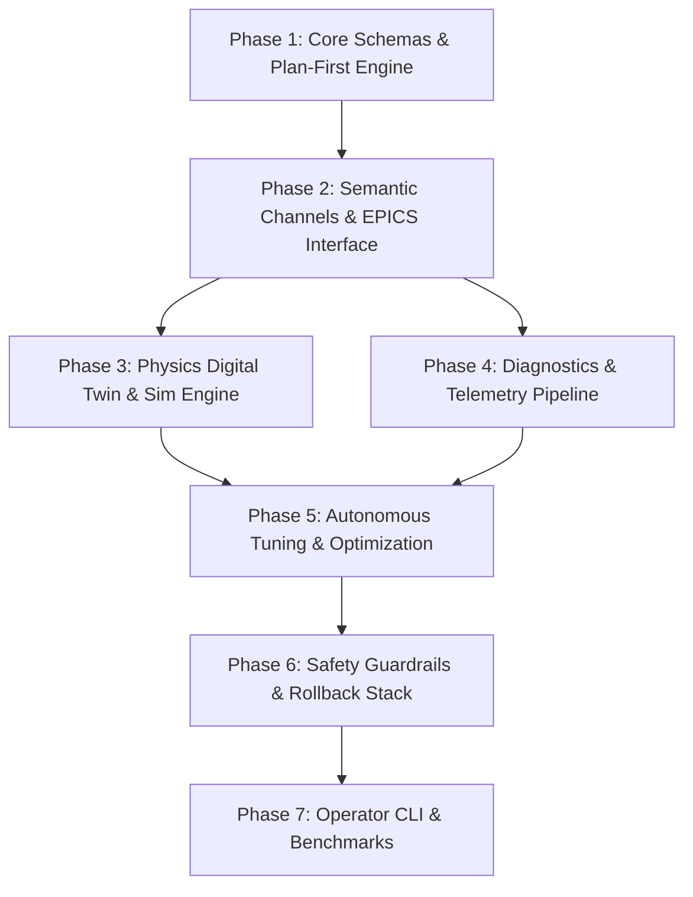

# Execution Plan / Change Record: 00001

- **Title**: Bootstrap Framework, Adopt LBNL Osprey Architecture, Add MIT License, and Establish Development Task List
- **Status**: Completed
- **Date**: 2026-10-13
- **Author**: Chong Shik Park / HELIOS Team
- **Reference**: LBNL Osprey Framework

---

## 1. Objectives

1. Add the official MIT license to the repository.
2. Formally integrate Lawrence Berkeley National Laboratory's (LBNL) **Osprey** framework as the reference architecture for HELIOS.
3. Establish the **Plan-First** execution tracking directory structure (`docs/exec-plans/active/` and `docs/exec-plans/completed/`).
4. Establish a comprehensive, phased master development roadmap for the HELIOS autonomous heavy ion linac orchestration framework.

---

## 2. Changes Implemented

### 2.1 MIT License
- Created `LICENSE` granting open-source permissions under the standard MIT license terms.

### 2.2 Osprey Reference Integration
- Updated `README.md` to highlight LBNL Osprey's core design tenets:
  - Plan-first execution protocol.
  - Dynamic capability classification for prompt and context optimization.
  - Semantic channel resolution for heavy ion linac control.
  - Deterministic guardrails, rollback stacks, and reproducible artifact provenance.
- Updated `AGENTS.md` with Section 6 detailing the Plan-First Execution Model aligned with Osprey.

### 2.3 Execution Plan & Tracking System
- Created `docs/exec-plans/README.md` outlining the execution plan lifecycle and git commit conventions.
- Established `docs/exec-plans/active/` for currently ongoing plans.
- Established `docs/exec-plans/completed/` for finalized change logs and post-execution summaries with 5-digit numerical prefixes.

### 2.4 Development Task List
- Created `docs/exec-plans/active/00001_development_tasklist.md` detailing the 7-phase implementation roadmap:
  - **Phase 1**: Core Schemas & Plan-First Orchestration Engine
  - **Phase 2**: Semantic Channel Resolution & Control System Interface (EPICS CA/PVA)
  - **Phase 3**: Accelerator Physics Digital Twin & Simulation Engine (TraceWin, IMPACT-Z, Surrogates)
  - **Phase 4**: Diagnostics, Telemetry & Anomaly Detection Pipeline
  - **Phase 5**: Autonomous Tuning & Optimization Workflows (BO, ESC, SVD, RL)
  - **Phase 6**: Safety Guardrails, Rollback Stack & Graduated Autonomy (HITL)
  - **Phase 7**: Operator CLI, Benchmarking & Commissioning Demos

---

## 3. Files Modified / Created

- `A  LICENSE`
- `M  README.md`
- `M  AGENTS.md`
- `A  docs/exec-plans/README.md`
- `A  docs/exec-plans/active/00001_development_tasklist.md`
- `A  docs/exec-plans/completed/00001_bootstrap_and_development_tasklist.md`

---

## 4. Completed Phases 1 to 7 Execution Roadmap

# HELIOS Development Task List & Roadmap

- **Status**: Active
- **Reference Architecture**: LBNL Osprey Framework
- **Domain**: Heavy Ion Linear Accelerators (LEBT, RFQ, MEBT, SCL, HEBT)
- **Last Updated**: 2026-10-13

---

## 🎯 Development Roadmap Overview

The HELIOS framework development is partitioned into seven iterative phases following LBNL Osprey's **Plan-First** orchestration paradigm, semantic channel mapping, dynamic capability classification, and rigorous safety-by-design principles.

---

## Phase 1: Core Foundation & Plan-First Orchestration Engine

- [x] **1.1 Project Scaffolding & Packaging**
  - [x] Set up `pyproject.toml` with modern build backend (setuptools/wheel).
  - [x] Configure core dependencies (`pydantic>=2.5`, `numpy`, `scipy`, `pyyaml`, `rich`, `typer`).
  - [x] Set up development tooling (pytest, pytest-asyncio, pytest-cov).
- [x] **1.2 Data Schemas & State Models**
  - [x] Define `ExecutionPlan`, `PlanStep`, `PlanState`, and `ValidationResult` Pydantic models.
  - [x] Define `MachineState`, `SetpointBatch`, `TelemetrySnapshot`, and `AnomalyReport` schemas.
- [x] **1.3 Plan-First Orchestrator Engine**
  - [x] Implement plan lifecycle manager (`DRAFT` → `SIMULATION_VERIFIED` → `SAFETY_APPROVED` → `EXECUTING` → `COMPLETED` / `ROLLED_BACK`).
  - [x] Implement Plan artifact serializer and file-based state tracker (`docs/exec-plans/active/` and `completed/`).
- [x] **1.4 Dynamic Capability Classifier**
  - [x] Build intent-based tool/capability dispatcher (Osprey pattern) to keep LLM context compact.
  - [x] Implement capability registries for agents.

---

## Phase 2: Semantic Channel Resolution & Control System Interface

- [x] **2.1 Semantic Channel Mapping**
  - [x] Define heavy ion linac device hierarchy (Ion Source, LEBT, RFQ, MEBT, SCL QWR/HWR, HEBT).
  - [x] Implement semantic alias resolution (e.g. `"MEBT Quad 01 gradient"` → `MEBT:QD01:BField_Set`).
  - [x] Support YAML/JSON linac lattice channel configuration files.
- [x] **2.2 EPICS CA / PVA Interface Layer**
  - [x] Implement unified `EPICSInterface` with asynchronous `caget`, `caput`, and PV monitoring.
  - [x] Build readback verification (`caget` confirmation after `caput` with tolerance and timeout).
  - [x] Implement slew-rate limiter and rate-of-change clamping to protect hardware.
- [x] **2.3 Mock / Virtual EPICS Environment**
  - [x] Implement `MockControlInterface` for offline development, automated tests, and simulation bridging.

---

## Phase 3: Accelerator Physics, Simulation & Digital Twin Engine

- [x] **3.1 Lattice Model & Physics Abstraction**
  - [x] Define linac beamline elements (Solenoid, Quadrupole, Dipole, RF Cavity, Drift, BPM, BLM).
  - [x] Implement lattice importer/exporter (TraceWin `.dat`, IMPACT-Z input, Elegant `.lte`).
- [x] **3.2 Beam Dynamics Simulator Wrappers**
  - [x] Create standardized wrapper interface `BeamDynamicsEngine`.
  - [x] Implement TraceWin wrapper (envelope tracking and multi-particle runs).
  - [x] Implement IMPACT-Z wrapper for 3D space-charge intensive sections.
- [x] **3.3 Fast Neural Surrogate Engine**
  - [x] Define surrogate model inference pipeline (ONNX / PyTorch / Analytic) for sub-second envelope & loss prediction.
  - [x] Pre-flight physics verification tool for proposed setpoints.

---

## Phase 4: Diagnostics, Telemetry & Anomaly Detection

- [x] **4.1 Telemetry Pipeline**
  - [x] Real-time BPM signal ingestion (RMS orbit distortion, beam phase, energy calculation).
  - [x] BLM loss profile aggregator and beam transmission calculator.
  - [x] Wire scanner / emittance reconstruction utilities.
- [x] **4.2 Data Archiver Bridge**
  - [x] EPICS Archiver Appliance query client / mock.
  - [x] Telemetry snapshot recorder (JSON / provenance).
- [x] **4.3 Anomaly & Fault Detection**
  - [x] RF cavity trip detector and phase jump monitor.
  - [x] Vacuum degradation and steerer current drift monitors.

---

## Phase 5: Autonomous Tuning & Optimization Engine

- [x] **5.1 Algorithm Suite**
  - [x] Singular Value Decomposition (SVD) and response-matrix orbit correction.
  - [x] Multi-objective Bayesian Optimization (surrogate-assisted exploration).
  - [x] Extremum Seeking Control (ESC) for real-time beam transmission maximization.
- [x] **5.2 Standard Linac Commissioning Workflows**
  - [x] MEBT / SCL trajectory and orbit correction workflow.
  - [x] Transverse envelope matching across matching sections.
  - [x] RF cavity phase and amplitude calibration scan workflow (Time-of-Flight).

---

## Phase 6: Safety Guardrails, Rollback Stack & Graduated Autonomy

- [x] **6.1 Deterministic Safety Gatekeeper**
  - [x] Hard software boundary enforcement (min/max current, max power, temperature limits).
  - [x] Machine Protection System (MPS) interlock state verifier.
- [x] **6.2 Instant Rollback Controller**
  - [x] Rollback snapshot stack: automatic capture of pre-action setpoints.
  - [x] Atomic rollback trigger upon beam loss trip or operator abort.
- [x] **6.3 Graduated Autonomy Policy Engine**
  - [x] Implement Autonomy Levels (0: Advisory, 1: Assisted, 2: Supervised, 3: Bounded Auto, 4: Fully Auto).
  - [x] Interactive human operator sign-off gates.

---

## Phase 7: Operator CLI, Interactive Console & Benchmarks

- [x] **7.1 Command Line & Interactive Console**
  - [x] Rich/Typer-based CLI for orchestrator launch, plan inspection, and execution monitoring.
  - [x] Human-in-the-loop interactive review prompt.
- [x] **7.2 End-to-End Simulation Benchmarks**
  - [x] Closed-loop MEBT steering benchmark on virtual linac.
  - [x] SCL RF phase scan and fault recovery benchmark.
- [x] **7.3 Documentation & Tutorials**
  - [x] Developer guide and API reference.
  - [x] Quickstart tutorial using mock linac simulation.
