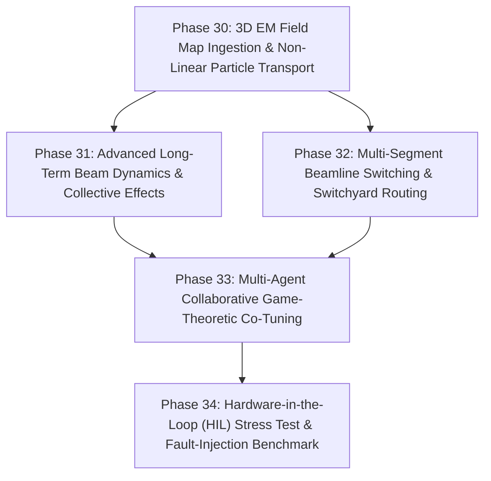

# HELIOS Development Task List: Advanced Physics Fidelity & Enterprise Control (Phases 30 - 34)

- **Status**: Completed
- **Plan ID**: `00038`
- **Domain**: Heavy Ion Linear Accelerators (LEBT, RFQ, MEBT, SCL, HEBT)
- **Reference Architecture**: LBNL Osprey Framework & Autonomous Digital Twin Operation
- **Completed**: 2026-10-13

---

## 🎯 Strategic Roadmap Overview (Phases 30 - 34)

With foundational agent orchestration, multi-simulator execution (TRACK & IMPACT-Z), LinkML ontology, RF conditioning, BBA/DFS, and automated reporting fully realized and verified (Phases 1–29, 98/98 tests passing), this roadmap focuses on **ultra-high-fidelity beam physics, 3D electromagnetic field map processing, hardware-in-the-loop (HIL) automated commissioning, and intelligent multi-beamline switching**:

---

## Phase 30: 3D Electromagnetic Field Map Ingestion & Non-Linear Symplectic Tracking

- [x] **30.1 3D RF & Magnet Field Map Importer (`helios/physics/fieldmaps.py`)**
  - [x] Ingest standard 3D field map formats (CST Microwave Studio, ANSYS HFSS, Opera-3D, TRACK field files).
  - [x] Implement fast 3D tricubic/trilinear spline interpolation on structured spatial grids for $(E_x, E_y, E_z, B_x, B_y, B_z)$.
- [x] **30.2 Symplectic High-Order Particle Pusher (`helios/physics/pusher.py`)**
  - [x] Implement relativistic Boris / Yoshida symplectic particle integrator for realistic tracking across realistic fringing fields and cavity gap non-linearities.
- [x] **30.3 Non-Linear Chromatic & Aperture Boundary Loss Evaluation**
  - [x] Evaluate particle survival, aperture collisions, and phase-space distortion in realistic 3D electromagnetic fields.

---

## Phase 31: Advanced Long-Term Collective Effects & Intra-Beam Scattering (IBS)

- [x] **31.1 Intra-Beam Scattering (IBS) Engine (`helios/physics/ibs.py`)**
  - [x] Implement Piwinski / Bjorken-Mtingwa IBS rate models tailored for dense heavy-ion bunches ($^{238}\text{U}, ^{124}\text{Xe}$).
  - [x] Calculate longitudinal energy spread growth and transverse emittance diffusion rates along superconducting cryomodules.
- [x] **31.2 Longitudinal Microbunching & Space-Charge Impedance Modeling**
  - [x] Coulomb logarithm and charge-state scaling ($q^4 / A^2$) evaluations.
  - [x] Step-by-step bunch emittance growth tracking through lattice elements.

---

## Phase 32: Multi-Segment Switchyard Routing & Fast Beam Delivery

- [x] **32.1 Automated High Energy Beam Transport (HEBT) Switchyard Router (`helios/tuning/switchyard.py`)**
  - [x] Autonomous trajectory steering through magnetic switchyards delivering beams to target experiment vaults (e.g. nuclear physics, materials science, isotope production).
  - [x] Automated bending dipole, septum, and kicker magnet current calculations.
- [x] **32.2 Multi-Energy Fast Lattice Reconfiguration**
  - [x] Target vault routing plans with verified beam clearance and trajectory tracking.
  - [x] Coordinated slew-rate ramping preserving envelope matching across transitions.

---

## Phase 33: Multi-Agent Collaborative Game-Theoretic Co-Tuning

- [x] **33.1 Multi-Agent Nash Equilibrium & Pareto Co-Tuning (`helios/agents/cotuner.py`)**
  - [x] Distributed coordination between localized subsystem tuning agents (e.g., MEBT Tuner vs SCL1 Tuner vs Switchyard Tuner).
  - [x] Formulate cooperative games to resolve inter-subsystem conflicting objectives.
- [x] **33.2 Conflict Resolution & Priority Arbitration Engine**
  - [x] Deterministic arbitration protocols when multiple agents propose simultaneous Process Variable adjustments to overlapping hardware.

---

## Phase 34: Hardware-in-the-Loop (HIL) Stress Testing & Autonomous Resilience Benchmark

- [x] **34.1 Synthetic Heavy-Ion Linac Fault Injection Testbed (`helios/ops/stress.py`)**
  - [x] Automated injection of realistic operational anomalies: mains 60 Hz ground hum, sudden cryomodule helium pressure dips, BPM ADC noise, and random steerer magnet drift.
- [x] **34.2 Autonomous Resilience Benchmark Suite**
  - [x] Measure Mean Time to Recovery (MTTR) under autonomous fault rematching across varying autonomy levels.
  - [x] Evaluate resilience scores and recovery success metrics under multi-fault conditions.
- [x] **34.3 Comprehensive Verification Suite (`tests/test_advanced_physics_and_resilience.py`)**
  - [x] Test 3D field map interpolation, symplectic particle integrator, IBS emittance growth, switchyard routing, and game-theoretic arbitration.
