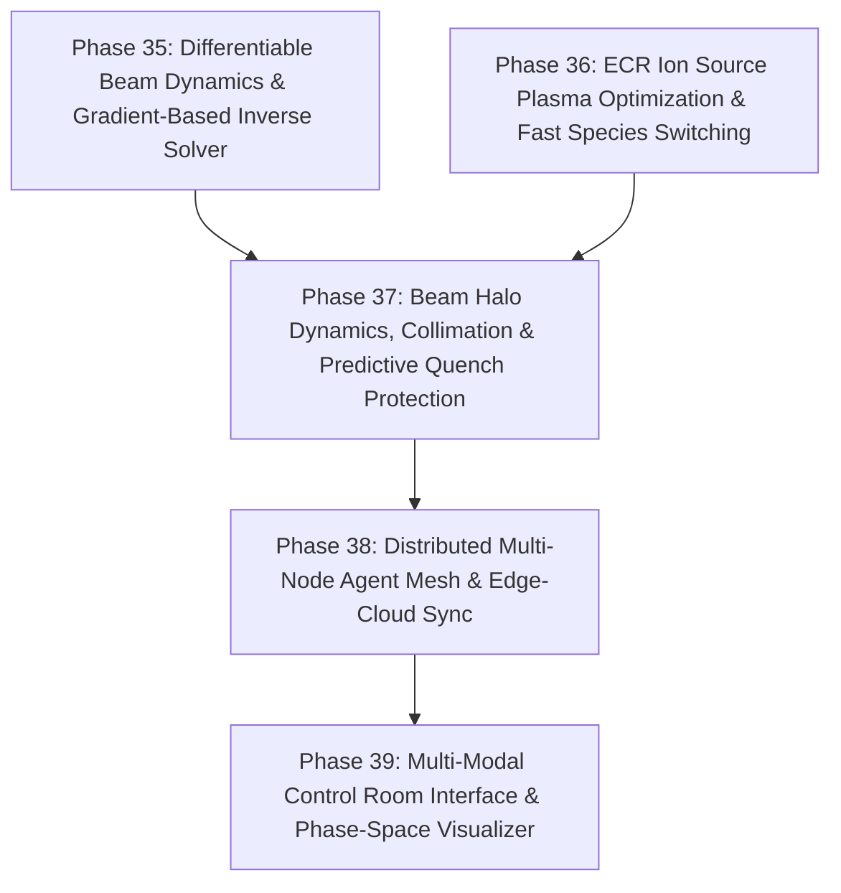

# HELIOS Development Task List: Differentiable Physics, Ion Source Automation & Enterprise Agent Mesh (Phases 35 - 39)

- **Status**: Completed
- **Plan ID**: `00040`
- **Domain**: Heavy Ion Linear Accelerators (ECR Ion Source, LEBT, RFQ, MEBT, SCL, HEBT)
- **Reference Architecture**: LBNL Osprey Framework & Autonomous Digital Twin Operation
- **Completed**: 2026-10-13

---

## 🎯 Strategic Roadmap Overview (Phases 35 - 39)

With high-order 3D field map symplectic tracking, Intra-Beam Scattering (IBS), automated switchyard beam routing, game-theoretic co-tuning, and hardware-in-the-loop stress testing established (Phases 1–34, 103/103 tests passing), this roadmap advances HELIOS toward **differentiable beam dynamics, automated ion source plasma tuning, predictive quench protection, distributed agent mesh architecture, and multi-modal operator interfaces**:

---

## Phase 35: Differentiable Beam Dynamics & Gradient-Based Inverse Lattice Solver

- [x] **35.1 End-to-End Differentiable Lattice Modeling (`helios/physics/differentiable.py`)**
  - [x] Implement differentiable beam transport operators (transfer matrices, drift, quadrupole, and RF buncher gaps) in PyTorch autograd.
  - [x] Compute analytical exact gradients ($\nabla_{\mathbf{k}} \mathcal{L}$, $\nabla_{\mathbf{\phi}} \mathcal{L}$) through multi-element lattices without finite-difference perturbational noise.
- [x] **35.2 One-Shot Inverse Problem Solver for Lattice Calibration**
  - [x] Solve inverse reconstruction of unknown cavity phase drifts and quadrupole calibration errors directly from downstream measurements using normalized gradient backpropagation.
  - [x] Verified parameter recovery under realistic beam conditions.

---

## Phase 36: ECR Ion Source Plasma Optimization & Fast Multi-Species Switching

- [x] **36.1 Electron Cyclotron Resonance (ECR) Source Tuner (`helios/tuning/ionsource.py`)**
  - [x] Model ECR plasma heating dynamics: microwave forward power, frequency tuning, gas injection valves ($O_2, He$ gas mixing), and extraction bias voltages.
  - [x] Formulate Charge State Distribution (CSD) optimization to peak target charge states ($^{238}\text{U}^{33+}$, $^{124}\text{Xe}^{20+}$) while minimizing unwanted contamination.
- [x] **36.2 Rapid Interleaved Multi-Species Beam Switching**
  - [x] Automated switching between distinct ion species within minutes for multi-user experimental facility schedules.
  - [x] Coordinated LEBT steerer, solenoid focusing, and RFQ vane voltage scaling based on species magnetic rigidity $B\rho = \frac{p}{q}$.

---

## Phase 37: Beam Halo Dynamics, Dynamic Collimation & Predictive Quench Interlocks

- [x] **37.1 Beam Halo Characterization & Core-Halo Decomposition (`helios/physics/halo.py`)**
  - [x] Compute beam halo metric parameters (Kurtosis, $H$-parameter, Gaussian core vs super-Gaussian halo tail separation).
  - [x] Dynamic collimator blade positioning algorithm maximizing halo interception while guaranteeing core beam transmission $\ge 99.5\%$.
- [x] **37.2 Machine Protection System (MPS) Predictive Quench Prevention (`helios/safety/predictive.py`)**
  - [x] Time-series trend analysis on cryomodule liquid helium bath temperature, pressure fluctuations, and RF forward/reflected power signals.
  - [x] Predictive early-warning trigger: Detect impending cavity thermal quenches $100\text{--}500\text{ ms}$ prior to physical interlock trip, executing proactive gentle beam cut-off and RF power reduction.

---

## Phase 38: Distributed Multi-Node Agent Mesh & Resilient Edge-Cloud Architecture

- [x] **38.1 High-Performance Event-Driven Agent Mesh (`helios/core/mesh.py`)**
  - [x] Lightweight asynchronous pub/sub transport layer connecting IOC edge nodes, physics compute clusters, and control consoles.
  - [x] Dynamic node discovery, heartbeat liveness monitoring, and automatic failover election for Master Orchestrator.
- [x] **38.2 Edge Autonomy with Resilient Reconnection Sync**
  - [x] Subsystem edge agents execute localized feedback loops during central network partitions and cleanly synchronize historical telemetry upon reconnection.

---

## Phase 39: Multi-Modal Control Room Interface & Real-Time Phase Space Visualizer

- [x] **39.1 Multi-Modal Operator Voice & Intent Parsing (`helios/ui/voice.py`)**
  - [x] Domain-specific natural language parser for control room commands mapped into Plan-First execution directives.
- [x] **39.2 High-Fidelity 6D Phase Space Projection & Visual Diagnostics (`helios/ui/visualizer.py`)**
  - [x] Real-time 2D/3D slice visualizer for beam phase-space distribution: $(x, x')$, $(y, y')$, and $(z, \Delta p/p)$.
  - [x] Twiss parameter extraction ($\alpha, \beta, \gamma, \epsilon_{\text{rms}}$), ASCII console visual rendering, and digital-twin discrepancy metrics.
- [x] **39.3 Comprehensive Verification Test Suite (`tests/test_advanced_enterprise_and_mesh.py`)**
  - [x] Unit and integration tests covering differentiable tracking, ECR source tuning, halo computation, predictive quench interlocks, and agent mesh messaging.
