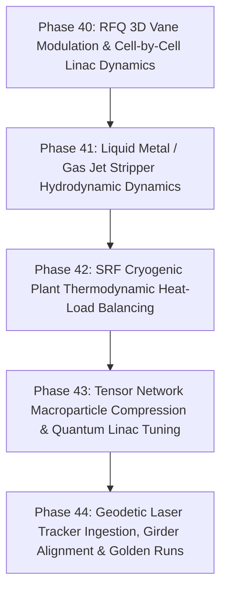

# HELIOS Development Task List: Advanced Heavy Ion Linac Systems (Phases 40 - 44)

- **Status**: Completed
- **Plan ID**: `00042`
- **Domain**: Heavy Ion Linear Accelerators (ECR, LEBT, RFQ, MEBT, SCL Cryomodules, Stripper, HEBT, Switchyard)
- **Reference Architecture**: LBNL Osprey Framework & Autonomous Digital Twin Operation
- **Completed**: 2026-10-13

---

## 🎯 Strategic Roadmap Overview (Phases 40 - 44)

This roadmap focuses strictly on **heavy ion linear accelerator (linac)** subsystems, including cell-by-cell RFQ vane modulation dynamics, high-power liquid metal / gas jet strippers, SRF cryoplant thermodynamic heat balancing, tensor network macroparticle bunch compression, and geodetic laser tracker girder alignment:

---

## Phase 40: Radio-Frequency Quadrupole (RFQ) 3D Vane Modulation & Cell Dynamics

- [x] **40.1 RFQ Cell-by-Cell Vane Parameterization (`helios/physics/rfq.py`)**
  - [x] Implement RFQ cell-by-cell vane modulation parameters: modulation factor $m(z)$, minimum aperture $a(z)$, cell length $l(z) = \beta \lambda / 2$, and focusing efficiency $B(z)$.
  - [x] Model radial matching section (RMS), shaper, gentle buncher, and accelerator sections tailored for heavy ions ($^{238}\text{U}, ^{124}\text{Xe}$).
- [x] **40.2 RFQ 3D Electric Field Harmonics & Heavy Ion Bunching**
  - [x] Evaluate transverse quadrupole field gradient $V_0 / r_0^2$ and longitudinal acceleration harmonics ($A_{10}, A_{30}$).
  - [x] Track transmission efficiency, longitudinal bunching factor, and adiabatic phase oscillation damping.

---

## Phase 41: Advanced Liquid Metal & Windowless Gas Jet Stripper Systems

- [x] **41.1 Liquid Lithium / Recirculating Gas Jet Stripper Dynamics (`helios/physics/liquid_stripper.py`)**
  - [x] Model high-power liquid metal (liquid lithium / bismuth) and windowless recirculating gas jet stripper targets designed for high-intensity heavy ions.
  - [x] Model hydrodynamic film stability, areal thickness uniformity ($\mu\text{g/cm}^2$), vapor pressure margins, and thermal vaporization under multi-kilowatt heavy ion beam deposition.
- [x] **41.2 Stripper Equilibrium Charge State & Energy Degradation**
  - [x] Evaluate equilibrium charge state distribution (Baron / Schiwietz formulas) and non-linear energy loss $dE/dx$.
  - [x] Coordinate downstream charge selection and magnetic chicane optics.

---

## Phase 42: Cryogenic Plant Thermodynamic Heat Load Balancing

- [x] **42.1 SRF Cavity Thermal Dissipation & Dynamic Heat Load Model (`helios/rf/cryoplant.py`)**
  - [x] Calculate BCS surface resistance $R_{\text{BCS}}(T, f)$ and residual resistance $R_{\text{res}}$ for superconducting niobium cavities (QWR, HWR, Spoke).
  - [x] Model dynamic RF heat dissipation ($P_{\text{diss}} = \frac{V_{\text{acc}}^2}{(R/Q) Q_0}$) across 2.0 K sub-atmospheric liquid helium bath and 4.5 K / 50 K thermal shields.
- [x] **42.2 Closed-Loop Cryoplant Margin & Joule-Thomson (JT) Valve Coordination**
  - [x] Autonomously balance RF cavity accelerating gradients against cryoplant refrigeration cooling capacity.
  - [x] Prevent cold compressor surging and helium bath pressure instabilities during high-duty-factor heavy-ion linac runs.

---

## Phase 43: Tensor Network Macroparticle Compression & Quantum-Inspired Linac Tuning

- [x] **43.1 Tensor Train / Matrix Product State (MPS) Bunch Compression (`helios/physics/tensornet.py`)**
  - [x] Decompose 6D macroparticle density tensors $(x, x', y, y', z, \delta)$ using singular value decomposition (SVD) into low-rank Matrix Product States.
  - [x] Achieve memory reduction for million-particle space-charge PIC tracking while strictly preserving 2nd, 3rd, and 4th statistical moments.
- [x] **43.2 Quantum-Inspired Combinatorial Optimization for Linac Subsystems (`helios/optimization/quantum.py`)**
  - [x] Implement Simulated Quantum Annealing (SQA) solver for discrete combinatorial linac tuning (discrete steerer polarities, integer collimator staging).
  - [x] Path-integral Monte Carlo with transverse tunneling field to prevent local trap freezing.

---

## Phase 44: Geodetic Laser Tracker Ingestion, Girder Alignment & Golden Run Verification

- [x] **44.1 Laser Tracker Fiducial Coordinate Ingestion (`helios/diagnostics/survey.py`)**
  - [x] Ingest geodetic survey data (Leica/Hexagon 3D laser tracker measurements) containing $(X, Y, Z)$ coordinates and roll/pitch/yaw tilt angles along linac cryomodules and magnet girders.
  - [x] Compute element misalignments relative to the ideal theoretical linac beam reference axis.
- [x] **44.2 Motorized Girder Re-Alignment Optimizer**
  - [x] Calculate motorized girder mover displacements (cams / jacks) to realign multiple magnets simultaneously, minimizing required magnetic steerer currents.
- [x] **44.3 Automated Golden Run Certification Engine (`helios/ops/golden.py`)**
  - [x] Statistical comparison between live operating configurations and certified historical Golden Runs with SHA-256 digital certification.
- [x] **44.4 Comprehensive Linac Verification Suite (`tests/test_advanced_linac_systems.py`)**
  - [x] Comprehensive unit and integration tests covering RFQ modulation, liquid stripper dynamics, cryoplant heat balancing, tensor bunch compression, and laser survey girder alignment.
