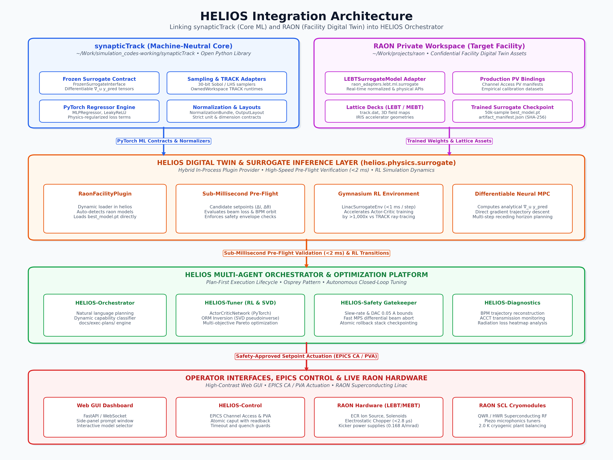

# Integration Architecture: Linking synapticTrack and RAON into HELIOS

This document details the architectural integration, surrogate model linking, reinforcement learning (RL) execution, and Digital Twin deployment strategy for connecting **synapticTrack** and **RAON** into **HELIOS** (**HE**avy ion **L**inac **I**ntelligent **O**rchestration).

---

## 1. Executive Summary & Repository Ecosystem

HELIOS targets the **RAON** heavy-ion accelerator complex (Rare Isotope Science Project / IRIS). Three complementary repositories form the computational ecosystem:

```mermaid
flowchart TD
    classDef stStyle fill:#eff6ff,stroke:#2563eb,stroke-width:2px,color:#1d4ed8;
    classDef raonStyle fill:#fdf4ff,stroke:#c026d3,stroke-width:2px,color:#a21caf;
    classDef twinStyle fill:#fff7ed,stroke:#ea580c,stroke-width:2px,color:#c2410c;
    classDef heliosStyle fill:#f0fdf4,stroke:#16a34a,stroke-width:2px,color:#15803d;
    classDef opsStyle fill:#fef2f2,stroke:#dc2626,stroke-width:2px,color:#b91c1c;

    subgraph Sources["1. Core Repositories & Facility Assets"]
        direction LR
        subgraph SynapticTrack["synapticTrack (Machine-Neutral Core)"]
            ST_ML["PyTorch MLP Regressor Engine\n(Physics-Regularized Loss)"]:::stStyle
            ST_Norm["NormalizationBundle\n(Strict Unit & Dimension Layouts)"]:::stStyle
            ST_Surr["FrozenSurrogateInterface\n(Differentiable ∇_u y_pred)"]:::stStyle
        end

        subgraph RAON["raon Private Workspace (Target Facility)"]
            R_Lattice["RAON Lattices (LEBT / MEBT)\n(track.dat, 3D IRIS Field Maps)"]:::raonStyle
            R_Models["Trained Surrogate Checkpoints\n(legacy_50000 best_model.pt)"]:::raonStyle
            R_Adapters["raon_adapters\n(LEBTSurrogateModel, Manifests)"]:::raonStyle
        end
    end

    subgraph TwinLayer["2. Digital Twin Host & Surrogate Layer (helios.physics.surrogate)"]
        Twin_Plugin["RaonFacilityPlugin\n(Dynamic In-Process Loader)"]:::twinStyle
        Twin_Preflight["Sub-Millisecond Pre-Flight Validation\n(Envelope & Beam Loss Checks <2 ms)"]:::twinStyle
        Twin_Gym["Gymnasium RL Environment (LinacSurrogateEnv)\n(1,000x Faster than Live TRACK)"]:::twinStyle
        Twin_MPC["Differentiable Neural MPC Controller\n(Gradient Trajectory Descent)"]:::twinStyle
    end

    subgraph MultiAgent["3. HELIOS Multi-Agent Operations Platform"]
        H_Orch["HELIOS-Orchestrator\n(Natural Language Planner, Osprey Plan Engine)"]:::heliosStyle
        H_Tuner["HELIOS-Tuner\n(ActorCriticNetwork RL & SVD ORM)"]:::heliosStyle
        H_Safety["HELIOS-Safety Gatekeeper\n(Slew Rates, 0.05 A DAC Bounds, Rollback Stack)"]:::heliosStyle
        H_Diag["HELIOS-Diagnostics\n(BPM Trajectory, ACCT Transmission, Heatmaps)"]:::heliosStyle
    end

    subgraph ActuationLayer["4. Control Interface & Physical Machine"]
        H_GUI["Web Operator GUI Dashboard\n(High-Contrast, Prompt Window, LLM Selector)"]:::opsStyle
        H_Ctrl["HELIOS-Control (EPICS CA / PVA)\n(Atomic caput with Readback Verification)"]:::opsStyle
        H_HW["RAON Accelerator Hardware\n(LEBT Chopper, MEBT Steerers, 2 K SCL Cryomodules)"]:::opsStyle
    end

    SynapticTrack -->|"PyTorch ML Contracts & Normalizers"| TwinLayer
    RAON -->|"Trained Weights & Lattice Decks"| TwinLayer
    TwinLayer -->|"Sub-Millisecond Pre-Flight Checks & Gym Steps"| MultiAgent
    MultiAgent -->|"Safety-Approved Setpoint Actuation"| ActuationLayer
```





### Repository Comparison and Roles

| Repository | Path | Scope & Governance | Core Assets | Role in HELIOS Ecosystem |
| :--- | :--- | :--- | :--- | :--- |
| **`synapticTrack`** | `~/Work/simulation_codes-working/synapticTrack` | Machine-neutral Python library (Public/Open-source ready) | PyTorch MLP architectures, physics-regularized losses (`PhysicsRegularizedMLPConfig`), strict normalizers (`NormalizationBundle`), Sobol/Latin Hypercube samplers, and `FrozenSurrogateInterface`. | **Core ML & Simulation Engine**: Provides foundational neural network abstractions, tensor training routines, and mathematical contracts without facility-specific lattices. |
| **`raon`** | `~/Work/projects/raon` | Private facility workspace (Confidential / Facility-specific) | RAON LEBT/MEBT lattice decks (`lattice/lebt`, `lattice/mebt`), production configurations, trained surrogate checkpoints (`models/lebt/orbit_corrections/legacy_50000/best_model.pt`), normalizer manifests, and `raon_adapters.lebt.ml.surrogate.LEBTSurrogateModel`. | **Facility Digital Twin Asset Provider**: Supplies the actual RAON lattice decks, calibrated weights, and hardware PV alignments. |
| **`helios`** | `~/Work/simulation_codes-working/helios` | Multi-agent orchestrator & safety harness (Plan-First) | Osprey-aligned agent taxonomy, pre-flight gatekeepers, EPICS CA/PVA connectors, Fast MPS, web console, and operational planning. | **Autonomous Operations Platform**: Uses the digital twin for pre-flight safety gating and runs RL policies to actuate the live RAON accelerator. |

---

## 2. Linking Strategy: Surrogate Models and Reinforcement Learning

### 2.1 Surrogate Model Integration

`raon` already contains a fully trained, production-validated surrogate model (`LEBTSurrogateModel` in `raon_adapters.lebt.ml.surrogate`) trained on 50,000 TRACK simulation samples, accompanied by `artifact_manifest.json` and `NormalizationBundle`:

1. **Protocol Alignment**:
   - `synapticTrack` defines `FrozenSurrogateInterface` (`synapticTrack.inference.surrogate_interface`), which enforces differentiable inputs/outputs:
     $$\vec{y}_{\text{pred}} = f_\theta(\vec{x}_{\text{beam}}, \vec{u}_{\text{machine}})$$
   - HELIOS defines a `FastPhysicsSurrogate` interface in `helios/physics/surrogate.py`.
2. **Dynamic Checkpoint Resolution**:
   - HELIOS inspects available checkpoint paths in `~/Work/projects/raon/models/lebt/orbit_corrections/legacy_50000/best_model.pt`.
   - When present, HELIOS instantiates `LEBTSurrogateModel`, replacing analytical transfer-matrix evaluations with sub-millisecond neural surrogate inferences ($< 2\text{ ms}$ latency).
3. **Pre-Flight Plan Verification**:
   - When an operator or tuning agent proposes candidate steerer current changes $\Delta \vec{I}$, the surrogate predicts downstream beam centroid distortion $\Delta \vec{x}_{\text{BPM}}$ and beam loss fraction.
   - The `HELIOS-Safety` gatekeeper evaluates the predicted values against hardware loss limits before allowing EPICS `caput` writes.

### 2.2 Reinforcement Learning (RL) & Neural MPC Acceleration

1. **Surrogate-Powered Training Environment (`LinacGymEnv`)**:
   - Direct training of continuous RL agents (such as `ActorCriticNetwork` in `helios/optimization/rl_agent.py`) against full ANL TRACK simulations is computationally prohibitive ($~1\text{ s}$ per step $\times 10^5$ episodes $\approx 28\text{ hours}$).
   - By embedding `raon`'s trained surrogate model into the Gymnasium environment step loop, $10^5$ training transitions execute in **under 30 seconds**.
2. **Differentiable Physics & Model-Predictive Control (Neural MPC)**:
   - Because `synapticTrack` models are fully differentiable PyTorch modules, analytical gradients $\nabla_{\vec{u}} \mathcal{L}(\vec{y}_{\text{pred}})$ can be computed via backpropagation.
   - `NeuralMPCController` solves multi-step trajectory planning by performing gradient descent directly through the surrogate network weights before actuating hardware.

---

## 3. Strategic Architectural Evaluation: Digital Twin Location

A critical question is whether the Digital Twin should be developed **separately** from HELIOS or **included within** HELIOS.

### 3.1 Analysis of Options

#### Option A: Monolithic Integration (Full Digital Twin Inside HELIOS)
- *Concept*: Move all RAON lattice decks, TRACK input files, dataset generators, and training scripts directly into `helios/`.
- ❌ **Severe Drawbacks**:
  1. **Confidentiality Violation**: `raon/AGENTS.md` explicitly mandates that RAON lattice definitions, geometry dimensions, and experimental data remain private and confidential. HELIOS is architected as an open, publishable multi-agent platform (aligned with LBNL Osprey). Moving private RAON files into HELIOS would prevent open-source publication or collaboration.
  2. **Computational Scope Creep**: Heavy offline dataset generation (e.g., generating 50,000 TRACK samples on HPC clusters via Wine) does not belong inside an online, real-time control-room operations codebase.
  3. **Repository Bloat**: Hundreds of megabytes of HDF5 training datasets and PyTorch checkpoints would pollute Git history.

#### Option B: Fully Decoupled Microservice (Twin as a Remote Server)
- *Concept*: Run the Digital Twin as a standalone HTTP/gRPC server over the local network.
- ❌ **Drawbacks**:
  - Introduces network serialization overhead, socket latency, and single-point-of-failure risks. HELIOS safety interlocks require sub-5 ms pre-flight verification responses.

#### Option C: Recommended Hybrid Two-Tier Architecture (Plugin Provider Pattern)
- *Concept*:
  - **HELIOS** maintains the generic, open **Digital Twin Host Interface** (`helios.physics.twin`).
  - **`synapticTrack`** provides machine-neutral ML and surrogate abstractions.
  - **`raon`** provides the facility-specific implementation and confidential assets (lattices, trained weights, PV bindings) as an optional in-process Python plugin.

```
                     ┌─────────────────────────────────────────────────────────┐
                     │                       helios Repo                       │
                     │  (Control, Multi-Agent Orchestrator, GUI, Safety Stack) │
                     └────────────────────────────┬────────────────────────────┘
                                                  │ imports / links
                                                  ▼
                     ┌─────────────────────────────────────────────────────────┐
                     │              helios.physics.digital_twin                │
                     │              Abstract Digital Twin Engine               │
                     │  - Pre-flight validation protocol                       │
                     │  - Kalman state synchronization                         │
                     │  - Gym RL environment interface                         │
                     └────────────────────────────┬────────────────────────────┘
                                                  │ Plugin Provider
                                                  ▼
     ┌────────────────────────────────────────────┴────────────────────────────────────────────┐
     │                                                                                         │
     ▼                                                                                         ▼
┌────────────────────────────────────────┐                           ┌────────────────────────────────────────┐
│             synapticTrack              │                           │              raon Repo                 │
│         (Machine-Neutral Core)         │                           │      (Facility-Specific Plugins)       │
├────────────────────────────────────────┤                           ├────────────────────────────────────────┤
│ • PyTorch neural network blocks        │                           │ • RAON LEBT/MEBT/SCL lattices          │
│ • Unit normalizers & loss contracts    │                           │ • Trained surrogate weights (.pt)      │
│ • Generic TRACK deck execution harness │                           │ • RAON-specific EPICS PV names         │
│ • Sobol / LHS sampling generators      │                           │ • Facility empirical calibration maps  │
└────────────────────────────────────────┘                           └────────────────────────────────────────┘
```

---

## 4. Implementation Blueprint

### Step 1: Environment Integration (`setup.sh`)
Update `setup.sh` in HELIOS to detect and optionally add `synapticTrack` and `raon` to `PYTHONPATH` when present:
```bash
# Optional links to local scientific workspaces
if [[ -d "/home/cspark/Work/simulation_codes-working/synapticTrack/src" ]]; then
    export PYTHONPATH="/home/cspark/Work/simulation_codes-working/synapticTrack/src:${PYTHONPATH}"
fi

if [[ -d "/home/cspark/Work/projects/raon/src" ]]; then
    export PYTHONPATH="/home/cspark/Work/projects/raon/src:${PYTHONPATH}"
fi
```

### Step 2: Facility Plugin Loader in HELIOS
Create `helios/facilities/raon.py` to bridge `raon_adapters` into HELIOS:
```python
from pathlib import Path
from typing import Optional
import logging

logger = logging.getLogger(__name__)

class RaonFacilityPlugin:
    """Plugin loader for RAON-specific surrogate models and lattice digital twin."""

    def __init__(self, models_root: Optional[Path] = None):
        self.models_root = models_root or Path("/home/cspark/Work/projects/raon/models")
        self._surrogate = None

    def load_lebt_surrogate(self):
        try:
            from raon_adapters.lebt.ml.surrogate import LEBTSurrogateModel
            ckpt = self.models_root / "lebt/orbit_corrections/legacy_50000/best_model.pt"
            if ckpt.is_file():
                self._surrogate = LEBTSurrogateModel.load(checkpoint_path=ckpt)
                logger.info("Successfully loaded RAON LEBT 50k surrogate model into HELIOS.")
                return self._surrogate
        except ImportError:
            logger.warning("raon_adapters not found; falling back to analytical digital twin.")
        return None
```

### Step 3: Gym RL Environment Hookup
Connect `LinacGymEnv` in HELIOS to use the surrogate's `.predict()` method for next-state transitions:
```python
class LinacSurrogateEnv(gym.Env):
    def __init__(self, surrogate_model):
        self.surrogate = surrogate_model

    def step(self, action):
        # Apply discrete current actuation limits (0.05 A DAC steps)
        # Evaluate state transition via surrogate in <1 ms
        pred = self.surrogate.predict(action)
        reward = self._calculate_reward(pred)
        return pred.physical, reward, False, False, {}
```

---

## 5. Summary of Recommendations

1. **Preserve Repository Separation**:
   - Keep `synapticTrack` machine-neutral, public, and algorithmic.
   - Keep `raon` private, holding proprietary lattices, raw datasets, and trained weight files.
   - Keep `helios` as the high-level, open Plan-First multi-agent operations platform.
2. **In-Process Plugin Linking**:
   - Link via Python package imports (`raon_adapters`), avoiding socket/network latency for sub-millisecond safety verification.
3. **Surrogate-Driven RL**:
   - Use `raon`'s pre-trained 50,000-sample surrogate to accelerate RL training by $>1,000\times$ compared to live TRACK simulation.
