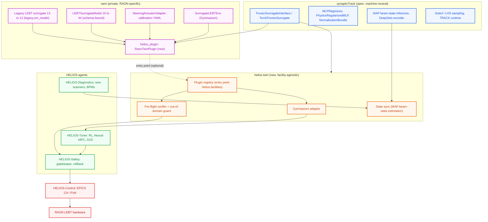
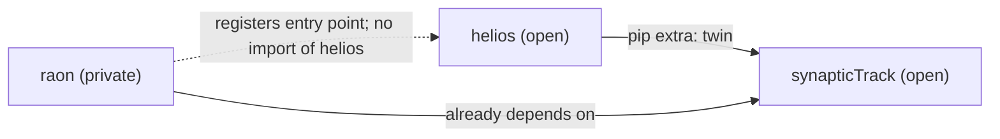
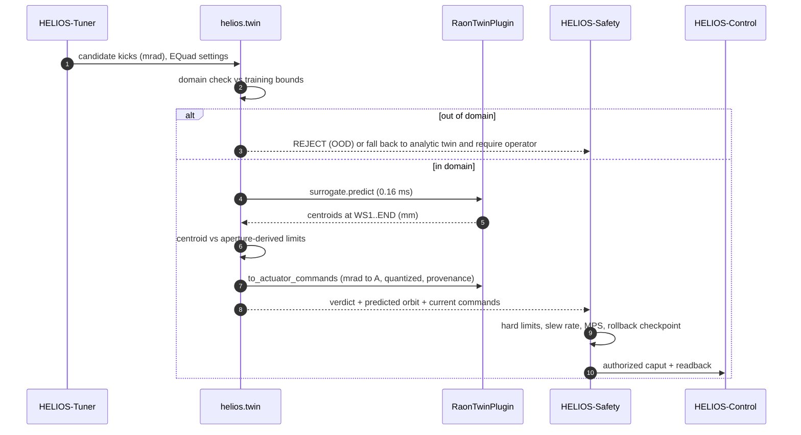

# Integration Architecture: Linking synapticTrack and RAON into HELIOS

This document covers how to link **synapticTrack** (machine-neutral beam-dynamics ML library) and **raon** (private RAON facility workspace) into **HELIOS** (**HE**avy ion **L**inac **I**ntelligent **O**rchestration) for surrogate modeling and reinforcement learning (RL), and recommends where the RAON Digital Twin should live. The target facility is **RAON** at the Institute for Rare Isotope Science (IRIS).

> **Revision note (2026-10-13).** This revision is based on a direct re-inspection of all three repositories and on measurements of the trained RAON surrogate run from the HELIOS Python environment. It corrects several statements in the previous revision (see [Section 9](#9-corrections-to-the-previous-revision)).

---

## 1. Executive Summary

**Recommendation: neither a fully separate Digital Twin nor a merged one.** Split the twin by *kind of code*:

| Twin layer | Where it lives | Why |
| :--- | :--- | :--- |
| **Twin framework**: facility-agnostic host, plugin registry, pre-flight verifier, Gymnasium wrapper, MPC hooks, state synchronization loop | **HELIOS** (new `helios.twin` package) | Online, safety-coupled, open/publishable; must be called in-process by the Safety gatekeeper |
| **ML and inference engine**: surrogate contracts, models, normalizers, MAP beam-state inference, samplers, TRACK runtime | **synapticTrack** (unchanged, used as a pip dependency) | Already machine-neutral and governed by its own `AGENTS.md` |
| **Twin content**: lattices, TRACK decks, datasets, training runs, checkpoints, calibrations, PV/channel maps, RAON plugin factory | **raon** (developed separately, stays private) | Confidential by policy; offline HPC lifecycle; independent release cadence |

Linking is **in-process**: HELIOS discovers an optional RAON plugin through a Python entry point. Nothing goes over the network, and HELIOS has no import-time dependency on raon. When raon is not installed (for example in public CI), HELIOS falls back to its analytic twin.

**Measured feasibility (HELIOS env: Python 3.11, torch 2.14.1+cpu):**

| Quantity | Result |
| :--- | :--- |
| Load RAON legacy LEBT surrogate (`legacy_50000/best_model.pt`) via `raon_adapters.legacy.sm_model.load_surrogate_checkpoint` | OK: `LEBTSurrogate`, 13 → 12, 120,332 parameters |
| Wrap in `synapticTrack.inference.TorchFrozenSurrogate` (physical units in/out) | OK |
| Single-sample inference latency (CPU) | **0.16 ms** |
| Batched inference (1024 samples, CPU) | **2.4 µs / sample** |
| Gradient ∂‖y‖²/∂u through the frozen surrogate | Finite (pre-requisite for Neural MPC) |
| `raon_adapters.legacy.rl_env.SurrogateLEBTEnv` step (obs 25, action 13) | **0.48 ms / step → 10⁵ steps ≈ 48 s** |
| Held-out test RMS error (n = 7,500), x/y centroids | 0.002 mm (WS1) to 0.11 mm (WS4) |

> [!WARNING]
> In a stock HELIOS environment, the cross-repo import currently **fails**: `pandas` and `periodictable` (synapticTrack runtime dependencies) are not installed, and `stable_baselines3` (the synapticTrack `rl` extra) is missing. The measurements above used an isolated scratch install of these packages. See [Section 5.1](#51-step-1--environment-and-packaging).

---

## 2. Architecture Overview




**Dependency direction (enforced):**



- `helios` → `synapticTrack`: optional extra, never mandatory.
- `raon` → `synapticTrack`: already declared in `raon/pyproject.toml` (`synapticTrack>=0.5.0`).
- `raon` does **not** import `helios`. The plugin returns synapticTrack types plus plain dataclasses and dictionaries, so raon has no dependency on HELIOS's release cycle.
- `helios` never imports `raon_adapters` by name. It only iterates the `helios.facilities` entry-point group.

---

## 3. What Each Repository Actually Provides

### 3.1 synapticTrack (`~/Work/simulation_codes-working/synapticTrack`)

Governance (`AGENTS.md`): machine-neutral, PyTorch-based, no machine names, lattice paths, or production defaults in public modules.

| Capability | Module | Use in HELIOS |
| :--- | :--- | :--- |
| Surrogate contract | `synapticTrack.inference.surrogate_interface`: `FrozenSurrogateInterface.predict(beam_state, machine_setting) -> SurrogatePrediction(diagnostics, state_outputs, aux)`; `TorchFrozenSurrogate` (frozen, differentiable); `MockLinearSurrogate` and `MockNonlinearSurrogate` | **The single surrogate type HELIOS consumes.** Mocks give HELIOS deterministic CI tests without raon. |
| Models | `synapticTrack.ml.models`: `MLPRegressor`, `PhysicsRegularizedMLP`, `PositiveDefiniteStateHead`, `build_surrogate_model` | Instantiated inside the raon plugin, not by HELIOS directly |
| Normalization | `synapticTrack.ml.normalization`: `Normalizer`, `NormalizationBundle`, `DifferentiableOutputTransform` | Keeps the physical-unit boundary differentiable |
| Beam-state inference | `synapticTrack.inference`: `refine_beam_state_map`, `MAPObjective`, `BeamStatePrior`, `ObservationSet`, `DeepSetsBeamStateEncoder` | **Twin synchronization**: estimate the incoming beam (Twiss, emittance) from wire-scanner and Allison-scanner data |
| Data generation | `synapticTrack.sampling` (Sobol, LHS), `synapticTrack.track` (workspace-isolated TRACK runs via Wine), `synapticTrack.simulation` | Offline only; stays outside HELIOS |
| Artifacts | `synapticTrack.ml.checkpoints`, `run_artifacts` (`artifact_manifest.json`), `artifact_loading` (strict JSON/YAML/CSV loaders) | Provenance recorded in HELIOS audit logs |
| RL extra | `pip install synapticTrack[rl]` → `gymnasium>=1.2.2`, `stable_baselines3>=2.8` | RL training backend |

Runtime dependencies: `torch>=2.13`, `numpy`, `scipy`, `matplotlib`, `pandas`, `h5py`, `PyYAML`, `typer`, `periodictable`, `jsonschema`. Requires Python ≥ 3.10.

### 3.2 raon (`~/Work/projects/raon`)

Governance (`AGENTS.md`): **confidential**. Do not add a public remote, publish packages, or commit datasets or trained models to Git. RAON integration tests stay in this repository.

| Asset | Location | Status |
| :--- | :--- | :--- |
| Lattices | `lattice/lebt/{track.dat, fi_in.dat}`, `lattice/mebt/{track.dat, sclinac.dat, fi_in.dat}` | Present |
| LEBT schema | `raon_adapters.lebt.schema`: 6 beam-optics inputs (`alpha/beta/emittance` x,y), 10 steerer kicks `SM0..4_H/V` [mrad], 3 EQuad families `alpha_0..2`; fixed orbit offsets and current (0.05, TRACK units); 6 diagnostics `WS1, AS, WS2, WS3, WS4, END` | Present |
| **Legacy LEBT surrogate** | `models/lebt/orbit_corrections/legacy_50000/best_model.pt` (untracked, local), factory id `raon_legacy_surrogate_v1`, 13 controls → 12 centroids [mm], trained on 50k LHS samples | **Only trained checkpoint on disk.** Loads only via `raon_adapters.legacy.sm_model.load_surrogate_checkpoint` |
| Schema-bound surrogate | `raon_adapters.lebt.ml.surrogate.LEBTSurrogateModel` and `load_surrogate(..., schema=...)`; config `configs/ml/lebt_no_offset_multitarget_44d.yaml` (19 → 44: 24 diagnostics + 2 × 10 state moments; 4 × 512 SiLU; 100k Sobol samples) | **Code and config only. No trained checkpoint is present.** |
| RL environment | `raon_adapters.legacy.rl_env.SurrogateLEBTEnv` / `make_env(checkpoint_path, ...)`: obs = 12 normalized errors + 13 normalized controls; action ∈ [−1, 1]¹³ increments; weighted-RMS reward; `rl_training.train_rl_orbit_corrector` (SB3) | Present, works with the legacy checkpoint |
| Hardware adapters | `raon_adapters.lebt.hardware`: `SteeringCalibrationSet` (default 0.168 A/mrad, quantized current steps), `SteeringActuatorAdapter.kicks_to_current_commands` (quantized plan with provenance, **no I/O**) | Present, maps the twin's mrad to supply amperes |
| Simulation backend protocol | `raon_adapters.lebt.interfaces.SimulationBackend.run(LEBTSimulationRequest) -> LEBTSimulationResult` | Present, TRACK-backed |
| MEBT | Lattice, Sobol production, nominal worker | **No trained surrogate** |

### 3.3 HELIOS (this repository)

| Existing component | Current state | Integration impact |
| :--- | :--- | :--- |
| `helios/physics/surrogate.py`: `FastPhysicsSurrogate` | Wraps the analytic MEBT twin; returns `loss_pct`, envelope, exit orbit | Becomes the **fallback** backend |
| `helios/models/surrogate.py`: `NeuralLinacSurrogate` | Untrained, randomly initialized PyTorch network with hard-coded `MEBT:*` PV keys and a dict API | Superseded by `FrozenSurrogateInterface`. Keep for demos only. |
| `helios/envs/linac_env.py`: `LinacGymEnv` | Analytic MEBT, 4 steerers, 4 BPMs | Remains the open demo environment |
| `helios/optimization/mpc.py`: `NeuralMPCController` | Bound to the `NeuralLinacSurrogate` dict API | Needs an adapter that accepts `FrozenSurrogateInterface` |
| `helios/optimization/rl_agent.py`: `LinacRLAgent` | In-house actor-critic | Can train on the RAON env through the Gymnasium API |
| `helios/physics/facilities.py`: `create_raon_scl1_lattice` | Representative SCL1 lattice | Different section from the trained surrogate (LEBT) |
| `helios/safety/gatekeeper.py`: `SafetyGatekeeper` | Limits, slew rate, MPS | Consumes pre-flight verdicts |
| `pyproject.toml` | `ml = ["torch>=2.0.0"]` | Needs a `twin` extra |

---

## 4. Digital Twin: Separate or Included?

### 4.1 Options considered

| Criterion | A. Merge everything into HELIOS | B. Separate twin service (gRPC/REST, own repo) | **C. Split by layer, in-process plugin (recommended)** |
| :--- | :--- | :--- | :--- |
| RAON confidentiality (`raon/AGENTS.md`) | ❌ Violated; HELIOS could no longer be published | ✅ | ✅ raon stays private |
| synapticTrack neutrality (`synapticTrack/AGENTS.md`) | ⚠️ Pressure to add RAON defaults | ✅ | ✅ |
| Pre-flight latency in the safety path | ✅ ~0.2 ms | ⚠️ Network round trip, serialization, partition risk | ✅ ~0.2 ms (measured) |
| Gradient access for Neural MPC and differentiable inverse problems | ✅ | ❌ Gradients do not cross RPC | ✅ |
| RL throughput (10⁵ steps) | ✅ ~48 s | ❌ RPC-bound | ✅ ~48 s |
| Offline HPC lifecycle (TRACK datasets, training) | ❌ Bloats an online control-room repo | ✅ | ✅ Stays in raon/synapticTrack |
| Public CI for HELIOS | ❌ Needs private assets | ⚠️ Needs a mock service | ✅ Uses synapticTrack mocks |
| Release cadence | ❌ Coupled | ✅ Decoupled | ✅ Decoupled through a versioned plugin protocol |
| Operational overhead | Low | High (deployment, auth, monitoring) | Low |

### 4.2 Decision

Adopt **Option C**. Do not create a fourth "digital-twin" repository now. The facility-specific part of the twin already has a natural, policy-mandated home (raon), and the reusable ML part already has one (synapticTrack). What is missing is a thin, open **host** layer, and that host belongs in HELIOS, which is where the Safety and Tuner agents call it.

### 4.3 When to revisit (triggers for Option B)

Expose the in-process twin through a service, without moving its code, when one of these becomes true:

1. Several independent consumers need the same live twin state concurrently (for example, control-room GUIs, a virtual accelerator publishing soft-IOC PVs, or other teams' tools).
2. Inference must run on a dedicated GPU node remote from the HELIOS host.
3. The twin evolves into a slow, high-fidelity model (multi-particle TRACK in the loop) whose latency already dominates any RPC overhead.

Even then, the Safety gatekeeper should keep an **in-process** copy of the fast surrogate for pre-flight checks.

---

## 5. Linking Blueprint

### 5.1 Step 1: Environment and packaging

Install packages instead of editing `PYTHONPATH`. `PYTHONPATH` only adds source trees; it does not install their dependencies, which is exactly why the import currently fails.

```bash
conda activate helios
pip install -e ~/Work/simulation_codes-working/synapticTrack[rl]   # pulls pandas, periodictable, gymnasium, SB3
pip install -e ~/Work/projects/raon                                # private; local only, never in CI
```

`pyproject.toml` (HELIOS). raon is deliberately not listed:

```toml
[project.optional-dependencies]
twin = ["synapticTrack[rl]>=0.5.0"]
```

`setup.sh`: opt-in, using environment variables instead of hard-coded home paths, because HELIOS is meant to be publishable:

```bash
# Optional: link local checkouts for development without reinstalling.
for src in "${HELIOS_SYNAPTICTRACK_SRC:-}" "${HELIOS_RAON_SRC:-}"; do
    if [[ -n "${src}" && -d "${src}" ]]; then
        export PYTHONPATH="${src}${PYTHONPATH:+:${PYTHONPATH}}"
    fi
done
```

> [!NOTE]
> synapticTrack requires `torch>=2.13`, but HELIOS's `ml` extra allows `torch>=2.0`. The HELIOS env already has torch 2.14.1, so there is no conflict today. The `twin` extra inherits the stricter bound automatically.

### 5.2 Step 2: Twin host protocol in HELIOS (`helios/twin/`)

```python
# helios/twin/protocol.py  (open, no raon imports)
from dataclasses import dataclass, field
from typing import Mapping, Protocol, Sequence
import numpy as np
from synapticTrack.inference import FrozenSurrogateInterface


@dataclass(frozen=True)
class TwinDomain:
    """Validity domain of a surrogate in physical units (training-set bounds)."""
    names: Sequence[str]
    lower: np.ndarray
    upper: np.ndarray

    def out_of_domain(self, u: np.ndarray, margin: float = 0.0) -> list[str]:
        span = self.upper - self.lower
        bad = (u < self.lower - margin * span) | (u > self.upper + margin * span)
        return [n for n, b in zip(self.names, bad) if b]


@dataclass(frozen=True)
class FacilityTwin:
    facility: str                      # e.g. "RAON"
    section: str                       # e.g. "LEBT"
    surrogate: FrozenSurrogateInterface
    control_names: Sequence[str]       # e.g. SM0_H ... SM4_V, alpha_0..2
    control_units: Sequence[str]       # mrad / unitless
    diagnostic_names: Sequence[str]    # e.g. WS1_x ... END_y
    domain: TwinDomain
    provenance: Mapping[str, str] = field(default_factory=dict)  # checkpoint sha256, factory id, schema


class FacilityPlugin(Protocol):
    name: str
    def available_sections(self) -> Sequence[str]: ...
    def load_twin(self, section: str) -> FacilityTwin: ...
    def to_actuator_commands(self, section: str, controls: Mapping[str, float]) -> Mapping[str, dict]: ...
    def make_env(self, section: str, **kwargs): ...   # returns a gymnasium.Env
```

```python
# helios/twin/registry.py
from importlib.metadata import entry_points
import logging

log = logging.getLogger(__name__)

def discover_plugins() -> dict:
    plugins = {}
    for ep in entry_points(group="helios.facilities"):
        try:
            plugin = ep.load()()
            plugins[plugin.name] = plugin
        except Exception as exc:          # a broken private plugin must never break HELIOS
            log.warning("facility plugin %s unavailable: %s", ep.name, exc)
    return plugins
```

### 5.3 Step 3: RAON plugin (lives in raon, imports only synapticTrack)

```toml
# raon/pyproject.toml
[project.entry-points."helios.facilities"]
raon = "raon_adapters.helios_plugin:RaonTwinPlugin"
```

```python
# raon/src/raon_adapters/helios_plugin.py  (private)
import hashlib, os
from pathlib import Path
import numpy as np
import torch
from synapticTrack.inference import TorchFrozenSurrogate
from raon_adapters.legacy import sm_model
from raon_adapters.lebt.hardware import SteeringActuatorAdapter, load_steering_calibration_set


class _PhysicalUnits(torch.nn.Module):
    """Physical controls -> physical centroids [mm]; keeps gradients."""
    def __init__(self, net, xm, xs, ym, ys):
        super().__init__()
        self.net = net
        for k, v in dict(xm=xm, xs=xs, ym=ym, ys=ys).items():
            self.register_buffer(k, torch.as_tensor(v, dtype=torch.float32).reshape(-1))
    def forward(self, u):
        return self.net((u - self.xm) / self.xs) * self.ys + self.ym


class RaonTwinPlugin:
    name = "RAON"

    def __init__(self):
        root = Path(os.environ.get("RAON_MODELS_ROOT", Path(__file__).parents[2] / "models"))
        self.lebt_ckpt = root / "lebt/orbit_corrections/legacy_50000/best_model.pt"

    def available_sections(self):
        return ["LEBT"] if self.lebt_ckpt.is_file() else []

    def load_twin(self, section):
        model, xm, xs, ym, ys, cfg = sm_model.load_surrogate_checkpoint(str(self.lebt_ckpt), device="cpu")
        sur = TorchFrozenSurrogate(_PhysicalUnits(model.cpu(), xm, xs, ym, ys),
                                   beam_state_dim=1, machine_dim=13, diagnostic_dim=12,
                                   input_builder=lambda _b, u: u, device="cpu")
        ...  # build FacilityTwin with names, units, TwinDomain from training bounds, sha256 provenance
```

### 5.4 Step 4: Surrogate-based pre-flight verification



Rules:

1. **The surrogate does not predict beam loss.** Both RAON models predict centroids (and, for the 19 → 44 model, RMS sizes and second moments), not transmission. Loss checks therefore use an aperture model: predicted centroid plus k·σ against the local aperture. This needs RMS sizes, which only the 19 → 44 model provides. Until that model is trained, combine predicted centroids with σ from the analytic twin.
2. **Out-of-domain inputs are rejected or escalated**, never extrapolated silently.
3. **Units are converted only at the plugin boundary**: the twin works in mrad; `SteeringActuatorAdapter.kicks_to_current_commands` produces quantized ampere commands and flags clipped limits, which the gatekeeper must honor.
4. **Provenance**: the checkpoint SHA-256, factory id, and schema are recorded in the plan's audit trail (`docs/exec-plans/...`).

### 5.5 Step 5: Reinforcement learning

- **Reuse** `raon_adapters.legacy.rl_env.make_env` through `FacilityPlugin.make_env("LEBT")` instead of re-implementing it in HELIOS. It already encodes the RAON-specific observation, action, and reward contract (only centroids enter the reward, so beam sizes are never driven to zero).
- **Throughput**: measured 0.48 ms per step on CPU, so a PPO run of 10⁵ steps takes about 48 s of environment time. Time per TRACK case was not measured in this study; multi-particle TRACK runs via Wine take seconds per case. Benchmark both on the same host before quoting a speed-up.
- **Training backends**: SB3 PPO/SAC (synapticTrack `rl` extra) or HELIOS `LinacRLAgent`. Both use the Gymnasium API.
- **Sim-to-real safeguards**:
  - Randomize the domain over beam optics (the 6 Twiss/emittance inputs of the 19D model) and calibration slopes, and add BPM/wire-scanner noise. `SurrogateLEBTEnv` already supports adaptive noise levels.
  - Gate on uncertainty with an ensemble of surrogates or MC dropout, and terminate episodes on disagreement.
  - Clip actions to the quantized supply step and the gatekeeper slew limits during training, not only at deployment.
  - Prefer **residual policies** on top of SVD/ORM correction for first beam tests.
  - Deploy at **Autonomy Level 1–2** only, with every action passing the pre-flight path in Step 4.

### 5.6 Step 6: Neural MPC and differentiable optimization

`NeuralMPCController` currently depends on `NeuralLinacSurrogate`'s dict API. Refactor it to accept a `FrozenSurrogateInterface` and optimize Δu directly with autograd:

$$
\vec{u}^* = \arg\min_{\vec{u}\in\mathcal{D}} \sum_{k=1}^{H} \left\| W\big(\vec{y}_\theta(\vec{u}_k) - \vec{y}_{\text{target}}\big)\right\|^2 + \lambda_a\|\vec{u}_k-\vec{u}_0\|^2 + \lambda_s\|\vec{u}_k-\vec{u}_{k-1}\|^2
$$

where $\mathcal{D}$ is the surrogate validity domain intersected with hardware limits. Gradients through the frozen RAON surrogate were verified to be finite.

### 5.7 Step 7: Twin state synchronization

A twin is only as good as its estimate of the incoming beam. synapticTrack already provides the tools:

1. HELIOS-Diagnostics collects wire-scanner (WS1–WS4) and Allison-scanner (AS) profiles.
2. `refine_beam_state_map` (with `MAPObjective`, `BeamStatePrior`), or the amortized `DeepSetsBeamStateEncoder`, estimates the 6 beam-optics parameters by inverting the surrogate.
3. The estimate becomes the `beam_state` input of the 19 → 44 schema-bound model, and the domain randomization center for RL.

This step requires the trained 19 → 44 model. The legacy 13 → 12 model has no beam-state inputs.

---

## 6. Gaps and Risks

| # | Gap / risk | Impact | Mitigation |
| :---: | :--- | :--- | :--- |
| 1 | HELIOS env lacks `pandas`, `periodictable`, `stable_baselines3` | Cross-repo import fails | `pip install -e synapticTrack[rl]`; add `twin` extra |
| 2 | Only the legacy 13 → 12 checkpoint exists; `LEBTSurrogateModel.load` rejects it ("requires an explicit model_factory") | No beam-state inputs, no RMS sizes, no loss proxy | Load through `legacy.sm_model`; train the 19 → 44 multitarget model (config exists) |
| 3 | Surrogate covers **LEBT only**; HELIOS's RAON lattice model is SCL1; no MEBT surrogate | Twin coverage stops at the LEBT exit | Train MEBT surrogates (lattice and Sobol production already in raon) |
| 4 | No beam-loss prediction | Pre-flight loss checks cannot rely on the NN | Aperture model plus RMS sizes; later add a transmission head |
| 5 | Name/unit mismatch (HELIOS PV currents vs RAON kicks in mrad) | Wrong-unit actuation | Single conversion point: `SteeringActuatorAdapter`; channel map lives in raon |
| 6 | Extrapolation outside the training domain | Silent, confident errors | `TwinDomain` OOD guard; ensembles |
| 7 | Hard-coded home paths in HELIOS docs/scripts | Leak of private layout in an open repo | Environment variables (`HELIOS_RAON_SRC`, `RAON_MODELS_ROOT`) |
| 8 | Checkpoints are untracked local files | Reproducibility | SHA-256 provenance in plugin; `artifact_manifest.json` |

---

## 7. Phased Roadmap

| Phase | Deliverable | Repository | Exit criterion |
| :---: | :--- | :--- | :--- |
| 0 | `twin` extra; editable installs; env-var `setup.sh` | helios | `import synapticTrack.inference, raon_adapters` succeeds in the HELIOS env |
| 1 | `helios.twin` protocol, registry, OOD guard; CI using `MockNonlinearSurrogate` | helios | Public CI green without raon |
| 2 | `RaonTwinPlugin` (legacy LEBT), entry point, integration tests | raon | Plugin discovered; predictions match `sm_model.surrogate_forward` to 1e-6 |
| 3 | Pre-flight path wired into `SafetyGatekeeper`; audit provenance | helios | Plan executes end-to-end against the simulated control interface |
| 4 | RL via `FacilityPlugin.make_env`; Neural MPC refactor | helios | PPO policy reduces the weighted orbit RMS on held-out seeds |
| 5 | Train the 19 → 44 multitarget model; MAP state sync | raon + synapticTrack | Test metrics published; MAP recovers synthetic Twiss within tolerance |
| 6 | MEBT surrogate; loss/transmission head | raon | Coverage through MEBT |
| 7 | Shadow-mode beam test (Autonomy L0 → L1) | all | Predictions vs measured WS centroids within agreed tolerance |

Each phase that touches machine actuation follows the HELIOS Plan-First model (`docs/exec-plans/active/` → `completed/`).

---

## 8. Summary of Recommendations

1. **Split the Digital Twin by layer.** The host/framework goes in HELIOS (`helios.twin`), the ML engine in synapticTrack, and facility content in raon, developed separately and kept private. No fourth repository and no network service for now.
2. **Link in-process through an entry-point plugin**, with dependencies flowing helios → synapticTrack ← raon. raon never imports HELIOS, and HELIOS never imports raon by name.
3. **Standardize on `FrozenSurrogateInterface`** as the only surrogate type HELIOS consumes. Retire the untrained `NeuralLinacSurrogate` from operational paths.
4. **Start with what exists**: the legacy LEBT 13 → 12 surrogate and `SurrogateLEBTEnv` already work (0.16 ms inference, 0.48 ms per RL step).
5. **Train the 19 → 44 schema-bound model next.** It unlocks beam-state synchronization, RMS-based aperture checks, and domain randomization over the incoming beam.
6. **Make safety explicit**: OOD rejection, aperture-based loss checks, a single unit-conversion boundary, provenance logging, and Autonomy ≤ L2 for learned policies.

---

## 9. Corrections to the Previous Revision

| Previous statement | Verified fact |
| :--- | :--- |
| `LEBTSurrogateModel.load` loads `legacy_50000/best_model.pt` | Fails: the checkpoint uses factory `raon_legacy_surrogate_v1`; load via `raon_adapters.legacy.sm_model.load_surrogate_checkpoint` |
| Surrogate predicts beam loss fraction | Neither RAON model predicts loss/transmission |
| 10⁵ RL steps in under 30 s; > 1,000× faster than TRACK | Measured 0.48 ms per step → ≈ 48 s; TRACK per-case time not measured |
| Pre-flight < 2 ms | Measured 0.16 ms for a single surrogate inference (pre-flight total depends on checks) |
| `setup.sh` with hard-coded `/home/cspark/...` `PYTHONPATH` | Use `pip install -e` (installs dependencies) and opt-in environment variables |
| raon provides "3D IRIS field maps" and "Channel Access PV manifests" | Not found in raon; lattices are TRACK decks; hardware mapping is the steering calibration set |
| HELIOS host at `helios.physics.twin` / `helios.physics.digital_twin` | Neither exists; proposed as a new `helios.twin` package |
