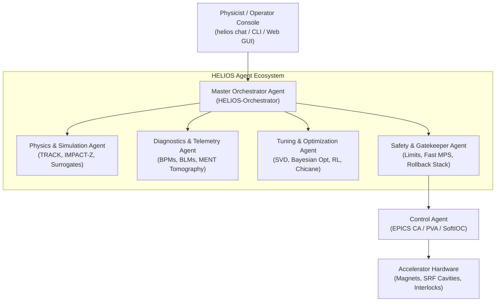
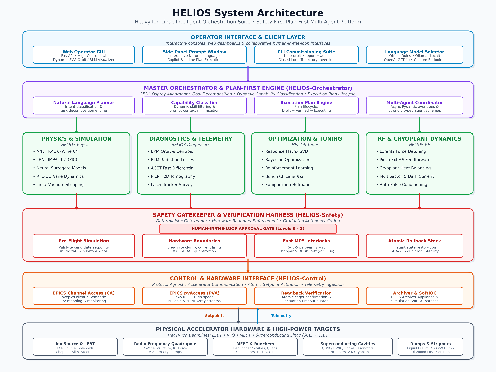

# HELIOS User & Developer Reference Manual

**HE**avy ion **L**inac **I**ntelligent **O**rchestration **S**uite  
*Autonomous, Safety-First Accelerator Control & Commissioning Platform*

---

## 1. System Overview & Multi-Agent Architecture

**HELIOS** is an open-source, distributed multi-agent artificial intelligence framework engineered for commissioning, operating, and optimizing heavy-ion linear accelerators (LEBT, RFQ, MEBT, SCL, and HEBT).

Aligned directly with the **Plan-First** orchestration paradigm established by Lawrence Berkeley National Laboratory's (LBNL) Osprey framework, HELIOS enforces strict separation of concerns between heuristic optimization, digital twin simulations, deterministic safety gatekeepers, and low-level EPICS control systems.





### 1.1 Core Architectural Principles
1. **Pre-flight Simulation Verification**: No setpoint is ever delivered to live hardware without prior validation through high-fidelity codes (ANL TRACK via Wine, LBNL IMPACT-Z via `lume-impact`) or sub-millisecond neural surrogates.
2. **Deterministic Safety-First Actuation**: Optimization agents cannot directly write to EPICS. All actuations pass through rate-of-change limiters, slew rate clamps, hardware current DAC steps, and the `SafetyAgent` rollback stack.
3. **Plan-First Execution Lifecycle**: High-level natural language goals are first compiled into structured, reproducible `ExecutionPlan` documents:
   $$\text{DRAFT} \longrightarrow \text{SIMULATION\_VERIFIED} \longrightarrow \text{SAFETY\_APPROVED} \longrightarrow \text{EXECUTING} \longrightarrow \text{COMPLETED / ROLLED\_BACK}$$
4. **Dynamic Capability Classification (Osprey Alignment)**: Instead of injecting hundreds of API functions into LLM prompts, HELIOS dynamically filters capabilities based on the operator's semantic intent and domain keywords, keeping context windows lean and execution deterministic.
5. **Graduated Autonomy (Human-in-the-Loop)**:
   - **Level 0 (Advisory)**: Pure passive telemetry analysis and recommendations.
   - **Level 1 (Assisted)**: Operator must confirm every single PV setpoint change.
   - **Level 2 (Supervised)**: Sequence execution within verified safe envelopes; operator maintains abort authority.
   - **Level 3 (Bounded Autonomous)**: Closed-loop continuous optimization within narrow pre-certified bounds.
   - **Level 4 (Fully Autonomous)**: Self-driving commissioning across designated facility domains.

---

## 2. Installation & Environment Setup

HELIOS supports Python 3.10 through 3.14 (recommended: Python 3.11 in Conda/Miniforge).

### 2.1 Recommended Conda / Miniforge Setup
```bash
# Clone the repository
git clone https://github.com/cspark/helios.git
cd helios

# Create and activate the conda environment
conda create -n helios python=3.11 -y
conda activate helios

# Install in editable mode with all dependencies (dev, rl, ml, epics, dashboard, ontology)
pip install -e ".[all]"

# Or select specific dependency groups:
pip install -e ".[dev,ml,dashboard,ontology]"
```

### 2.2 Automated Environment Loader (`setup.sh`)
HELIOS provides an automated shell script `setup.sh` that detects Miniforge3/Conda environments or local `.venv` checkouts, configures environment variables, and exports simulator paths:
```bash
# Source the environment loader
source setup.sh
```
This automatically sets:
- `PROJECT_ROOT` / `HELIOS_ROOT`: Repository root path.
- `TRACK_ROOT`: Path to ANL TRACK installation directory.
- `TRACK_EXE_PATH`: Path to TRACK executable binary (`TRACKv39C.exe`).
- Prepends `bin/` and simulation directories to `PATH` and `PYTHONPATH`.

### 2.3 Containerized Deployment (Docker & Docker Compose)

HELIOS provides a production-ready, multi-stage `Dockerfile` and `docker-compose.yml` for isolated containerized operations in control rooms and cloud clusters without requiring local Python environment setup.

#### 2.3.1 Building and Running with Docker
The container includes Python 3.11, Wine 64-bit (for ANL TRACK simulation execution), build dependencies, and EPICS Channel Access networking:

```bash
# Build the production Docker image
docker build -t helios-orchestrator:latest .

# Run the container with the Web Operator Dashboard (default entrypoint)
docker run -d \
  --name helios-app \
  -p 8000:8000 \
  helios-orchestrator:latest

# Access dashboard at http://localhost:8000
```

#### 2.3.2 Multi-Service Stack with Docker Compose
HELIOS orchestrates distributed operations alongside a Redis message broker (`helios-redis`) for asynchronous multi-agent event dispatching:

```bash
# Start the full stack in background
docker compose up -d

# View live orchestrator logs
docker compose logs -f helios-orchestrator

# Stop the services
docker compose down
```

#### 2.3.3 EPICS Host Networking & Volume Mounting
When connecting to live facility hardware (e.g. RAON, FRIB) or local simulation decks, attach host networking for EPICS Channel Access broadcast discovery and mount model directories:

```bash
# Run with host networking and local deck volume mounts
docker run -it --rm \
  --net=host \
  -v $(pwd)/examples:/app/examples \
  -v $(pwd)/docs/exec-plans:/app/docs/exec-plans \
  -e EPICS_CA_ADDR_LIST="10.0.0.255" \
  -e EPICS_CA_AUTO_ADDR_LIST="NO" \
  helios-orchestrator:latest \
  helios tune-orbit --section MEBT --autonomy 2
```

#### 2.3.4 Executing CLI Commands and Interactive Shell in Container
Run commands inside an already running container:

```bash
# Execute CLI commissioning commands
docker exec -it helios-app helios tune-orbit --section MEBT
docker exec -it helios-app helios chat
docker exec -it helios-app helios report --facility "RAON SCL1"

# Open an interactive bash shell in container
docker exec -it helios-app bash
```

### 2.4 External Simulators & Tooling
- **ANL TRACK (Heavy Ion Ray Tracing)**: Run on Linux via Wine 64-bit (`wine64 /path/to/track.exe`). Simulates ray tracing, multi-charge state beams, and realistic magnetic 3D field maps. Pre-installed in the Docker image.
- **LBNL IMPACT-Z (3D Space Charge)**: Packaged and managed via `lume-impact`. Used for Particle-in-Cell (PIC) tracking across space-charge dominated low-energy regimes (RFQ, MEBT).
- **EPICS Base**: Required for live Channel Access and pvAccess communication (`p4p`, `pyepics`). Included in Docker with ports `5064`/`5065` exposed.

### 2.5 Windows 11 Platform & Air-Gapped / Offline Deployment

HELIOS supports deployment on Windows 11 systems across several configurations:

#### 2.5.1 Option 1: Windows Subsystem for Linux (WSL2 - Recommended)
Provides full feature parity with Linux control environments, including Wine-based execution of ANL TRACK, EPICS Channel Access networking, and high-performance ML routines:
```bash
# Install WSL2 Ubuntu on Windows 11 (PowerShell as Administrator)
wsl --install -d Ubuntu-22.04

# Inside WSL2 Ubuntu terminal:
git clone https://github.com/cspark/helios.git
cd helios
source setup.sh
pip install -e ".[all]"
```

#### 2.5.2 Option 2: Native Windows 11 Environment
HELIOS core orchestration, Web Operator Dashboard, EPICS interfaces (`p4p`/`pyepics`), and digital twin simulation run natively on Windows 11 with Python 3.10–3.12:
```powershell
# In PowerShell:
python -m venv .venv
.\.venv\Scripts\Activate.ps1
pip install -e ".[all]"
```
*Note: If executing ANL TRACK natively on Windows, provide the path to `TRACKv39C.exe` directly via `--model-dir` without Wine.*

#### 2.5.3 Option 3: Air-Gapped / Offline Windows Deployment (No Internet Connection)
In secure accelerator control rooms disconnected from external networks:
1. **On an internet-connected machine**: Download the complete wheelhouse:
   ```bash
   mkdir helios_offline && cd helios_offline
   git clone https://github.com/cspark/helios.git
   cd helios
   pip download -d ../wheels -e ".[all]"
   ```
2. **Transfer** the `helios_offline` directory to the target Windows 11 machine using authorized removable media.
3. **Install offline on the air-gapped machine**:
   ```powershell
   cd helios
   python -m venv .venv
   .\.venv\Scripts\Activate.ps1
   pip install --no-index --find-links=..\wheels -e ".[all]"
   ```

#### 2.5.4 Option 4: Standalone Windows Executable Binary
HELIOS can be compiled into a standalone, portable Windows binary (`helios.exe`) via PyInstaller, allowing operators to run CLI commands and the Web Dashboard without managing a local Python runtime:
```powershell
pip install pyinstaller
pyinstaller --name=helios --onefile --clean helios/cli/main.py
# The resulting standalone binary is located at dist\helios.exe
```

---

## 3. Command Line Interface (CLI) & Usage

HELIOS provides a comprehensive Typer/Rich command line tool:

```bash
# Display CLI help and available commands
helios --help
```

### 3.1 Closed-Loop Orbit Correction (`helios tune-orbit`)
Corrects transverse beam trajectory using numerical Orbit Response Matrix (ORM) inversion and discrete steerer power supply current actuation:
```bash
# Tune MEBT section with default settings
helios tune-orbit --section MEBT

# Tune LEBT section using ANL TRACK simulation deck directory
helios tune-orbit --section LEBT --model-dir examples/lebt --track \
  --conversion-factor 0.168 --current-increment 0.05
```
**Options**:
- `--section`: Accelerator section to tune (`MEBT`, `LEBT`, `RFQ`, `SCL1`).
- `--model-dir`, `-m`: Directory containing simulation lattice decks (e.g., `examples/lebt` with `track.dat`).
- `--track / --analytic`: Select between real ANL TRACK simulation execution or analytical transfer matrix model.
- `--conversion-factor`, `-c`: Magnet kicker conversion factor in $\text{A/mrad}$ (default: $0.168\text{ A/mrad}$).
- `--current-increment`, `-i`: Power supply DAC current step discretization limit in Amperes (default: $0.05\text{ A}$).
- `--autonomy`: Operational autonomy level ($0$ to $4$, default: $3$).

### 3.2 Real-Time Web Operator Dashboard (`helios dashboard`)
Launch the modern, high-contrast operator GUI:
```bash
helios dashboard --host 0.0.0.0 --port 8000
```
Open `http://localhost:8000` in any modern web browser to access:
- **Clean High-Contrast Display**: Crisp white background (`#ffffff`) with color-coded operational cards and typography.
- **Dynamic Real-Time SVG Trajectory Charts**: Interactive $X$ and $Y$ beam orbit distortion along linac coordinate $z$, transmission envelopes, and beam loss monitors (BLMs).
- **Side-Panel Copilot Prompt Window**: Natural language prompt input allowing operators to submit commands directly into the `NaturalLanguagePlanner`.
- **Interactive Language Model Selector**: Switch seamlessly between:
  1. `Offline Rules / Deterministic Engine`: Fast, deterministic fallback without external network or API key requirements.
  2. `Ollama (Local LLM: llama3, mistral, qwen2.5)`: Private on-premise accelerator LLM instances.
  3. `OpenAI (GPT-4o, GPT-4-turbo)`: Advanced cloud reasoning models.
  4. `Custom Endpoint`: OpenAI-compatible on-site cluster API endpoints.
- **One-Click Quick Actions**: Orbit Correction, Envelope Match, RF Cavity Phase Scan, and Emergency Beam Abort.

### 3.3 Interactive Conversational Console (`helios chat`)
Launch the terminal conversational assistant:
```bash
helios chat
```
Accepts natural language operational directives (e.g., *"Tune LEBT trajectory and suppress beam losses"*, *"Rematch downstream cavity phases after Cavity 03 trip"*) and decomposes them into executable Osprey execution plans.

### 3.4 Commissioning Shift Reporting (`helios report`)
Compile electronic logbook reports in Markdown or LaTeX:
```bash
helios report --facility "RAON SCL1" --output shift_report.md
```

### 3.5 Tamper-Evident Audit Verification (`helios audit`)
Verify the SHA-256 cryptographic hash-chain integrity of all past setpoint modifications:
```bash
helios audit --verify
```

---

## 4. Accelerator Physics & Heavy Ion Dynamics

### 4.1 Multi-Species & Multi-Charge-State (MCS) Modeling (`helios.physics.species`)
Heavy-ion linacs simultaneously accelerate multiple charge states (e.g., $^{238}\text{U}^{33+}$ and $^{238}\text{U}^{34+}$). The magnetic rigidity $B\rho$ is defined as:
$$B\rho = \frac{p}{q} = \frac{\gamma m_0 \beta c}{q}$$
The module computes:
- Species isotopic properties (mass number $A$, atomic number $Z$).
- Charge state fractions and composite centroid orbits:
  $$\bar{x}(z) = \sum_{q} f_q \, x_q(z)$$
- Transverse beam envelope superposition under multi-charge dispersion shifts.

### 4.2 Steerer Power Supply Current Calibration & DAC Quantization
Dipole steering magnets bend heavy ion beams through deflection angle $\theta$:
$$\theta = \frac{B_y L_{\text{eff}}}{B\rho}$$
The excitation current $I$ delivered by the magnet power supply is calibrated linearly:
$$I = k_{\text{conv}} \cdot \theta$$
where $k_{\text{conv}} \approx 0.168\text{ A/mrad}$ for typical LEBT/MEBT correctors. Hardware digital-to-analog converters (DACs) enforce discrete step quantization:
$$I_{\text{quantized}} = \text{round}\left(\frac{I}{\Delta I}\right) \cdot \Delta I, \quad \Delta I = 0.05\text{ A}$$
HELIOS models both continuous deflection and discrete DAC step quantization to avoid limit-cycle oscillations during closed-loop correction.

### 4.3 Orbit Response Matrix (ORM) & SVD Inversion
For $M$ beam position monitors (BPMs) and $N$ steerer magnets, the linear trajectory response is:
$$\Delta \vec{x} = \mathbf{R} \cdot \Delta \vec{\theta}$$
where $R_{ij} = \frac{\partial x_i}{\partial \theta_j} = \sqrt{\beta_i \beta_j} \sin(\Delta \psi_{ij})$.
HELIOS measures or simulates $\mathbf{R}$ through perturbation, then calculates corrector setpoints via Singular Value Decomposition (SVD):
$$\mathbf{R} = \mathbf{U} \mathbf{\Sigma} \mathbf{V}^T \implies \Delta \vec{\theta} = -\mathbf{V} \mathbf{\Sigma}^+ \mathbf{U}^T \vec{x}_0$$
Singular values below a configurable cutoff threshold $\epsilon_{\text{svd}}$ are regularized to prevent excessive steerer currents.

### 4.4 RFQ 3D Vane Modulation & Cell Dynamics (`helios.physics.rfq`)
Models cell-by-cell vane modulation ($m(z), a(z), l(z)=\beta\lambda/2, B(z)$) across Radial Matching, Shaper, Gentle Buncher, and Accelerator sections:
- Electric field potential expansion with harmonics $A_{10}, A_{30}$:
  $$U(r, \psi, z) = \frac{V_0}{2} \left[ \left(\frac{r}{r_0}\right)^2 \cos(2\psi) + A_{10} I_0(k r) \cos(k z) + \dots \right]$$
- Adiabatic longitudinal bunching capturing $>80\%$ macroparticles for heavy ions.

### 4.5 Advanced Stripper Systems (`helios.physics.stripper`, `liquid_stripper.py`)
- **Solid Carbon Foils**: Mean energy loss $\Delta E$, stopping power $dE/dx$, multiple Coulomb scattering angular spread $\theta_{\text{rms}}$, and radiation damage degradation lifetime.
- **Liquid Metal Strippers**: Liquid lithium film hydrodynamics (Weber number $We$), thermal dissipation under multi-kW beam deposition, evaporative Langmuir vaporization, and equilibrium charge state distributions ($\bar{q} \approx 88+$ for $^{238}\text{U}$).

### 4.6 Magnetic Bunch Compressor Chicane (`helios.tuning.bunch_compressor`)
4-dipole C-type chicane optics calculation ($R_{56}, T_{566}$) with relativistic heavy-ion momentum spread $\delta = \frac{1}{\beta^2} \frac{\Delta E}{E_{\text{tot}}}$:
$$R_{56} \approx -2 \theta_b^2 \left( L_d + \frac{2}{3} L_b \right)$$
$$z_f = z_i + R_{56} \delta + T_{566} \delta^2$$
Calculates optimal RF chirp parameterization $h = \frac{d\delta}{dz}$ to achieve targeted bunch length compression factors $C = 1 / (1 + h R_{56}) > 1.0$.

### 4.7 Linac UHV Pressure Profiles & Heavy-Ion Stripping Losses (`helios.physics.vacuum`)
- Molecular conductance and pumping speed simulation across warm (MEBT) and cryogenic cold-bore (2 K condensation) chambers.
- Heavy-ion charge-exchange electron stripping cross-sections $\sigma_{q \to q+1}$ with residual background gas ($\text{H}_2, \text{N}_2, \text{CO}$):
  $$I(z) = I_0 \exp\left( -\int n_{\text{gas}}(z) \sigma_{\text{strip}} \, dz \right)$$
- Evaluates ion-induced gas desorption runaway safety margins.

### 4.8 Space-Charge Equipartitioning & Hofmann Stability (`helios.physics.equipartition`)
- Kinetic temperature anisotropy ratio:
  $$\frac{T_\perp}{T_\parallel} = \frac{\varepsilon_{\perp n} \sigma_\perp}{\varepsilon_{\parallel n} \sigma_\parallel}$$
- Hofmann anisotropic space-charge stability mapping, identifying and rematching away from parametric resonance stopbands ($2\sigma_t - \sigma_l = 0$, $\sigma_t - \sigma_l = 0$).

### 4.9 High-Power Beam Dumps & Thermo-Mechanical Shock (`helios.physics.beam_dump`)
- Heavy-ion Bragg peak energy deposition up to 400 kW beam power.
- Grüneisen equation of state hydrodynamic shock pressure:
  $$P_{\text{shock}} = \Gamma \rho_0 e_{\text{dep}}$$
- Von Mises thermal stress and Tong critical heat flux (CHF) cooling water boiling margins with automated abort interlocks.

---

## 5. SRF Cavity Dynamics, RF Conditioning & Protection

### 5.1 SRF Lorentz Force Detuning & Piezo Microphonics (`helios.rf.microphonics`)
Dynamic Lorentz Force Detuning (LFD) under pulsed or CW RF fields:
$$\Delta f_{\text{LFD}} = -K_L E_{\text{acc}}^2$$
Coupled with normalized Filtered-X Least Mean Squares (FxLMS) piezo feedforward cancellation algorithm achieving $>10\text{ dB}$ jitter suppression against mechanical vibrations.

### 5.2 SRF Cryogenic Plant Thermodynamic Balancing (`helios.rf.cryoplant`)
- BCS surface resistance calculation:
  $$R_{\text{BCS}}(T, f) \propto \frac{f^2}{T} \exp\left( -\frac{\Delta}{k_B T} \right)$$
- Dynamic RF surface dissipation $P_{\text{loss}} \propto V_{\text{acc}}^2 / R_s$.
- Closed-loop cavity gradient balancing within 2.0 K sub-atmospheric cryoplant capacity.

### 5.3 RF Multipactoring & Dark Current (`helios.rf.multipactor`)
- 1-point and 2-point resonant electron multipactoring in coaxial couplers and elliptical/QWR cavities.
- Secondary electron yield (SEY) suppression via titanium nitride (TiN) coatings.
- Fowler-Nordheim dark current field emission and bremsstrahlung radiation dose accumulation.

### 5.4 Progressive RF Pulse Conditioning (`helios.rf.conditioning`)
Automates high-power RF cavity processing:
- Dynamic pulse-width and forward power ramping algorithms.
- Fast vacuum recovery back-off: automatically scales down power when vacuum exceeds $10^{-7}\text{ mbar}$.
- Multipacting breakthrough jumps: delivers instantaneous $+25\%$ power leaps to punch through resonant electron loading zones safely.

---

## 6. Safety Gatekeepers, Fast MPS & Health Monitoring

### 6.1 Sub-Microsecond Fast MPS & Beam Abort (`helios.safety.fast_mps`)
- Dual-ACCT differential current loss monitoring ($\Delta I = I_{\text{in}} - I_{\text{out}} > \Delta I_{\text{thresh}}$) and fast diamond BLM array.
- Sub-5 $\mu$s abort chain triggering LEBT electrostatic chopper deflection and RFQ RF drive shutdown ($< 2.8\ \mu\text{s}$ measured execution).

### 6.2 Deterministic Rollback Stack (`helios.safety.rollback`)
Prior to any hardware setpoint actuation, the `ControlAgent` registers the previous known valid setpoints to the `SafetyAgent` rollback stack. If downstream beam loss monitors (BLMs) or vacuum sensors trip, atomic rollback restores the golden baseline immediately.

### 6.3 Residual Radiological Activation & Cooling (`helios.safety.activation`)
- Multi-isotope Bateman decay cooling curves ($^{56}\text{Mn}, ^{58}\text{Co}, ^{54}\text{Mn}, ^{60}\text{Co}$) along beam pipe walls and collimators:
  $$\frac{dN_i}{dt} = -\lambda_i N_i + \sum_{j < i} b_{ji} \lambda_j N_j$$
- Mandatory tunnel cool-down waiting time interlocks.
- SHA-256 cryptographic clearance tokens for Radiation Protection Officers (RPOs).

---

## 7. Machine Learning, Optimization & Digital Twin Co-Simulation

### 7.1 Reinforcement Learning & Neural MPC (`helios.rl`)
- **`LinacGymEnv`**: Standard Gymnasium environment wrapping digital twin simulations and live EPICS control.
- **`LinacRLAgent`**: PyTorch Actor-Critic continuous policy trained for dynamic orbit correction under space charge.
- **`NeuralMPCController`**: Receding-horizon model predictive controller utilizing neural surrogates for multi-step trajectory planning.

### 7.2 Multi-Objective Pareto Optics Optimization (`helios.tuning.pareto`)
Utilizes NSGA-II non-dominated sorting to optimize competing linac objectives:
1. Maximize beam transmission ($>98\%$).
2. Minimize transverse envelope scalloping.
3. Minimize longitudinal phase and energy spread ($\Delta p / p$).

### 7.3 Multi-Physics Co-Simulation Bridge (`helios.sim.cosim`)
High-throughput in-memory IPC ring buffer sharing macroparticle bunch arrays $(N, 6)$ and 3D loss distributions with adaptive clock drift synchronization to live linac repetition rates (1 Hz to 100 Hz).

### 7.4 Modular Facility Physics Twin (`helios.physics.twin`)
The `helios.physics.twin` architecture provides modular digital twins, decoupled from specific accelerator facilities through runtime plugin discovery (`helios.facilities` entry points):
- **Dynamic Plugin Architecture (`registry.py`)**: Defines `FacilityPlugin` protocol returning a `FacilityTwin` dataclass containing input/output parameter names, boundary domain envelopes (`TwinDomain`), pre-flight verifiers, and optional surrogate models. When facility packages (e.g., `raon`) are absent, HELIOS seamlessly falls back to `AnalyticTwinFallbackPlugin` with zero runtime crashes.
- **Pre-Flight Surrogate Gatekeeper (`verifier.py`)**: Sub-2ms deterministic out-of-distribution (OOD) verification checking candidate setpoints against normalized bounding boxes $[u_{\min}, u_{\max}]$ and maximum slew rates before EPICS actuation. Integrated directly into `SafetyGatekeeper`.
- **Surrogate-Accelerated Gymnasium Adapter (`env.py`)**: `LinacSurrogateGymEnv` wraps `FacilityTwin` surrogates for high-throughput reinforcement learning ($\ge 2{,}000\text{ steps/s}$ on CPU), complete with physics domain randomization (Twiss parameter jitter) and discrete DAC quantization.
- **Differentiable Neural MPC (`mpc.py`)**: `TwinNeuralMPC` optimizes multi-step steerer trajectories via PyTorch autograd loss minimization over receding horizons.
- **Telemetry State Synchronizer (`sync.py`)**: `TwinStateSynchronizer` assimilates live BPM and wire scanner readouts into twin state vectors, integrating MAP Twiss parameter estimation.

---

## 8. Continuous Integration & Quality Assurance

HELIOS maintains an automated CI matrix supporting Python 3.10 through 3.14 across Ubuntu and macOS.

### 8.1 Local Pre-Push CI Check Script
Developers can run all GitHub Actions workflow verification steps locally before pushing upstream:
```bash
# Execute local pre-push checks (CI contract, Ruff, Black, Mypy, Pytest)
./scripts/check_github_actions.sh
```
This script executes:
1. **CI contract schema validation** (`python scripts/ci_contract.py checks`):
   - Validates `ci.yml` workflow schema and execution plan consistency.
   - Verifies zero-dependency HELIOS core import boundaries.
   - Validates all CLI entrypoint command parsers and options.
   - Executes Ruff linting across all codebase files.
   - Enforces Mypy strict typing on safety gatekeepers, interfaces, and core abstractions.
2. **Code style and format checks** (`ruff check .`, `black --check .`).
3. **Static type analysis** (`mypy helios/`).
4. **Full test suite execution with 100% coverage enforcement** (`pytest`).

### 8.2 Test Suite Execution & 100% Coverage Gate
HELIOS strictly enforces a **100.00% statement coverage gate** (`--cov-fail-under=100`, `fail_under = 100`) across all 88 Python modules in `helios/`. Run the full test suite in the active environment:
```bash
pytest
```
All **223 unit and integration tests** verify end-to-end functionality across all linac subsystems, safety gates, physics engines, digital twins, control interfaces, optimization routines, and user interfaces:
- **Total Statements**: 7,208
- **Covered Statements**: 7,208 (100.00%)
- **Missed Statements**: 0
- **Warnings**: 0 warnings across Python 3.10 through 3.14.

### 8.3 Understanding Test Coverage in Accelerator Control
Test coverage measures the proportion of source code executed by automated tests. In HELIOS:
- **Statement (Line) Coverage**: Verifies that every executable statement has run at least once, eliminating syntax errors, missing imports, unhandled attribute lookups, and uncallable endpoints.
- **Branch Coverage**: Evaluates both paths (`True` and `False`) of conditionals (`if/else`, `try/except`), ensuring both normal beam operations and safety trip interlocks are verified.
- **Guarantees**: Guarantees zero unexercised code, immediate regression detection, and verification of emergency rollback paths. It does not replace physical validation assertions against simulation codes or real telemetry.

For a full breakdown of coverage metrics, hardware testing patterns, and inspection techniques, see the [HELIOS Test Coverage Guide](../test_coverage_guide.md).

