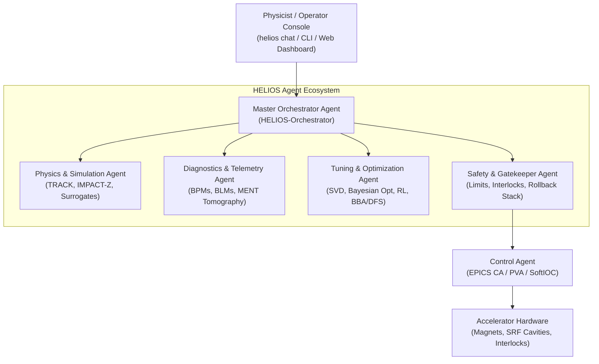

# HELIOS User & Developer Reference Manual

**HE**avy ion **L**inac **I**ntelligent **O**rchestration Framework  
*Autonomous, Safety-First Accelerator Control & Commissioning Platform*

---

## 1. System Overview & Architecture

**HELIOS** is a distributed, agentic artificial intelligence framework for heavy-ion linear accelerators (LEBT, RFQ, MEBT, SCL, and HEBT). It aligns directly with the **Plan-First** orchestration paradigm established by LBNL's Osprey framework, incorporating strict safety-by-design gatekeepers, digital twin pre-flight simulation, LinkML-governed ontologies, and EPICS hardware integration.



---

## 2. Core Architectural Principles

1. **Pre-flight Simulation Verification**: No setpoint is ever delivered to live hardware without prior validation through high-fidelity codes (ANL TRACK via Wine, LBNL IMPACT-Z via `lume-impact`) or sub-millisecond neural surrogates.
2. **Deterministic Safety-First Actuation**: Optimization agents cannot directly write to EPICS. All actuations pass through rate-of-change limiters, slew rate clamps, and the `SafetyAgent` rollback stack.
3. **Plan-First Execution Lifecycle**: High-level natural language goals are first compiled into structured, reproducible `ExecutionPlan` documents:
   $$\text{DRAFT} \longrightarrow \text{SIMULATION\_VERIFIED} \longrightarrow \text{SAFETY\_APPROVED} \longrightarrow \text{EXECUTING} \longrightarrow \text{COMPLETED / ROLLED\_BACK}$$
4. **Dynamic Capability Classification (Osprey Alignment)**:
   Instead of injecting hundreds of API functions into LLM prompts, HELIOS dynamically filters capabilities based on the operator's semantic intent and domain keywords, keeping context windows lean and execution deterministic.
5. **Graduated Autonomy (Human-in-the-Loop)**:
   - **Level 0 (Advisory)**: Pure passive telemetry analysis and recommendations.
   - **Level 1 (Assisted)**: Operator must confirm every single PV setpoint change.
   - **Level 2 (Supervised)**: Sequence execution within verified safe envelopes; operator maintains abort authority.
   - **Level 3 (Bounded Autonomous)**: Closed-loop continuous optimization within narrow pre-certified bounds.
   - **Level 4 (Fully Autonomous)**: Self-driving commissioning across designated facility domains.

---

## 3. Installation & Environment Setup

HELIOS runs under Python 3.10+ (recommended: Python 3.11 in Conda).

### 3.1 Conda Environment Setup
```bash
# Clone the repository
git clone https://github.com/cspark/helios.git
cd helios

# Create and activate the conda environment
conda create -n helios python=3.11 -y
conda activate helios

# Install in editable mode with development, ML, and ontology dependencies
pip install -e ".[dev,ml,dashboard,ontology]"
```

### 3.2 External Simulators & Tooling
- **ANL TRACK (Heavy Ion Ray Tracing)**: Run via Wine 64-bit (`wine64 /path/to/track.exe`). Simulates ray tracing, multi-charge state beams, and realistic magnetic 3D field maps.
- **LBNL IMPACT-Z (3D Space Charge)**: Packaged and managed via `lume-impact`. Used for Particle-in-Cell (PIC) tracking across space-charge dominated low-energy regimes (RFQ, MEBT).
- **EPICS Base**: Required for live Channel Access and pvAccess communication (`p4p`, `pyepics`).

---

## 4. Command Line Interface (CLI) & Console Operation

HELIOS provides a comprehensive Typer/Rich command line tool:

```bash
# Display CLI help and available commands
helios --help
```

### 4.1 Interactive Operator Chat Console (`helios chat`)
Launch the conversational operator assistant:
```bash
helios chat
```
The console accepts natural language operational directives and decomposes them into explicit plan steps:
- *"Correct the horizontal trajectory across MEBT and project downstream beam losses."*
- *"Check the quench safety margin for SCL1 cavity 02."*
- *"Rematch downstream cavity phases after Cavity 03 trip."*

### 4.2 Web Dashboard & Real-Time Visualization (`helios dashboard`)
Launch the FastAPI + WebSocket monitoring dashboard:
```bash
helios dashboard --host 0.0.0.0 --port 8000
```
Open your browser at `http://localhost:8000` to inspect:
- Real-time horizontal and vertical BPM orbit traces.
- Superconducting cavity cryogenic temperatures, multipacting bands, and gradient bars.
- Radiation loss distributions and halo scraping heatmaps from BLM telemetry.
- One-click Human-in-the-Loop plan approval/rejection cards.

### 4.3 Automated Commissioning Shift Reports (`helios report`)
Compile electronic logbook reports in Markdown or LaTeX:
```bash
helios report --facility "RAON SCL1" --output shift_report.md
```

### 4.4 Tamper-Evident Audit Ledger Verification (`helios audit`)
Verify the SHA-256 cryptographic hash-chain integrity of all past setpoint modifications:
```bash
helios audit --verify
```

---

## 5. Accelerator Physics & Beam Dynamics Modules

### 5.1 Multi-Species & Multi-Charge-State (MCS) Modeling (`helios.physics.species`)
Heavy-ion linacs simultaneously accelerate multiple charge states (e.g., $^{238}\text{U}^{33+}$ and $^{238}\text{U}^{34+}$). The magnetic rigidity $B\rho$ is defined as:
$$B\rho = \frac{p}{q} = \frac{\gamma m_0 \beta c}{q}$$
The module computes:
- Species isotopic properties (mass number $A$, atomic number $Z$).
- Charge state fractions and composite centroid orbits.
- Transverse beam envelope superposition under multi-charge dispersion shifts.

```python
from helios.physics.species import SpeciesConfig, HeavyIonBeamDistribution

species = SpeciesConfig(name="Uranium-238", mass_number_a=238, atomic_number_z=92)
beam = HeavyIonBeamDistribution(
    species=species,
    charge_states={33: 0.45, 34: 0.55},
    kinetic_energy_mev_u=0.5,
    total_current_ma=2.0
)
brho_33 = beam.calculate_magnetic_rigidity_tesla_m(charge_state=33)
```

### 5.2 Stripper Foil Degradation & Lifetime Modeling (`helios.physics.stripper`)
Simulates carbon and liquid lithium stripper foils:
- Mean energy loss $\Delta E$ and stopping power $dE/dx$.
- Multiple Coulomb scattering angular spread $\theta_{\text{rms}}$.
- Thermal sublimation, radiation damage, and foil replacement warning triggers.

### 5.3 Beam-Based Alignment (BBA) & Dispersion-Free Steering (DFS) (`helios.tuning.bba`)
Pinpoints beam offsets relative to quadrupole magnetic centers via strength modulation $\Delta K_1$:
$$\Delta x_{\text{BPM}} = R_{12} \cdot (\Delta K_1 L) \cdot (x_{\text{beam}} - x_{\text{quad}})$$
Dispersion-Free Steering simultaneously minimizes trajectory offsets and spurious dispersion:
$$\min_{\Delta \theta} \left( \| R_{\text{orbit}} \Delta \theta + x_0 \|^2 + w^2 \| R_{\text{disp}} \Delta \theta + \eta_0 \|^2 \right)$$

```python
from helios.tuning.bba import BeamBasedAlignmentSolver, DispersionFreeSteeringSolver

# Solve single quadrupole magnetic center offset
offset_mm = BeamBasedAlignmentSolver.solve_quad_offset(
    delta_k1=0.2,
    bpm_reading_nominal_mm=1.0,
    bpm_reading_modulated_mm=1.05,
    transfer_r12=0.5
)
```

### 5.4 Maximum Entropy (MENT) Tomography & Beam Halo (`helios.physics.halo`)
Reconstructs 2D transverse phase-space $(x, x')$ distributions from 1D profile projections:
- Iterative Maximum Entropy (MENT) algorithm.
- Wangler-Crump halo parameter evaluation:
  $$H = \frac{\langle r^4 \rangle}{2 \langle r^2 \rangle^2} - 1.0$$
- Continuous 3D lost-particle power density mapping ($W/m$) from BLM arrays.

---

## 6. Autonomous RF Conditioning & Superconducting Cavity Control

### 6.1 Progressive RF Pulse Conditioning Sequencer (`helios.rf.conditioning`)
Automates high-power RF cavity processing from initial multipacting to full gradient:
- Dynamic pulse-width and forward power ramping algorithms.
- Fast vacuum recovery back-off: automatically scales down power when vacuum exceeds $10^{-7}\text{ mbar}$.
- Multipacting breakthrough jumps: delivers instantaneous $+25\%$ power leaps to punch through resonant electron loading zones safely.

### 6.2 Dual-Actuator Resonance Frequency Tracking
Superconducting cavities undergo detuning from helium bath pressure drift and mechanical microphonics. The `CavityResonanceTracker` coordinates:
1. **Fine Fast Actuation**: Piezoelectric crystals compensating rapid fluctuations ($\pm 100\text{ Hz}$).
2. **Coarse Slow Actuation**: Stepper motors absorbing thermal drift and resetting piezo voltage to center bias.

---

## 7. Optimization Algorithms & Self-Driving Policies

### 7.1 Reinforcement Learning Continuous Control (`helios.rl`)
- **`LinacGymEnv`**: Standard `gymnasium.Env` wrapping the digital twin, neural surrogate, or live EPICS control.
- **`LinacRLAgent`**: PyTorch continuous Actor-Critic policy for dynamic trajectory and envelope control under non-linear space-charge forces.
- **`NeuralMPCController`**: Model-Predictive Controller utilizing neural surrogates for multi-step receding horizon trajectory planning.

### 7.2 Multi-Objective Pareto Optics Optimizer (`helios.tuning.pareto`)
Utilizes NSGA-II non-dominated sorting to optimize competing linac objectives:
1. Maximize beam transmission ($>98\%$).
2. Minimize transverse envelope scalloping.
3. Minimize longitudinal phase and energy spread ($\Delta p / p$).

---

## 8. Automated Fault Recovery & Self-Healing Linac Architecture

HELIOS provides self-healing accelerator intelligence:
- **Local RF Cavity Failure Rematching (`helios.healing.rf_rematch`)**: When a superconducting cavity trips, downstream cavity voltages and phases are autonomously recalculated via L-BFGS-B to preserve synchronous arrival time and final beam energy.
- **Magnet Power Supply Trip Isolation (`helios.healing.magnet_recovery`)**: Isolates failed power supplies and reallocates compensatory dipole kicks to neighboring steerers.
- **Beam Loss Hotspot Mitigation (`helios.healing.loss_mitigation`)**: Detects radiation spikes from BLM telemetry and steers the beam off vacuum chamber walls.

---

## 9. LinkML Accelerator Modeling & Knowledge Graphs

HELIOS formally defines its accelerator domain using the **LinkML** standard (`helios/ontology/helios_schema.yaml`).

### 9.1 Schema Classes & Validation (`helios.ontology.loader`)
- Declares core accelerator entities: `BeamlineElement`, `MagneticElement`, `Quadrupole`, `DipoleSteerer`, `RFCavityElement`, `BeamPositionMonitor`, `BeamLossMonitor`, and `LinacLatticeModel`.
- `LinkMLOntologyManager` validates arbitrary configuration dictionaries against required slots and types.
- Translates seamlessly between LinkML models, native `LinacDevice`, and simulation physics `Element` instances (`Quadrupole`, `RFCavity`, `Drift`).

### 9.2 W3C RDF / Turtle OWL Exporter (`helios.ontology.rdf_exporter`)
Exports live linac lattice states and parameter readbacks into standard Linked Open Data knowledge graphs with upstream and downstream topological connections.

### 9.3 Beamline Topology Knowledge Graph (`helios.ontology.graph`)
The `BeamlineKnowledgeGraph` enables spatial and causal queries along the beamline:
```python
from helios.ontology.graph import BeamlineKnowledgeGraph

graph = BeamlineKnowledgeGraph(elements)
# Locate nearest upstream steerers capable of correcting BPM02
correctors = graph.find_affecting_steerers("MEBT:BPM02", max_steerers=2)
```

---

## 10. Digital Twin Synchronization & State Estimation

### 10.1 Continuous Ensemble Kalman Filter (`helios.physics.sync`)
Assimilates real-time BPM trajectory measurements to reconstruct full 6D linac state vectors, estimating unmeasured physical properties:
- Beam energy spread ($\Delta p / p$).
- Unmonitored transverse emittance ($\varepsilon_x, \varepsilon_y$).
- State covariance confidence bounds.

### 10.2 Model Drift Detection & Golden Baseline Archiving
- `DigitalTwinDriftDetector`: Continuously computes the RMS residual error between simulation predictions and live machine readbacks, triggering background recalibration when drift exceeds statistical bounds.
- `GoldenBaselineArchive`: Stores golden linac setpoint snapshots and calculates semantic deviations by subsystem.

---

## 11. Security, Rollback Stack & Regulatory Compliance

1. **Role-Based Access Control (`helios.security.rbac`)**: HMAC-signed session tokens enforce strict permissions across `VIEWER`, `PHYSICIST`, `SAFETY_OFFICER`, and `ADMIN`.
2. **Machine Protection System (MPS) Watchdog**: Sub-second cryptographic heartbeat (`MPSHeartbeatWatchdog`) triggers safe rollback upon agent communication timeouts.
3. **Cryptographic SHA-256 Audit Trail (`helios.ops.audit`)**: Non-repudiation ledger maintaining an immutable hash chain of all hardware writes.

---

## 12. Automated Testing & Verification Suite

Run the full pytest suite:
```bash
pytest
```
All **98 unit and integration tests** verify end-to-end functionality across:
- Plan generation & Dynamic capability classification
- TRACK, IMPACT-Z & Neural surrogate wrappers
- EPICS CA, PVA NTTable & Archiver client
- SRF quench thermal limits & persistent SQLite rollback
- Multi-species dynamics, CSS chicane tuning & stripper foil degradation
- Gymnasium RL environment & Neural MPC controller
- Automated fault rematching & Multi-facility benchmarks (RAON, FRIB, GSI)
- Tamper-evident audit trail & Distributed event bus
- BBA, DFS, MENT phase space tomography & Autonomous RF conditioning
- Parallel parameter sweeps, Kalman state estimation & NSGA-II Pareto optimization
- LinkML ontology validation, RDF/OWL export & Beamline knowledge graphs
