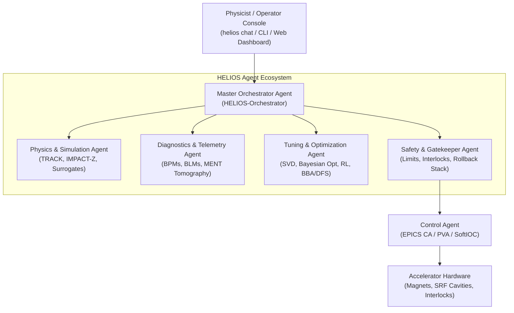

# HELIOS User & Developer Reference Manual

**HE**avy ion **L**inac **I**ntelligent **O**rchestration Framework  
*Autonomous, Safety-First Accelerator Control & Commissioning Platform*

---

## 1. System Overview & Architecture

**HELIOS** is a distributed, agentic artificial intelligence framework for heavy-ion linear accelerators (LEBT, RFQ, MEBT, SCL, and HEBT). It aligns directly with the **Plan-First** orchestration paradigm established by LBNL's Osprey framework, incorporating strict safety-by-design gatekeepers, digital twin pre-flight simulation, LinkML-governed ontologies, and EPICS hardware integration.



---

## 2. Core Architectural Principles

1. **Pre-flight Simulation Verification**: No setpoint is ever delivered to live hardware without prior validation through high-fidelity codes (ANL TRACK via Wine, LBNL IMPACT-Z via `lume-impact`) or sub-millisecond neural surrogates.
2. **Deterministic Safety-First Actuation**: Optimization agents cannot directly write to EPICS. All actuations pass through rate-of-change limiters, slew rate clamps, and the `SafetyAgent` rollback stack.
3. **Plan-First Execution Lifecycle**: High-level natural language goals are first compiled into structured, reproducible `ExecutionPlan` documents:
   $$\text{DRAFT} \longrightarrow \text{SIMULATION\_VERIFIED} \longrightarrow \text{SAFETY\_APPROVED} \longrightarrow \text{EXECUTING} \longrightarrow \text{COMPLETED / ROLLED\_BACK}$$
4. **Graduated Autonomy (Human-in-the-Loop)**:
   - **Level 0 (Advisory)**: Pure passive telemetry analysis and recommendations.
   - **Level 1 (Assisted)**: Operator must confirm every single PV setpoint change.
   - **Level 2 (Supervised)**: Sequence execution within verified safe envelopes; operator maintains abort authority.
   - **Level 3 (Bounded Autonomous)**: Closed-loop continuous optimization within narrow pre-certified bounds.
   - **Level 4 (Fully Autonomous)**: Self-driving commissioning across designated facility domains.

---

## 3. Installation & Environment Setup

HELIOS runs under Python 3.10+ (recommended: Python 3.11 in Conda).

### 3.1 Conda Environment Setup
```bash
# Clone the repository
git clone https://github.com/cspark/helios.git
cd helios

# Create and activate the conda environment
conda create -n helios python=3.11 -y
conda activate helios

# Install in editable mode with development, ML, and ontology dependencies
pip install -e ".[dev,ml,dashboard,ontology]"
```

### 3.2 External Simulators & Tooling
- **ANL TRACK (Heavy Ion Ray Tracing)**: Run via Wine 64-bit (`wine64 /path/to/track.exe`).
- **LBNL IMPACT-Z (3D Space Charge)**: Packaged and managed via `lume-impact`.
- **EPICS Base**: Required for live Channel Access and pvAccess communication (`p4p`, `pyepics`).

---

## 4. Command Line Interface (CLI)

HELIOS provides a comprehensive Typer/Rich command line tool:

```bash
# Display CLI help and available commands
helios --help
```

### 4.1 Interactive Operator Chat Console
Launch the natural language planning assistant:
```bash
helios chat
```
You can issue directives such as:
> *"Correct the horizontal trajectory across MEBT and project downstream beam losses"*  
> *"Check the quench safety margin for SCL1 cavity 02"*

### 4.2 Web Dashboard & Real-Time Visualization
Launch the FastAPI + WebSocket monitoring dashboard:
```bash
helios dashboard --host 0.0.0.0 --port 8000
```
Open your browser at `http://localhost:8000` to inspect live BPM orbits, cavity states, BLM loss distributions, and approve pending human-in-the-loop plans.

### 4.3 Automated Commissioning Shift Reports
Generate electronic logbook reports in Markdown or LaTeX:
```bash
helios report --facility "RAON SCL1" --output shift_report.md
```

### 4.4 Tamper-Evident Audit Ledger Verification
Verify the SHA-256 cryptographic hash-chain integrity of all past setpoint modifications:
```bash
helios audit --verify
```

---

## 5. Accelerator Physics & Beam Dynamics Modules

### 5.1 Multi-Species & Multi-Charge-State (MCS) Modeling (`helios.physics.species`)
Supports heavy ion isotope species ($^{238}\text{U}$, $^{124}\text{Xe}$, $^{40}\text{Ar}$, $^{16}\text{O}$, protons) with composite envelope calculations:
```python
from helios.physics.species import SpeciesConfig, HeavyIonBeamDistribution

species = SpeciesConfig(name="Uranium-238", mass_number_a=238, atomic_number_z=92)
beam = HeavyIonBeamDistribution(
    species=species,
    charge_states={33: 0.45, 34: 0.55},
    kinetic_energy_mev_u=0.5,
    total_current_ma=2.0
)
brho = beam.calculate_magnetic_rigidity_tesla_m(charge_state=33)
```

### 5.2 Stripper Foil Degradation Modeling (`helios.physics.stripper`)
Simulates carbon / liquid lithium stripper foils, Coulomb scattering angular straggling, energy loss $\Delta E$, and thermal degradation lifetime tracking.

### 5.3 Beam-Based Alignment (BBA) & Dispersion-Free Steering (DFS) (`helios.tuning.bba`)
Pinpoint beam offsets relative to quadrupole magnetic centers using quadrupole strength modulation ($\Delta K_1$):
```python
from helios.tuning.bba import BeamBasedAlignmentSolver, DispersionFreeSteeringSolver

# Compute quad offset from modulation
offset_mm = BeamBasedAlignmentSolver.solve_quad_offset(
    delta_k1=0.2,
    bpm_reading_nominal_mm=1.0,
    bpm_reading_modulated_mm=1.05,
    transfer_r12=0.5
)
```

### 5.4 Maximum Entropy (MENT) Tomography & Beam Halo (`helios.physics.halo`)
Reconstruct 2D transverse phase-space $(x, x')$ distributions from 1D profile projections and compute the Wangler-Crump halo parameter $H$:
```python
from helios.physics.halo import PhaseSpaceTomographyMENT, BeamHaloQuantifier

recon = PhaseSpaceTomographyMENT.reconstruct_2d_phase_space(
    projections=[proj1, proj2, proj3],
    projection_angles_rad=[0.0, 0.785, 1.571]
)
halo_result = BeamHaloQuantifier.evaluate_halo(profile_intensity, radii_mm, pipe_radius_mm=20.0)
```

---

## 6. Optimization & Autonomous Control Policies

### 6.1 Reinforcement Learning (`helios.rl`)
- **`LinacGymEnv`**: Standard `gymnasium.Env` wrapping the digital twin, neural surrogate, or live EPICS control.
- **`LinacRLAgent`**: PyTorch continuous Actor-Critic policy for dynamic trajectory and envelope control.
- **`NeuralMPCController`**: Model-Predictive Controller compensating for 60 Hz mains ripple and cryo-pressure jitter.

### 6.2 Multi-Objective Pareto Optics Optimizer (`helios.tuning.pareto`)
Utilizes NSGA-II non-dominated sorting to simultaneously optimize competing linac objectives:
1. Maximize beam transmission ($>98\%$).
2. Minimize transverse envelope scalloping.
3. Minimize longitudinal energy spread ($\Delta p / p$).

---

## 7. Automated Fault Recovery & Self-Healing Linac

- **RF Cavity Rematching (`helios.healing.rf_rematch`)**: Upon superconducting cavity trips or microphonics unlock, downstream cavity voltages and phases are autonomously recalculated via L-BFGS-B/SLSQP to preserve target beam arrival time and final energy.
- **Magnet Power Supply Trip Isolation (`helios.healing.magnet_recovery`)**: Isolates failed power supplies and reallocates compensatory dipole kicks to neighboring steerers.
- **Beam Loss Hotspot Mitigation (`helios.healing.loss_mitigation`)**: Detects radiation spikes from BLM telemetry and steers the beam off vacuum chamber walls.

---

## 8. LinkML Accelerator Modeling & Knowledge Graph

HELIOS formally defines its accelerator domain using the **LinkML** standard (`helios/ontology/helios_schema.yaml`).

### 8.1 Schema Verification & JSON-Schema Export
```python
from helios.ontology.loader import LinkMLOntologyManager

manager = LinkMLOntologyManager()
# Validate arbitrary device dictionary
result = manager.validate_dict(device_dict, target_class="Quadrupole")
assert result.is_valid is True

# Generate JSON-Schema for LLM function calling
json_schema = manager.generate_json_schema()
```

### 8.2 W3C RDF / Turtle OWL Export
```python
from helios.ontology.rdf_exporter import RDFOntologyExporter

exporter = RDFOntologyExporter()
exporter.export_elements_to_graph(elements, lattice_name="RAON_SCL1")
ttl_output = exporter.serialize_turtle()
```

### 8.3 Beamline Topology Knowledge Graph
```python
from helios.ontology.graph import BeamlineKnowledgeGraph

graph = BeamlineKnowledgeGraph(elements)
# Locate nearest upstream steerers capable of correcting BPM02
correctors = graph.find_affecting_steerers("MEBT:BPM02", max_steerers=2)
```

---

## 9. Security, Rollback Stack & Regulatory Compliance

1. **Role-Based Access Control (`helios.security.rbac`)**: HMAC-signed tokens gate permissions across `VIEWER`, `PHYSICIST`, `SAFETY_OFFICER`, and `ADMIN`.
2. **Machine Protection System (MPS) Watchdog**: Sub-second cryptographic heartbeat (`MPSHeartbeatWatchdog`) triggers safe rollback upon agent communication timeouts.
3. **Cryptographic SHA-256 Audit Trail (`helios.ops.audit`)**: Non-repudiation ledger maintaining an immutable hash chain of all hardware writes.

---

## 10. Automated Testing & Verification Suite

Run the full pytest suite:
```bash
pytest
```
All **98 unit and integration tests** verify end-to-end functionality across:
- Plan generation & Dynamic capability classification
- TRACK, IMPACT-Z & Neural surrogate wrappers
- EPICS CA, PVA NTTable & Archiver client
- SRF quench thermal limits & persistent SQLite rollback
- Multi-species dynamics, CSS chicane tuning & stripper foil degradation
- Gymnasium RL environment & Neural MPC controller
- Automated fault rematching & Multi-facility benchmarks (RAON, FRIB, GSI)
- Tamper-evident audit trail & Distributed event bus
- BBA, DFS, MENT phase space tomography & Autonomous RF conditioning
- Parallel parameter sweeps, Kalman state estimation & NSGA-II Pareto optimization
- LinkML ontology validation, RDF/OWL export & Beamline knowledge graphs
