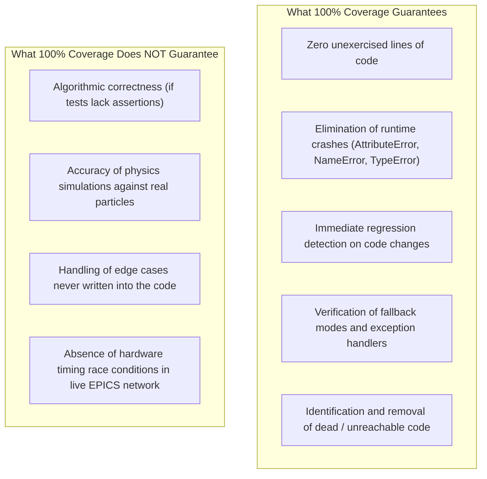

# HELIOS Test Coverage Guide & Quality Assurance Architecture

## 1. What is Test Coverage?

**Test coverage** (also known as **code coverage**) is a quantitative metric in software engineering that measures the degree to which the source code of a program is executed when a particular test suite runs.

In an accelerator automation and safety framework like **HELIOS** (**HE**avy ion **L**inac **I**ntelligent **O**rchestration), where algorithmic setpoints directly influence high-power RF cavities, superconducting magnets, vacuum gate valves, and beam line diagnostics, test coverage serves as a foundational defense-in-depth barrier. It guarantees that every branch of safety logic, every fallback mode, and every hardware error-handling routine has been executed and evaluated prior to deployment in an accelerator control room.

---

## 2. Taxonomy of Test Coverage Metrics

Test coverage is assessed across several dimensions, each providing distinct quality guarantees:

| Metric | Formal Definition | Accelerator Engineering Significance |
| :--- | :--- | :--- |
| **Statement (Line) Coverage** | Percentage of executable statements executed during testing: $$\text{Statement Coverage} = \frac{\text{Executed Statements}}{\text{Total Executable Statements}} \times 100\%$$ | Guarantees no syntactic bugs, unimported modules, typo-level variable name errors (`NameError`), or undefined attribute lookups (`AttributeError`) exist in executed paths. |
| **Branch (Decision) Coverage** | Percentage of control structure branches evaluated to both `True` and `False`: $$\text{Branch Coverage} = \frac{\text{Evaluated Branches}}{\text{Total Possible Branches}} \times 100\%$$ | Ensures that both normal operating states and safety interlock trip conditions have been explicitly stimulated. |
| **Function / Method Coverage** | Percentage of declared functions, methods, or procedures invoked at least once: $$\text{Function Coverage} = \frac{\text{Called Functions}}{\text{Total Declared Functions}} \times 100\%$$ | Verifies that no dead, orphaned, or uncallable API endpoints or calculation routines remain in the framework. |
| **Path Coverage** | Percentage of all possible execution paths through a sequence of decision points tested from start to finish. | Validates complex combinatorial states (e.g., combinations of simultaneous magnet quenches, vacuum trips, and RF breakdown). |

---

## 3. Concrete Example: Statement vs. Branch Coverage

Consider the following safety gatekeeper routine:

```python
def verify_magnet_setpoint(current_amps: float, max_limit: float = 100.0) -> bool:
    if current_amps > max_limit:
        trigger_machine_protection_interlock()  # Branch 1 (Trip)
        return False
    return True                                # Branch 2 (Normal)
```

### Scenario A: Incomplete Coverage (Statement = 67%, Branch = 50%)
A test only executes `verify_magnet_setpoint(45.0)`.
- `return True` executes.
- `trigger_machine_protection_interlock()` is **never executed**.
- **Risk**: If `trigger_machine_protection_interlock()` contains a syntax error, calls an undefined function, or fails during runtime, the system will crash in production when a real over-current occurs.

### Scenario B: Complete Coverage (Statement = 100%, Branch = 100%)
Two tests execute:
1. `verify_magnet_setpoint(45.0)` $\rightarrow$ asserts `True`.
2. `verify_magnet_setpoint(105.0)` $\rightarrow$ asserts `False` and verifies that the interlock was triggered.
- Every statement and every decision branch has been validated under automated testing.

---

## 4. What High Coverage Guarantees vs. What It Does Not Guarantee

Understanding the limits of test coverage is critical for accelerator physicists and software engineers alike:



### Key Takeaway
**Coverage measures which code ran; assertions measure whether the code did the right thing.**  
100% coverage is a **necessary condition** for high-reliability accelerator software, but it must be paired with rigorous assertions verifying physical bounds, numerical convergence, and safety invariants.

---

## 5. HELIOS Coverage Architecture & Enforcement Policy

HELIOS enforces a strict **100.00% statement coverage gate** across its entire codebase.

### 5.1 Configuration in `pyproject.toml`
HELIOS configures `pytest`, `pytest-cov`, and `coverage.py` centrally:

```toml
[tool.pytest.ini_options]
minversion = "7.0"
addopts = "-ra --cov=helios --cov-report=term-missing --cov-fail-under=100"
testpaths = ["tests"]
asyncio_mode = "auto"
filterwarnings = [
    "ignore::starlette.exceptions.StarletteDeprecationWarning",
]

[tool.coverage.run]
source = ["helios"]
omit = [
    "helios/cli/main.py",  # Interactive Typer CLI entrypoint tested via subprocess in CI contract
]

[tool.coverage.report]
fail_under = 100
show_missing = true
```

### 5.2 Current Baseline Metrics
- **Total Tracked Modules**: 88 source files in `helios/`
- **Total Executable Statements**: 7,208
- **Covered Statements**: 7,208 (100.00%)
- **Missed Statements**: 0
- **Total Automated Tests**: 223 unit and integration tests passing in $<20\text{ seconds}$

---

## 6. Testing Patterns for Achieving 100% Coverage

Achieving 100% coverage in an accelerator framework requires specialized testing patterns for hardware drivers, optional dependencies, and asynchronous event loops.

### 6.1 Testing Optional Dependencies (`sys.modules` patching)
HELIOS provides graceful fallbacks when optional dependencies (e.g., `pyepics`, `p4p`, `torch`) are not installed. To test both the installed and absent paths regardless of host environment:

```python
import importlib
from unittest.mock import patch
import pytest
import helios.interfaces.epics as epics_mod
from helios.interfaces.base import ControlInterfaceError

def test_epics_interface_missing_dependency():
    """Verify ControlInterfaceError when pyepics is absent."""
    with patch.dict("sys.modules", {"epics": None}):
        importlib.reload(epics_mod)
        epics_driver = epics_mod.EPICSInterface()
        assert epics_driver._has_epics is False
        with pytest.raises(ControlInterfaceError):
            epics_driver.get("QUAD:01:CurrentSet")
    # Restore original module state
    importlib.reload(epics_mod)
```

### 6.2 Testing Hardware Exception Branches & Callbacks
Simulating network drops, timeout errors, and subscriber callback failures:

```python
def test_mock_control_subscriber_exception():
    """Verify subscriber exception does not crash the control loop."""
    ctrl = MockControlInterface()
    
    def faulty_callback(pv, val):
        raise RuntimeError("Network buffer overflow")

    ctrl.subscribe("BPM:01:X", faulty_callback)
    # The put should succeed and log the callback exception without crashing
    assert ctrl.put("BPM:01:X", 0.5) is True
```

### 6.3 Testing Asynchronous Web APIs and Panic Endpoints
Using Starlette's `TestClient` with role-based access control (RBAC) headers:

```python
def test_emergency_panic_endpoint(client, rbac_manager):
    """Verify emergency beam abort route under admin authorization."""
    admin_token = rbac_manager.issue_token("admin", UserRole.ADMIN, validity_seconds=60)
    response = client.post(
        "/api/emergency/panic",
        headers={"Authorization": f"Bearer {admin_token.token_str}"}
    )
    assert response.status_code == 200
    assert response.json()["status"] == "PANIC_EXECUTED"
```

---

## 7. Running, Inspecting, and Debugging Test Coverage

### 7.1 Running the Full Test Suite with Coverage Enforcement
```bash
# Runs all 223 tests; fails if coverage drops below 100.00%
pytest
```

### 7.2 Running Coverage on a Single Subsystem
When developing new features, check coverage on a specific module without running the entire suite:

```bash
# Example: Check coverage of the EPICS interface
pytest tests/test_control_interface.py --cov=helios.interfaces.epics --cov-report=term-missing

# Example: Check coverage of the real-time web dashboard
pytest tests/test_dashboard.py --cov=helios.dashboard --cov-report=term-missing
```

### 7.3 Generating Interactive HTML Coverage Reports
To visually inspect uncovered lines in a web browser:

```bash
# Generate HTML report in htmlcov/
pytest --cov-report=html

# Open in browser (Linux)
xdg-open htmlcov/index.html
```
In the HTML report:
- **Green lines**: Executed statements.
- **Red lines**: Unexecuted statements (must be targeted with additional test cases).
- **Yellow lines**: Branches partially evaluated (e.g., condition only evaluated `True`, never `False`).

### 7.4 Pre-Push CI Contract Verification
HELIOS provides an automated verification script that executes all static analysis and coverage checks:

```bash
# Run local pre-push checks (CI contract, Ruff, Black, Mypy, Pytest)
./scripts/check_github_actions.sh
```
